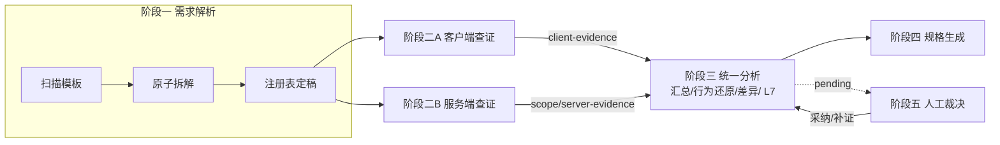

# game-requirement-audit 统一工作流执行文档

- 日期：2026-11-17
- 类型：执行文档（头部：步骤总览 + 全部步骤的产物与结构定义）
- 设计依据：`dev-docs/design/2026-11-17-game-requirement-audit-unified-workflow.md`（合并方案、五阶段架构、三原则、迁移表）
- 现状资产：`.opencode-workflows/workflows/output-spec-generate/`（四子流程）、`.opencode-workflows/workflows/server-rule-verify/`（四子流程 + 3C 客户端落判）、`.opencode-workflows/scripts/`（确定性装配脚本族）
- 状态：**头部定稿**——本文确定统一后的步骤清单、产物目录、全部步骤的产物及数据结构（含四大核心数据契约）；逐步骤的详细执行内容（Prompt、脚本改动、验收清单）为后续章节，见 §10 待写清单

---

## 0. 文档结构与本文范围

本文是执行文档的头部，只回答三个问题：

1. **统一后有哪些步骤**（§2 步骤总览表，S1~S11）；
2. **每一步产出什么**（§4 统一产物目录 + §5 步骤产物与结构，逐步骤定义所有产物的数据结构）；
3. **四大核心数据契约长什么样**（§6，Requirement Registry / Client Evidence / Server Evidence / Unified Difference 的字段表与关联关系——设计文档「下一步」要求的交付物）。

后续章节（§10 规划）逐步骤展开执行细节：Prompt 全文、确定性脚本改动方案、闸门实现、验收清单、迁移步骤。

## 1. 总体架构回顾（引自设计文档）

- 一个主 Workflow `game-requirement-audit`，五个阶段，两条并行查证分支（客户端 / 服务端）。
- 三条架构原则：
  1. **一个需求事实源**：Atom ID 只能由原子拆解阶段（S2）产生；
  2. **两套独立证据体系**：客户端（S4）与服务端（S5）分别查证，互不代替、互不覆盖；
  3. **一个统一业务结论**：双端证据汇总（S6 同步屏障）后才做差异判定（S7/S8）与 L7 分类（S9）。
- 客户端 `verdict`（是否发现客户端实现证据）与服务端 `applicability`（服务端作用域）是**两个独立维度**，永远不合并成一个字段。
- 文档生成（S10）后置于双端查证与统一分析之后；策划视图只消费业务行为与 L7 分类，不暴露技术细节。



## 2. 步骤总览表（S1~S11）

| 步骤 | 阶段 | 名称 | 职责一句话 | 主要输入 | 主要产物 | 关键闸门 | 现状来源 |
|---|---|---|---|---|---|---|---|
| S1 | 一 | 需求扫描 scan-template | 扫描模板章节结构并校验覆盖 | 模板 md | `scan.json` | 章节覆盖/编号连续校验 | 保留：`1-scan-template.js` |
| S2 | 一 | 原子拆解 atomize-requirements | 按阶段并行拆原子，只产需求侧字段 + 业务语义 + 来源行号 | `scan.json` + 模板原文 | 原子分片（runtime） | ID 规范/唯一校验、行号落界校验 | 拆分：`2-verify-stages.js` 第一步独立成步 |
| S3 | 一 | 注册表定稿 identity-map + requirement-registry | 确定性合并分片，落统一需求事实源 | S2 分片 + `scan.json` | `requirement-registry.json`、`identity-map.json` | 覆盖率/重复/统计块重算 | 新增（确定性脚本，机制参照 `recount-verify-parts.mjs`） |
| S4 | 二A | 客户端查证 client-verify | 只查证：客户端实现证据 + 实际观察行为 | Registry 原子（只读）+ Code/Fgui 工程 | `client-evidence.json` + runtime 分片 | 落盘闸门、verdict/证据自洽、重算闸门 | 拆分：`2-verify-stages.js` 第二/三步；证据形态吸收 S8 `3-verify-scope-client.js` |
| S5 | 二B | 服务端查证 server-verify | 符号索引 → 匹配候选 → 作用域落判 | Registry 原子（只读）+ 服务端源码根 | `symbol-index.json`、`scope-index.json`、`server-evidence.json` + runtime 分片 | 落盘闸门、双写闸门、SVE 形状/id 校验、重算闸门 | 保留：`1-scan-server.js` + `2-match-atoms.js` + `3-verify-scope.js`（内部三步不变） |
| S6 | 三 | 证据汇总 merge-evidence | 同步屏障 + 确定性合并双端证据与需求原文 | Registry + 双端产物 | `unified-atoms.json` | **同步屏障**（双端齐备或显式 pending）、Atom 对齐、evidenceIds 存在性 | 扩展：`merge-verify-output.mjs` |
| S7 | 三 | 业务行为还原 business-behavior-analysis | 双端证据合起来还原完整业务行为 + 差异初判（基线） | `unified-atoms.json` | `business-behavior.json`（含每原子基线 difference） | 落盘闸门、覆盖/枚举校验 | 新增（agent 阶段；差异初判口径继承 v4 需求 6.1） |
| S8 | 三 | 统一差异复核 difference-review | 双栏证据复核出建议（pending），人工批准后生效 | `unified-atoms.json` + `business-behavior.json` | `difference-review.json` | reviewRule 白名单、复核漂移检测、审批状态闸门 | 调整：`4-review-difference.js` + `merge-verify-output.mjs` 复核合并段 |
| S9 | 三 | L7 分类 l7-classify | 确定性矩阵：复核差异 × 作用域 → L7 | 四件套（registry/双端/复核） | `l7-classify.json` | 矩阵自洽、统计块交叉校验、五道闸门前置 | 保留：`classify-l7.mjs`（输入换 Registry 基线） |
| S10 | 四 | 统一规格生成 unified-spec | 双端齐备后一次性生成五类交付物 | 阶段三全部产物 | 技术实现视图、策划业务视图、规则验证报告、需求追溯索引、待处理问题清单 | 机械校验七维度、策划版泄漏扫描、AT-ID 覆盖 | 调整：`3-produce-outputs.js` + `4-assemble-verify.js` 移后 + 扩展 |
| S11 | 五 | 人工裁决 human-review | pending 清单审阅、补证重跑、采纳/修改/否决/挂起 | `pending-list.md` + 各正式产物 | 决议记录（reviewStatus 流转）、补证分片、approved 合并索引 | 审批状态独立闸门、v2 基线只读 | 保留扩展：`prepare-retry-input.mjs`、`assemble-output-spec-index.mjs` v3 模式 |

说明：

- S4 与 S5 **并行执行**（设计文档核心变更），共享同一份 Registry 原子输入与同一并发配额；
- S5 内部保留现有三步链（扫描 → 匹配 → 落判），对主编排是单步；
- 原 `4-review-difference.js` 的「复核建议」部分移入 S8，「merge/classify/check 确定性闸门」部分拆入 S6/S9/S10；
- 阶段五不是线性终点：补证（retry）后回到 S6 重走统一分析，决议（approved/rejected）改写 `reviewStatus` 后由确定性脚本重算 S9/S10 相关产物。

## 3. 统一产物目录

统一产物根：`spec-workflow/requirement-audit/<date>/`（`<date>` 经 args 显式传入，脚本内禁止取当前时间）。历史产物目录（`spec-workflow/output-spec/…`）一律只读。

```
spec-workflow/requirement-audit/<date>/
├── registry/                          # 阶段一：需求事实源（唯一 Atom ID 产生地）
│   ├── requirement-registry.json      # S3：统一原子注册表（核心契约 #1）
│   ├── identity-map.json              # S3：术语/章节/跨切面身份映射
│   └── runtime/
│       ├── state/scan.json            # S1：章节扫描结果（保留现结构）
│       └── atom-parts/                # S2：原子拆解分片 <stageId>-ap<NN>.json
├── client/                            # 阶段二A：客户端证据体系（独立，不被服务端覆盖）
│   ├── client-evidence.json           # S4：客户端证据正式产物（核心契约 #2）
│   └── runtime/
│       ├── verify-input/              # S4 输入分片 <stageId>-cp<NN>.json + manifest.json
│       ├── verify-output/             # S4 落判分片 <stageId>-cp<NN>.json
│       └── client-recount.json        # 重算闸门产物
├── server/                            # 阶段二B：服务端证据体系（内部形态不变）
│   ├── symbol-index.json              # S5-1：符号索引（保留）
│   ├── scope-index.json               # S5-3：作用域判定（核心契约 #3 组成）
│   ├── server-evidence.json           # S5-3：服务端证据 SVE（核心契约 #3 组成）
│   └── runtime/
│       ├── verify-input/              # 保留：分片 + manifest.json
│       ├── match-output/              # 保留：匹配候选分片
│       ├── verify-output/             # 保留：落判分片（-pNN 服务端 / -pcNN 客户端补证）
│       ├── verify-recount.json
│       └── review-output/             # S8 复核建议分片（迁到本目录，双端统一复核输入）
├── analysis/                          # 阶段三：统一分析
│   ├── unified-atoms.json             # S6：统一 Atom 视图（双端证据挂接 + pending 标记）
│   ├── business-behavior.json         # S7：业务行为还原 + 差异初判基线
│   ├── difference-review.json         # S8：统一差异复核（核心契约 #4 组成）
│   ├── l7-classify.json               # S9：L7 分类（核心契约 #4 组成）
│   └── runtime/spec-check/
│       └── l7-check-report.md         # 五道闸门报告
├── specs/                             # 阶段四：规格生成（结构对齐原 1-spec）
│   ├── stages/spec_stage_ST-Cxx.md    # 技术实现视图：阶段规格文档
│   ├── feature_index.json             # 统一索引（schema v3，双端字段）
│   ├── stage_manifest.md              # 阶段速查表
│   ├── trace_index.json               # 需求追溯索引
│   ├── pending-list.md                # 待处理问题清单（阶段五入口）
│   ├── 技术补充版.md                   # 技术实现视图：补充版需求文档（路径可配）
│   ├── 策划版.md                       # 策划业务视图（路径可配）
│   └── runtime/
│       ├── state/doc-parts/、parts/、planner-parts/   # 文档分片（保留分片写盘机制）
│       ├── build-config.json          # 装配配置（中文路径经此传递）
│       └── spec_check/verify-report.md
└── review/                            # 阶段五：人工裁决
    ├── decisions.json                 # 决议记录（采纳/修改/否决/挂起 + 理由）
    └── runtime/retry-input/           # 补证重跑分片（保留 prepare-retry-input.mjs 机制）
```

目录规则（沿用现约定）：

- 读写分离：`registry/`、双端正式产物对查证 agent 只读；agent 只写自己的 runtime 分片；
- 断点续跑：正式产物已存在且分片齐全时支持增量/幂等重跑；`specs/` 内已存在 `feature_index.json` 时 fail fast（换新目录或清理）；
- JSON 一律 UTF-8 无 BOM、LF、1 空格缩进；`date` 一律经 args/配置文件传递，禁止脚本内取当前时间。

## 4.（并入 §3 与 §5）产物目录见 §3，逐步骤结构见 §5

## 5. 步骤产物与结构

标注约定：**【保留】**现有字段不变；**【扩展】**现有结构新增字段；**【新增】**本工作流新产物。所有结构为 JSON 字段示意（同现有 schema 风格），非严格 JSON Schema 全文；严格 Schema 随各步骤详细章节给出。

---

### S1 需求扫描（scan-template）

- 脚本来源：`output-spec-generate/1-scan-template.js` 原样迁移。
- 产物：`registry/runtime/state/scan.json`【保留】

```json
{
  "templatePath": "templates/…核心简化版本.md",
  "totalLines": 0,
  "sections": [
    { "no": 1, "title": "", "fromLine": 1, "toLine": 0,
      "kind": "intro|terms|stage", "stageId": "ST-Cxx",
      "container": "", "sourceTitle": "行牌 > 吃碰杠" }
  ]
}
```

- 闸门：章节覆盖全文（首节起于 1 行、末节止于 totalLines、相邻间隔 ≤3 行）、stageId 连续编号（ST-C01…）。

---

### S2 原子拆解（atomize-requirements）

- 来源：`2-verify-stages.js` 的「第一步 拆原子需求」独立成步；**只拆解、不查证**。
- 输入：`scan.json`（内存链式）+ 模板原文行段 + 名词章节（terms）。
- 产物：`registry/runtime/atom-parts/<stageId>-ap<NN>.json`【新增】（agent 按阶段并行写盘，分片仅按阶段切，不拆散功能点）

```json
{
  "schemaVersion": 1,
  "stageId": "ST-Cxx",
  "partNo": 1,
  "features": [
    {
      "id": "FP-ST-Cxx-nnn", "name": "", "description": "",
      "scope": "", "coordination": "",
      "atoms": [
        {
          "atomId": "AT-ST-Cxx-nnn", "name": "",
          "rule": "",                       // 规则语义，忠实模板原文
          "uiRequirement": "",              // UI 表现相关语句，无则空串
          "businessBehavior": {             // 需求声明的业务语义四元组（玩家语言）
            "trigger": "", "condition": "", "action": "", "result": ""
          },
          "source": {                       // 原文来源追溯【新增】
            "chapter": "行牌 > 吃碰杠",
            "fromLine": 0, "toLine": 0      // 原子对应原文行号区间
          }
        }
      ]
    }
  ]
}
```

- 与现状差异：现 v4 的 `businessBehavior` 由客户端证据归纳；统一后改为**需求侧从原文归纳**（拆解阶段只看模板）。证据归纳的「实际观察行为」移入 S4（`observedBehavior`）。两套四元组在 S7 对比。
- 闸门：FP/AT ID 规范（`FP-/AT-ST-Cxx-nnn`）与阶段内唯一；`source.fromLine/toLine` 必须落在该阶段章节行段内；`rule` 非空。

---

### S3 注册表定稿（identity-map + requirement-registry）

- 来源：新增确定性脚本（合并 + 校验 + 统计重算，机制参照 `recount-verify-parts.mjs` / `merge-verify-output.mjs`）。
- 产物 1：`registry/requirement-registry.json`【新增】——**核心契约 #1：唯一需求事实源**

```json
{
  "schemaVersion": 1,
  "date": "2026-11-17",
  "source": { "templatePath": "", "totalLines": 0 },
  "stages": [
    { "stageId": "ST-Cxx", "name": "", "chapter": "", "summary": "",
      "featureCount": 0, "atomCount": 0 }
  ],
  "features": [
    { "id": "FP-ST-Cxx-nnn", "stageId": "ST-Cxx", "name": "", "description": "",
      "scope": "", "coordination": "",
      "atoms": [
        { "atomId": "AT-ST-Cxx-nnn", "name": "", "rule": "", "uiRequirement": "",
          "businessBehavior": { "trigger": "", "condition": "", "action": "", "result": "" },
          "source": { "chapter": "", "fromLine": 0, "toLine": 0 } }
      ]
    }
  ],
  "stats": { "stageCount": 0, "featureCount": 0, "atomCount": 0, "perStage": [] }
}
```

- 铁律：**查证字段（verdict/applicability/evidence…）永远不进 Registry**；Registry 定稿后双端只读；Atom ID 后续任何阶段不得增改。
- 产物 2：`registry/identity-map.json`【新增】——双端共享的身份与术语映射

```json
{
  "schemaVersion": 1,
  "terms": [ { "term": "", "definition": "", "source": "模板名词章节 或 file:line" } ],
  "stageChapters": [ { "stageId": "ST-Cxx", "chapter": "", "sourceTitle": "", "fromLine": 0, "toLine": 0 } ],
  "crossCutting": [ "" ]
}
```

- 闸门：分片原子全覆盖（每原子恰一条、无重复无外来）、统计块与逐原子重算一致。

---

### S4 客户端查证（client-verify）【阶段二A】

- 来源：`2-verify-stages.js` 第二/三步独立成步；证据条目形态吸收 S8 `3-verify-scope-client.js` 的 SVE 经验（layer=client_code/client_fgui、id 代际隔离、共享证据引用不复制），但文件独立于 server-evidence。
- 输入：`requirement-registry.json`（确定性投影成查证输入分片，只含需求侧字段）+ `source-code/client/Code`、`source-code/client/Fgui`。
- 产物：`client/client-evidence.json`【新增】——**核心契约 #2：客户端证据体系**

```json
{
  "schemaVersion": 1,
  "date": "",
  "source": { "codeDir": "source-code/client/Code", "fguiDir": "source-code/client/Fgui" },
  "entries": [                            // 每原子恰一条（含 pending）
    {
      "atomId": "AT-ST-Cxx-nnn",
      "verdict": "confirmed|partial|not_found",   // 是否发现客户端实现证据（维度一）
      "pending": false,                           // 分片超时/失败时 true，绝不当 not_found
      "clientLogic": "",                          // 客户端逻辑实现摘要
      "uiInteraction": "",                        // UI 交互表现
      "messages": [],                             // 涉及协议消息 MsgXxx
      "notes": "",
      "observedBehavior": {                       // 由证据归纳的实际业务行为（玩家语言）
        "trigger": "", "condition": "", "action": "", "result": ""
      },
      "evidenceIds": ["CLE-ST-Cxx-nnn-01"]
    }
  ],
  "evidence": [                           // 平级证据条目（CLE）
    { "id": "CLE-ST-Cxx-nnn-01", "atomId": "AT-ST-Cxx-nnn",
      "layer": "client_code|client_fgui",          // Code 工程 / Fgui 工程
      "file": "client_code/layer/GameMahView.ts",
      "location": "client_code/layer/GameMahView.ts:123",
      "symbol": "", "excerpt": "", "configKeys": [] }
  ],
  "stats": { "atomCount": 0, "confirmed": 0, "partial": 0, "not_found": 0,
             "pending": 0, "evidenceCount": 0 }
}
```

- CLE 编号规则：`CLE-<atomId>-NN`（原子内命名空间）；同一 file:line 服务多原子时只写一条、跨原子以 evidenceIds 引用（禁止复制条目，同 SVE 坑 8 口径）；补证重跑新增证据用 `CLE-<atomId>-R<k>-NN` 代际隔离。
- 自洽闸门（沿用现校验）：`verdict != not_found` 必带证据；`not_found` 不得带证据；`pending` 豁免上述两条但必须进 pending-list。
- runtime 分片：`client/runtime/verify-input|verify-output/<stageId>-cp<NN>.json` + `manifest.json`（机制同 server 分支，含落盘闸门与重算闸门）。

---

### S5 服务端查证（server-verify）【阶段二B】

- 来源：`1-scan-server.js`、`2-match-atoms.js`、`3-verify-scope.js` 内部三步链整体保留，唯一改动：匹配输入的基线从 `feature_index.json` 换成 `requirement-registry.json`（`prepare-verify-atoms.mjs` 改数据源）。
- 产物 1：`server/symbol-index.json`【保留】（stats：files/classes/methods/functions/configKeys/symbols）。
- 产物 2：`server/scope-index.json`【保留】——**核心契约 #3 组成：服务端作用域**

```json
{
  "schemaVersion": 1,
  "entries": [
    { "atomId": "AT-ST-Cxx-nnn",
      "applicability": "active|conditional|inactive|unknown|client",  // 维度二
      "configVerified": true, "callPathVerified": true,
      "configCondition": "",            // conditional 必填：配置 key + 默认值 + 可选值影响
      "callPath": "",                   // 证据调用链：函数名 + file:line
      "evidenceIds": ["SVE-ST-Cxx-P01-01"],
      "unresolved": "",                 // unknown 必填缺什么证据
      "noServerEvidence": false }
  ],
  "stats": { "atomCount": 0, "active": 0, "conditional": 0, "unknown": 0, "inactive": 0, "client": 0 }
}
```

- 产物 3：`server/server-evidence.json`【保留】——**核心契约 #3 组成：服务端证据（SVE）**

```json
{
  "schemaVersion": 1,
  "evidence": [
    { "id": "SVE-ST-Cxx-P01-01", "atomId": "",
      "layer": "common_game|hzmj_server|mah_frame|client_code|client_fgui",
      "file": "", "location": "", "symbol": "", "excerpt": "", "configKeys": [] }
  ],
  "stats": { "sveCount": 0 }
}
```

- 产物 4：runtime 中间产物 `verify-input/`、`match-output/`、`verify-output/`【保留】（分片 `<stageId>-p<NN>.json`；`-pc<NN>` 为客户端补证落判，S8 复核输入用）。
- 闸门：全部沿用（落盘、双写 dr.scopeApplicability==applicability、SVE 形状/id 劫持、recount 重算、证据文件范围硬约束三根目录）。
- 注：scope=client 条目仅由 S8 补证链路产出（服务端零实现的纯客户端原子）；正常路径 S5 只落四值 active/conditional/inactive/unknown。

---

### S6 证据汇总（merge-evidence）【阶段三，同步屏障】

- 来源：扩展 `merge-verify-output.mjs`（增加客户端证据合并段 + Registry 对齐段；复核段拆给 S8）。
- 输入：`requirement-registry.json` + `client-evidence.json` + `scope-index.json` + `server-evidence.json`。
- 产物：`analysis/unified-atoms.json`【新增】——统一 Atom 视图（S7/S8/S9/S10 的共同输入）

```json
{
  "schemaVersion": 1,
  "date": "",
  "atoms": [
    {
      "atomId": "AT-ST-Cxx-nnn",
      "requirement": { "rule": "", "uiRequirement": "", "source": {},
                       "businessBehavior": {} },           // ← Registry 原样
      "client": { "verdict": "", "evidenceIds": [], "observedBehavior": {},
                  "pending": false },                       // ← client-evidence 原样
      "server": { "applicability": "", "evidenceIds": [], "configCondition": "",
                  "pending": false },                       // ← scope-index 原样
      "baselineDifference": ""                              // S7 填入，本步留空
    }
  ],
  "stats": { "atomCount": 0, "clientPending": 0, "serverPending": 0,
             "dualLocated": 0, "clientOnly": 0, "serverOnly": 0, "neither": 0 }
}
```

- 闸门（本步核心）：
  1. **同步屏障**：双端正式产物齐备才放行；某端分片缺失/超时 → 该端 `pending=true` 放行（pending 原子后续不进差异判定，直送 pending-list）；
  2. Atom 对齐：client/scope 条目 atomId ⊆ Registry 且每原子至多一条；
  3. evidenceIds 存在性：所有 id 必须能在对应证据文件中找到（CLE→client-evidence，SVE→server-evidence）；
  4. 不做任何语义判断（确定性脚本，无 agent）。

---

### S7 业务行为还原与差异初判（business-behavior-analysis）

- 来源：新增 agent 阶段（按阶段分片并行）；差异初判规则继承 v4 需求 6.1 口径（partial≠unverified、conflict 必带证据、禁止从单一 verdict 直推结论）。
- 输入：`unified-atoms.json`。
- 产物：`analysis/business-behavior.json`【新增】

```json
{
  "schemaVersion": 1,
  "entries": [                            // 每原子恰一条（pending 原子除外）
    {
      "atomId": "AT-ST-Cxx-nnn",
      "trigger": "", "condition": "",     // 触发/条件（对齐需求侧与双端证据）
      "clientAction": "",                 // 客户端职责（玩家语言）
      "serverAction": "",                 // 服务端职责（含配置生效条件，玩家语言）
      "collaboration": "",                // 双端协作链（消息流叙述，不出现类名）
      "result": "",                       // 玩家看到什么
      "baselineDifference": "consistent|partial|conflict|unverified",  // 差异初判（基线）
      "baselineDetail": "",               // conflict 必填：需求原文 vs 实际表现
      "evidenceIds": []                   // CLE + SVE 混引
    }
  ],
  "stats": { "atomCount": 0, "consistent": 0, "partial": 0, "conflict": 0, "unverified": 0, "pending": 0 }
}
```

- 初判口径（双端合并版，逐步骤章节细化）：双端证据齐且同构 → 可判 consistent；任一端 pending 或证据不足 → unverified（**不允许**只凭客户端 confirmed 判一致——设计文档 4.2 反例）；发现与需求矛盾的实现行为 → conflict（必带双端证据）。
- 闸门：落盘、枚举合法、conflict 必带 baselineDetail+证据、`baselineDifference` 回写 `unified-atoms.json` 后统计块交叉校验。

---

### S8 统一差异复核（difference-review）

- 来源：`4-review-difference.js` 复核建议段迁移 + 输入从「服务端单栏」改为「双端双栏」；复核规则白名单沿用四条前缀（no-server-evidence-is-not-conflict / evidence-is-not-consistency / common-capability-is-not-enabled / ui-conflict-stands-alone），双端合并口径下的新增前缀在详细章节定稿。
- 输入：`unified-atoms.json`（含 S7 回写的 baselineDifference）。
- 产物：`analysis/difference-review.json`【扩展】——**核心契约 #4 组成：统一差异复核**

```json
{
  "schemaVersion": 2,
  "entries": [                            // 只对有把握/有变化的原子出条目，其余不出现
    {
      "atomId": "",
      "previousDifference": "",           // = S7 baselineDifference（漂移检测锚点）
      "clientVerdict": "",                // 双栏证据快照【扩展】
      "serverApplicability": "",          // 双栏证据快照【扩展】
      "reviewedDifference": "consistent|partial|conflict|unverified",
      "reviewReason": "",                 // 双栏证据摘要：需求语义 vs 双端实现（引 file:line / CLE / SVE）
      "reviewRule": "",                   // 白名单前缀（可带补充说明括号）
      "reviewStatus": "pending|approved|rejected",   // merge 脚本自动落 pending，人工批准流转
      "evidenceScopes": [                 // conflict 条目必带（证据级作用域）
        { "ref": "CLE-…|SVE-…|client-visual", "layer": "", "applicability": "", "note": "" }
      ]
    }
  ],
  "baseline": { "differenceStats": {} },  // 与 S7 统计一致（交叉校验）
  "afterReviewProjection": {}, "l7Projection": {}
}
```

- `l7/effectiveDifference/l7Basis` 三字段仍由 merge/classify 确定性回填（禁止手写，沿用现约定）。
- 闸门：reviewRule 前缀白名单、previousDifference 漂移检测、审批状态独立校验（pending/rejected 条目不得进正式索引、approved 必须 = effectiveDifference）。

---

### S9 L7 分类（l7-classify）

- 来源：`classify-l7.mjs` 保留；输入四件套的基线从 `feature_index.json` 换成 `requirement-registry.json`（previousDifference 对齐 business-behavior 基线）。
- 产物：`analysis/l7-classify.json`【保留】——**核心契约 #4 组成：L7 分类**

```json
{
  "schemaVersion": 1,
  "date": "",
  "entries": [
    { "atomId": "", "scope": "", "scopeSource": "",
      "l7": "verified|verification_required|decision_required|not_applicable",
      "effectiveDifference": "", "l7Basis": "proposed|approved|rejected" }
  ],
  "stats": { "atomCount": 0, "reviewedCount": 0, "unreviewedCount": 0,
             "l7": { "verified": 0, "verification_required": 0,
                     "decision_required": 0, "not_applicable": 0 },
             "l7Approved": { "verified": 0, "verification_required": 0,
                             "decision_required": 0, "not_applicable": 0 } }
}
```

- L7 矩阵（保留现表，`effectiveDifference × scope`）：

| effectiveDifference \ scope | active | conditional | unknown | inactive | client |
|---|---|---|---|---|---|
| consistent | verified | verification_required | verification_required | not_applicable | verified |
| partial | verification_required | verification_required | verification_required | not_applicable | verification_required |
| conflict | decision_required | decision_required | decision_required | not_applicable | decision_required |
| unverified | verification_required | verification_required | verification_required | not_applicable | verification_required |

- scope 解析优先级（统一版，详细章节定稿）：复核条目 scopeApplicability > scope-index Atom 级 > 客户端定位（server unknown 且 CLE 定位同构 → client）> unknown（缺省一律 unknown，禁止缺省 inactive）。
- 闸门：矩阵自洽重算、evidenceIds 存在性、统计块交叉校验、conflict 条目必带证据级 scope。

---

### S10 统一规格生成（unified-spec）

- 来源：`3-produce-outputs.js` + `4-assemble-verify.js` 整体移到阶段四，写作输入从「客户端单端」改为「统一视图」。
- 五类交付物（对应设计文档 mermaid 的五个输出节点）：

**① 技术实现视图**（`specs/`）
- `stages/spec_stage_ST-Cxx.md`【扩展】：阶段规格文档，原子项新增双端区块——客户端职责 / 服务端职责 / 双端协作 / 配置生效条件 / 证据定位（CLE+SVE）/ 实际实现差异；
- `feature_index.json`【扩展 schema v3】：统一索引，原子项即设计文档 4.1 的统一 Atom 结构：

```json
{ "id": "AT-ST-Cxx-nnn", "name": "", "rule": "", "uiRequirement": "",
  "clientVerification": { "verdict": "", "evidenceIds": [] },
  "serverVerification": { "applicability": "", "evidenceIds": [], "configCondition": "" },
  "difference": "", "l7": "" }
```

- `stage_manifest.md`【扩展】：速查表增双端分布列；
- `技术补充版.md`【保留】：模板复制后补充完整版（补全内容改由统一视图供料）。

**② 策划业务视图**（`specs/策划版.md`）【保留投影口径】
- 只消费 `business-behavior.json` + `l7-classify.json`（l7 四口径差异行规则沿用 v4）；技术字段（clientLogic/evidence/messages/类名/路径）结构性隔离，泄漏扫描闸门沿用。

**③ 规则验证报告**
- `specs/runtime/spec_check/verify-report.md`【保留】（机械校验七维度，索引统计源换统一视图）；
- `analysis/runtime/spec-check/l7-check-report.md`【保留】（L7 五道闸门）。

**④ 需求追溯索引**（`specs/trace_index.json`）【保留】
- 条目 `{ atomId, sourceStage, sourceRule, plannerSection, plannerPart, evidenceCount, required, reviewStatus }`；`sourceRule` 增强为可直接回跳 Registry 行号。

**⑤ 待处理问题清单**（`specs/pending-list.md`）【新增】
- 汇总：双端 pending 原子（缺哪端证据）、`l7=verification_required`（缺什么证据/依赖什么配置）、`l7=decision_required`（需求原文 vs 实际表现双栏）、`reviewStatus=pending` 的复核建议；每项带 atomId、证据链接、建议动作（补证/采纳/修改/否决/挂起）。

- 闸门：机械校验七维度（文件存在/计数自洽/阶段文档原子 ID 一致/清单覆盖/补充版章节完整/乱码与分片标记/策划版泄漏+AT-ID 覆盖+差异统计）、五道 L7 闸门。

---

### S11 人工裁决（human-review）

- 来源：`prepare-retry-input.mjs`（补证分片）、`assemble-output-spec-index.mjs` v3 模式（approved 合并）保留扩展。
- 产物：
- `review/decisions.json`【新增】——决议记录：

```json
{ "schemaVersion": 1, "date": "",
  "decisions": [
    { "atomId": "", "action": "approve|modify|reject|hold|re-verify",
      "target": "difference-review|l7|pending", "reason": "", "decidedAt": "" }
  ] }
```

- 补证分片 `review/runtime/retry-input/`【保留】：双端统一补证输入（现仅服务端口径，扩展客户端 CLE 补证段），重跑后回 S6；
- approved 合并：`reviewStatus=approved` 条目经确定性合并进正式索引（v3 模式机制保留，输出目录为 `specs/`），pending/rejected 不入正式索引。

- 闸门：审批状态独立校验、v2/历史基线只读（合并输出目录 ≠ 基线目录）。

## 6. 四大核心数据契约汇总（设计文档「下一步」交付）

| 契约 | 产物文件 | 产生步骤 | 消费步骤 | 唯一写者 |
|---|---|---|---|---|
| #1 Requirement Registry | `registry/requirement-registry.json` | S2→S3 | S4/S5/S6/S10（只读） | S3 确定性脚本（Atom ID 唯一产生地=S2） |
| #2 Client Evidence | `client/client-evidence.json` | S4 | S6/S7/S8/S10 | S4 merge 脚本（agent 只写 runtime 分片） |
| #3 Server Evidence | `server/scope-index.json` + `server/server-evidence.json` | S5 | S6/S7/S8/S9/S10 | merge-verify-output.mjs 扩展版 |
| #4 Unified Difference | `analysis/difference-review.json` + `analysis/l7-classify.json` | S7→S8→S9 | S10/S11 | S8 merge + S9 classify（确定性） |

关联主键：`atomId`（唯一事实源 Registry）；证据引用：`CLE-*` / `SVE-*` 双前缀互不混用；`previousDifference` 锚定 S7 基线做漂移检测。两个判定维度（client `verdict` / server `applicability`）贯穿 S6→S10 全程独立存在，仅在 L7 矩阵经 scope 解析汇合。

## 7. 执行约定（沿用现有工作流约定）

- **执行模式**：`mode=all`（默认一次跑完）/ `mode=step`（每步 checkpoint 人工确认；拒绝=正常停止，产物保留磁盘，`resumeFromRunId` 断点续跑）。
- **阶段筛选**：`stageIds` CSV 或 ALL（Registry 阶段集）；增量/补证模式沿用 `incremental` / `retryMode` 口径。
- **模型档位**：速度优先——分析类 `biangfeng-gateway/deepseek-v4.1-flash-official`，写作类会话默认；质量靠确定性闸门兜底（沿用 2026-11-14 问询结论）。
- **并发**：主脚本 `setConcurrency`（默认 16），双端分支共享同一配额。
- **timeout/retries**：S2/S4 查证 agent 沿用 7200000ms/2 次（v3 墙钟加固结论）；其余 agent 按现值。
- **Schema 版本警示**（沿用 2-verify-stages v4 教训）：Schema 变更后禁止用旧 run 的 `resumeFromRunId` 重放对应子流程；旧数据缺新字段按「未经新 Schema 查证」处理，禁止兜底冒充已验证。
- **禁止事项**：agent 严禁执行 git 命令、严禁写正式产物（只写自己的 runtime 分片）；服务端证据文件范围硬约束三根目录不变。

## 8. 本文契约决策记录（头部定稿的关键口径）

| # | 决策 | 理由 |
|---|---|---|
| D1 | Registry 含需求侧 `businessBehavior`（从原文归纳），S4 另产 `observedBehavior`（从证据归纳），S7 对比 | 设计文档 mermaid：Registry = Atom ID/原文/业务语义/来源；避免「证据归纳冒充需求语义」 |
| D2 | 客户端证据独立 `client-evidence.json`，条目前缀 CLE，不并入 server-evidence.json | 原则 2「两套独立证据体系」；S8 客户端 SVE（-pc 分片）作为补证特例保留兼容 |
| D3 | `verdict`（客户端）与 `applicability`（服务端）全程独立字段，仅 L7 矩阵汇合 | 设计文档 4.1 明确两维度不可合并 |
| D4 | 差异初判（baselineDifference）从 S4 移到 S7（双端证据合齐后） | 设计文档 4.2 同步屏障：不允许客户端先下结论 |
| D5 | pending 是一等公民：分片超时/失败标记 pending 放行，不判 not_found、不默认通过 | 设计文档 4.2 |
| D6 | CLE 编号 `CLE-<atomId>-NN`（原子内命名空间），重跑代际 `-R<k>-` | 吸收 SVE 坑 8（id 劫持）教训 |
| D7 | S5 匹配输入基线从 feature_index 换 Requirement Registry | 原则 1「一个需求事实源」；feature_index 变为下游产物 |
| D8 | 统一产物根 `spec-workflow/requirement-audit/<date>/`，历史目录只读 | 读写分离 + 断点续跑沿用 |

## 9. 验收口径（头部层面）

- 结构验收：本文 §5 每个产物结构在对应步骤详细章节中给出严格 JSON Schema + 确定性校验脚本清单；
- 一致性验收：四大契约字段在 S4~S10 全链路无改名、无双写冲突；`atomId` 全链路唯一来源 Registry；
- 迁移验收：现有两 workflow 的既有产物（2026-11-13/14 目录）可被统一工作流以只读方式消费（planner-only / 补证重跑场景不回退）。

## 10. 后续章节待写清单（逐步骤详细执行内容）

| 章节 | 内容 | 前置 |
|---|---|---|
| S1~S3 详细 | 拆解 Prompt 全文、注册表合并脚本设计、行号追溯闸门实现 | 本文定稿 |
| S4 详细 | 客户端查证 Prompt（吸收 2-verify-stages 二/三步 + S8 检索策略）、prepare-client-input / merge-client-evidence 脚本设计 | 本文定稿 |
| S5 详细 | prepare-verify-atoms.mjs 数据源切换方案（feature_index → Registry） | 本文定稿 |
| S6~S9 详细 | merge-evidence 扩展设计、同步屏障实现、S7 分片 Prompt、S8 双栏复核 Prompt 与白名单扩展、classify 基线切换 | 本文定稿 |
| S10~S11 详细 | 规格生成双端区块模板、pending-list 生成脚本、decisions 流转脚本、v3 合并改造 | 本文定稿 |
| 迁移执行计划 | 新目录 `.opencode-workflows/workflows/game-requirement-audit/` 脚本落位、旧 workflow 保留/废弃策略、Gold Set 回归验证 | 各步骤详细章节完成 |
