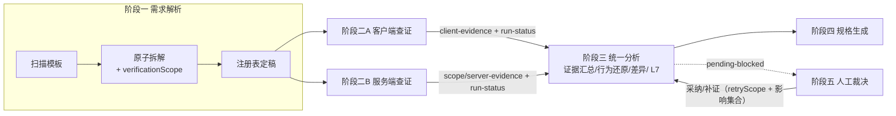

# game-requirement-audit 统一工作流执行文档

- 日期：2026-11-17
- 类型：执行文档（头部：步骤总览 + 全部步骤的产物与结构定义）
- 设计依据：`dev-docs/design/2026-11-17-game-requirement-audit-unified-workflow.md`（合并方案、五阶段架构、三原则、迁移表）
- 现状资产：`.opencode-workflows/workflows/output-spec-generate/`（四子流程）、`.opencode-workflows/workflows/server-rule-verify/`（四子流程 + 3C 客户端落判）、`.opencode-workflows/scripts/`（确定性装配脚本族）
- 状态：**头部 v3（评审修订版·冻结候选）**——v3 冻结后进入 S1~S11 详细执行章节编写
- 修订记录：
  - v1（2026-11-17 初稿）：步骤总览 S1~S11、统一产物目录、全部产物结构、四大数据契约；
  - v2（2026-11-17 评审修订一）：P0×4——S7 取消 conflict 必带双端证据；双端 pending 执行状态独立（run-status）；Registry 新增 `verificationScope`；S8/S9 rejected 回退基线。P1——CLE/SVE 版本追溯三字段；端级补证 retryScope；增量重算；
  - v3（2026-11-17 评审修订二）：**P0×4**——①S6/S7 冲突快速路径（单端直证冲突绕过必要端 pending 阻塞，新原则「冲突可单端立证，一致必须满足全部必要端证据」）；②SVE 收敛纯服务端（layer 去客户端两值、scope-index 去 client 值、废弃旧 S8 客户端补证链路）；③client scope 的 verified 完整前置条件；④Source Manifest 确定性采集（脚本读 SHA/hash，agent 零填写，按源码仓分别记录）。**P1×2**——证据失效 hash 优先（commit 漂移但文件不变不失效）；增量重算按共享证据影响集合。整体架构与四大契约保留。

---

## 0. 文档结构与本文范围

本文是执行文档的头部，只回答三个问题：

1. **统一后有哪些步骤**（§2 步骤总览表，S1~S11）；
2. **每一步产出什么**（§3 统一产物目录 + §5 步骤产物与结构，逐步骤定义所有产物的数据结构）；
3. **四大核心数据契约长什么样**（§6，Requirement Registry / Client Evidence / Server Evidence / Unified Difference 的字段表与关联关系——设计文档「下一步」要求的交付物）。

后续章节（§10 规划）逐步骤展开执行细节：Prompt 全文、确定性脚本改动方案、闸门实现、验收清单、迁移步骤。

## 1. 总体架构回顾（引自设计文档）

- 一个主 Workflow `game-requirement-audit`，五个阶段，两条并行查证分支（客户端 / 服务端）。
- 架构原则：
  1. **一个需求事实源**：Atom ID 只能由原子拆解阶段（S2）产生；
  2. **两套独立证据体系**：客户端（S4）与服务端（S5）分别查证，互不代替、互不覆盖；SVE 只承载服务端三目录证据，客户端证据只进 CLE（v3）；
  3. **一个统一业务结论**：双端证据汇总（S6 同步屏障）后才做差异判定（S7/S8）与 L7 分类（S9）；
  4. **执行状态与业务结论分离**（v2）：pending（查证未完成）是执行状态（run-status 表达），unknown（已查证但证据不足）/ not_found（已查证未找到实现）是业务结论；禁止用「缺证据」「缺条目」互相推断；
  5. **验证范围由需求侧声明**（v2）：`verificationScope`（client/server/both）只在 S2 依据需求语义判定并入 Registry，任何下游阶段不得从「哪端找到了证据」反推需求属于哪端；
  6. **客户端 `verdict` 与服务端 `applicability` 是两个独立维度**，永远不合并成一个字段；
  7. **冲突可单端立证，一致必须满足全部必要端证据**（v3）：任一已完成端的直接矛盾证据即可先行成立 conflict（不被另一必要端 pending 阻塞）；consistent / verified 必须等全部必要端查证完成，且不把执行失败当业务冲突。
- 文档生成（S10）后置于双端查证与统一分析之后；策划视图只消费业务行为与 L7 分类，不暴露技术细节。



S6 屏障内部判定路径（v3）：

```
双端证据汇总（unified-atoms）
    ↓
任一已完成端存在直接冲突证据（directConflict）？
    ├── 是 → conflict-fast：进 S7 冲突分析（不因另一必要端 pending 阻塞）
    └── 否 → 必要端（verificationScope 声明的端）全部完成？
              ├── 否 → blocked：不进差异判定，pending-list（l7 派生 verification_required）
              └── 是 → full：进 S7 完整差异分析
```

## 2. 步骤总览表（S1~S11）

| 步骤 | 阶段 | 名称 | 职责一句话 | 主要输入 | 主要产物 | 关键闸门 | 现状来源 |
|---|---|---|---|---|---|---|---|
| S1 | 一 | 需求扫描 scan-template | 扫描模板章节结构并校验覆盖 | 模板 md | `scan.json` | 章节覆盖/编号连续校验 | 保留：`1-scan-template.js` |
| S2 | 一 | 原子拆解 atomize-requirements | 按阶段并行拆原子，只产需求侧字段 + 业务语义 + 来源行号 + verificationScope | `scan.json` + 模板原文 | 原子分片（runtime） | ID 规范/唯一校验、行号落界校验、verificationScope 枚举校验 | 拆分：`2-verify-stages.js` 第一步独立成步 |
| S3 | 一 | 注册表定稿 identity-map + requirement-registry | 确定性合并分片，落统一需求事实源 | S2 分片 + `scan.json` | `requirement-registry.json`、`identity-map.json` | 覆盖率/重复/统计块重算（含 scopeStats） | 新增（确定性脚本，机制参照 `recount-verify-parts.mjs`） |
| S4 | 二A | 客户端查证 client-verify | 只查证：客户端实现证据 + 实际观察行为 + 冲突信号 | Registry 原子（只读）+ Code/Fgui 工程 | `client-evidence.json`、`runtime/run-status.json`、**`runtime/source-manifest.json`** + runtime 分片 | 落盘闸门、verdict/证据自洽（pending 时 verdict 空串）、directConflict 自洽、重算闸门 | 拆分：`2-verify-stages.js` 第二/三步；证据形态吸收 S8 `3-verify-scope-client.js` |
| S5 | 二B | 服务端查证 server-verify | 符号索引 → 匹配候选 → 作用域落判（纯服务端三目录） | Registry 原子（只读）+ 服务端源码根 | `symbol-index.json`、`scope-index.json`、`server-evidence.json`、`runtime/run-status.json`、**`runtime/source-manifest.json`** + runtime 分片 | 落盘闸门、双写闸门、SVE 形状/id 校验、**SVE layer 收敛服务端三目录**、重算闸门、按 run-status 分段校验 | 保留：`1-scan-server.js` + `2-match-atoms.js` + `3-verify-scope.js`（内部三步不变；**废弃 3C 客户端补证链路**） |
| S6 | 三 | 证据汇总 merge-evidence | 同步屏障 + **分析路径三分（conflict-fast / full / blocked）** + 确定性合并 | Registry + 双端产物 + 双端 run-status | `unified-atoms.json` | 同步屏障（run-status 判定 pending）、**冲突快速路径判定（directConflict 信号）**、Atom 对齐、evidenceIds 存在性 | 扩展：`merge-verify-output.mjs` |
| S7 | 三 | 业务行为还原 business-behavior-analysis | **双路径差异初判**：冲突快速路径（单端直证立 conflict）+ 完整路径（必要端齐备）+ 业务行为还原 | `unified-atoms.json`（conflict-fast + full 原子） | `business-behavior.json`（含每原子基线 difference） | 落盘闸门、覆盖/枚举校验、conflict 证据域校验（单端可立证） | 新增（agent 阶段；差异初判口径继承 v4 需求 6.1） |
| S8 | 三 | 统一差异复核 difference-review | 双栏证据复核出建议（pending），人工批准后生效 | `unified-atoms.json` + `business-behavior.json` | `difference-review.json` | reviewRule 白名单、复核漂移检测、审批状态闸门（rejected 回退基线） | 调整：`4-review-difference.js` + `merge-verify-output.mjs` 复核合并段 |
| S9 | 三 | L7 分类 l7-classify | 确定性矩阵：复核差异 × 作用域 → L7（scope 解析含 verificationScope；**client verified 前置条件**） | 四件套（registry/双端/复核） | `l7-classify.json` | 矩阵自洽、统计块交叉校验、scope 解析禁止证据反推、**client verified 前置条件校验**、五道闸门前置 | 保留：`classify-l7.mjs`（输入换 Registry 基线 + scope 解析扩展） |
| S10 | 四 | 统一规格生成 unified-spec | 双端齐备后一次性生成五类交付物 | 阶段三全部产物 | 技术实现视图、策划业务视图、规则验证报告、需求追溯索引、待处理问题清单 | 机械校验七维度、策划版泄漏扫描、AT-ID 覆盖 | 调整：`3-produce-outputs.js` + `4-assemble-verify.js` 移后 + 扩展 |
| S11 | 五 | 人工裁决 human-review | pending 清单审阅、端级补证（retryScope）+ **影响集合重算**、采纳/修改/否决/挂起 | `pending-list.md` + 各正式产物 | 决议记录、补证分片、approved 合并索引 | 审批状态独立闸门、v2 基线只读、**影响集合完整性校验** | 保留扩展：`prepare-retry-input.mjs`、`assemble-output-spec-index.mjs` v3 模式 |

说明：

- S4 与 S5 **并行执行**，共享同一份 Registry 原子输入与同一并发配额；
- S5 内部保留现有三步链（扫描 → 匹配 → 落判），对主编排是单步；**旧 S8 客户端补证落判（3C/-pc 分片）整体废弃**（v3，见 S5）；
- 原 `4-review-difference.js` 的「复核建议」部分移入 S8，「merge/classify/check 确定性闸门」部分拆入 S6/S9/S10；
- 阶段五不是线性终点：补证（retryScope + 影响集合）后回到 S6 重走统一分析，决议改写 `reviewStatus` 后由确定性脚本重算 S9/S10 相关产物。

## 3. 统一产物目录

统一产物根：`spec-workflow/requirement-audit/<date>/`（`<date>` 经 args 显式传入，脚本内禁止取当前时间）。历史产物目录（`spec-workflow/output-spec/…`）一律只读。

```
spec-workflow/requirement-audit/<date>/
├── registry/                          # 阶段一：需求事实源（唯一 Atom ID 产生地）
│   ├── requirement-registry.json      # S3：统一原子注册表（核心契约 #1）
│   ├── identity-map.json              # S3：术语/章节/跨切面身份映射
│   └── runtime/
│       ├── state/scan.json            # S1：章节扫描结果（保留现结构）
│       └── atom-parts/                # S2：原子拆解分片 <stageId>-ap<NN>.json
├── client/                            # 阶段二A：客户端证据体系（独立，不被服务端覆盖）
│   ├── client-evidence.json           # S4：客户端证据正式产物（核心契约 #2）
│   └── runtime/
│       ├── run-status.json            # S4：分支执行状态（pending/timeout/failed 分片清单）
│       ├── source-manifest.json       # S4：源码版本清单（确定性采集，agent 零填写）【v3 新增】
│       ├── verify-input/              # S4 输入分片 <stageId>-cp<NN>.json + manifest.json
│       ├── verify-output/             # S4 落判分片 <stageId>-cp<NN>.json
│       └── client-recount.json        # 重算闸门产物
├── server/                            # 阶段二B：服务端证据体系（纯服务端三目录）
│   ├── symbol-index.json              # S5-1：符号索引（保留）
│   ├── scope-index.json               # S5-3：作用域判定（核心契约 #3 组成）
│   ├── server-evidence.json           # S5-3：服务端证据 SVE（核心契约 #3 组成）
│   └── runtime/
│       ├── run-status.json            # S5：分支执行状态
│       ├── source-manifest.json       # S5：服务端源码仓版本清单【v3 新增】
│       ├── verify-input/              # 保留：分片 + manifest.json
│       ├── match-output/              # 保留：匹配候选分片
│       ├── verify-output/             # 保留：服务端落判分片 <stageId>-p<NN>.json（-pc 客户端补证分片废弃）
│       ├── verify-recount.json
│       └── review-output/             # S8 复核建议分片（迁到本目录，双端统一复核输入）
├── analysis/                          # 阶段三：统一分析
│   ├── unified-atoms.json             # S6：统一 Atom 视图（双端证据挂接 + pending 标记 + 分析路径）
│   ├── business-behavior.json         # S7：业务行为还原 + 差异初判基线
│   ├── difference-review.json         # S8：统一差异复核（核心契约 #4 组成）
│   ├── l7-classify.json               # S9：L7 分类（核心契约 #4 组成）
│   └── runtime/spec-check/
│       └── l7-check-report.md         # 五道闸门报告
├── specs/                             # 阶段四：规格生成（结构对齐原 1-spec）
│   ├── stages/spec_stage_ST-Cxx.md    # 技术实现视图：阶段规格文档
│   ├── feature_index.json             # 统一索引（schema v3，双端字段）
│   ├── stage_manifest.md              # 阶段速查表
│   ├── trace_index.json               # 需求追溯索引
│   ├── pending-list.md                # 待处理问题清单（阶段五入口）
│   ├── 技术补充版.md                   # 技术实现视图：补充版需求文档（路径可配）
│   ├── 策划版.md                       # 策划业务视图（路径可配）
│   └── runtime/
│       ├── state/doc-parts/、parts/、planner-parts/   # 文档分片（保留分片写盘机制）
│       ├── build-config.json          # 装配配置（中文路径经此传递）
│       └── spec_check/verify-report.md
└── review/                            # 阶段五：人工裁决
    ├── decisions.json                 # 决议记录（采纳/修改/否决/挂起 + retryScope + 影响集合）
    └── runtime/retry-input/           # 补证重跑分片（端级 client/server/both；影响集合由 evidenceIds 反查）
```

目录规则（沿用现约定）：

- 读写分离：`registry/`、双端正式产物对查证 agent 只读；agent 只写自己的 runtime 分片；
- 断点续跑：正式产物已存在且分片齐全时支持增量/幂等重跑；`specs/` 内已存在 `feature_index.json` 时 fail fast（换新目录或清理）；
- JSON 一律 UTF-8 无 BOM、LF、1 空格缩进；`date` 一律经 args/配置文件传递，禁止脚本内取当前时间。

## 4.（并入 §3 与 §5）产物目录见 §3，逐步骤结构见 §5

## 5. 步骤产物与结构

标注约定：**【保留】**现有字段不变；**【扩展】**现有结构新增字段；**【新增】**本工作流新产物；**【v2】/【v3】**评审修订新增。所有结构为 JSON 字段示意（同现有 schema 风格），非严格 JSON Schema 全文；严格 Schema 随各步骤详细章节给出。

---

### S1 需求扫描（scan-template）

- 脚本来源：`output-spec-generate/1-scan-template.js` 原样迁移。
- 产物：`registry/runtime/state/scan.json`【保留】

```json
{
  "templatePath": "templates/…核心简化版本.md",
  "totalLines": 0,
  "sections": [
    { "no": 1, "title": "", "fromLine": 1, "toLine": 0,
      "kind": "intro|terms|stage", "stageId": "ST-Cxx",
      "container": "", "sourceTitle": "行牌 > 吃碰杠" }
  ]
}
```

- 闸门：章节覆盖全文（首节起于 1 行、末节止于 totalLines、相邻间隔 ≤3 行）、stageId 连续编号（ST-C01…）。

---

### S2 原子拆解（atomize-requirements）

- 来源：`2-verify-stages.js` 的「第一步 拆原子需求」独立成步；**只拆解、不查证**。
- 输入：`scan.json`（内存链式）+ 模板原文行段 + 名词章节（terms）。
- 产物：`registry/runtime/atom-parts/<stageId>-ap<NN>.json`【新增】（agent 按阶段并行写盘，分片仅按阶段切，不拆散功能点）

```json
{
  "schemaVersion": 1,
  "stageId": "ST-Cxx",
  "partNo": 1,
  "features": [
    {
      "id": "FP-ST-Cxx-nnn", "name": "", "description": "",
      "scope": "", "coordination": "",
      "atoms": [
        {
          "atomId": "AT-ST-Cxx-nnn", "name": "",
          "rule": "",                       // 规则语义，忠实模板原文
          "uiRequirement": "",              // UI 表现相关语句，无则空串
          "verificationScope": "client|server|both",   // 【v2】需求验证范围（判定规则见下）
          "businessBehavior": {             // 需求声明的业务语义四元组（玩家语言）
            "trigger": "", "condition": "", "action": "", "result": ""
          },
          "source": {                       // 原文来源追溯【新增】
            "chapter": "行牌 > 吃碰杠",
            "fromLine": 0, "toLine": 0      // 原子对应原文行号区间
          }
        }
      ]
    }
  ]
}
```

- **verificationScope 判定规则【v2】**（拆解时依据需求语义判定，只看需求原文，不看代码）：
  - `client`：纯界面/交互表现类——UI 展示、动效、按钮状态、纯客户端壳逻辑，服务端无规则角色（如「牌河中财神标记显示方式」）；
  - `server`：纯规则计算/判定类——客户端仅展示服务端结果，需求正确性取决于服务端（如「胡牌番数计算规则」）；
  - `both`：双端协作类——客户端交互与服务端规则共同构成完整行为（如「点击吃牌按钮后完成吃牌」）；
  - **无法判定时一律 `both`（保守：宁可多查证，不可少查证）**。
- 与现状差异：现 v4 的 `businessBehavior` 由客户端证据归纳；统一后改为**需求侧从原文归纳**（拆解阶段只看模板）。证据归纳的「实际观察行为」移入 S4（`observedBehavior`）。两套四元组在 S7 对比。
- 闸门：FP/AT ID 规范（`FP-/AT-ST-Cxx-nnn`）与阶段内唯一；`source.fromLine/toLine` 必须落在该阶段章节行段内；`rule` 非空；`verificationScope` 枚举合法（缺省按 `both` 计）。

---

### S3 注册表定稿（identity-map + requirement-registry）

- 来源：新增确定性脚本（合并 + 校验 + 统计重算，机制参照 `recount-verify-parts.mjs` / `merge-verify-output.mjs`）。
- 产物 1：`registry/requirement-registry.json`【新增】——**核心契约 #1：唯一需求事实源**

```json
{
  "schemaVersion": 1,
  "date": "2026-11-17",
  "source": { "templatePath": "", "totalLines": 0 },
  "stages": [
    { "stageId": "ST-Cxx", "name": "", "chapter": "", "summary": "",
      "featureCount": 0, "atomCount": 0 }
  ],
  "features": [
    { "id": "FP-ST-Cxx-nnn", "stageId": "ST-Cxx", "name": "", "description": "",
      "scope": "", "coordination": "",
      "atoms": [
        { "atomId": "AT-ST-Cxx-nnn", "name": "", "rule": "", "uiRequirement": "",
          "verificationScope": "client|server|both",          // 【v2】从 S2 分片透传
          "businessBehavior": { "trigger": "", "condition": "", "action": "", "result": "" },
          "source": { "chapter": "", "fromLine": 0, "toLine": 0 } }
      ]
    }
  ],
  "stats": { "stageCount": 0, "featureCount": 0, "atomCount": 0,
             "perStage": [],
             "scopeStats": { "client": 0, "server": 0, "both": 0 } }   // 【v2】验证范围分布
}
```

- 铁律：**查证字段（verdict/applicability/evidence…）永远不进 Registry**；`verificationScope` 是需求侧声明字段，双端查证只读不写；Registry 定稿后 Atom ID 与 verificationScope 后续任何阶段不得增改（变更需重新拆解整链重跑）。
- 产物 2：`registry/identity-map.json`【新增】——双端共享的身份与术语映射

```json
{
  "schemaVersion": 1,
  "terms": [ { "term": "", "definition": "", "source": "模板名词章节 或 file:line" } ],
  "stageChapters": [ { "stageId": "ST-Cxx", "chapter": "", "sourceTitle": "", "fromLine": 0, "toLine": 0 } ],
  "crossCutting": [ "" ]
}
```

- 闸门：分片原子全覆盖（每原子恰一条、无重复无外来）、统计块与逐原子重算一致（含 scopeStats）。

---

### S4 客户端查证（client-verify）【阶段二A】

- 来源：`2-verify-stages.js` 第二/三步独立成步；证据条目形态吸收 S8 `3-verify-scope-client.js` 的经验（layer=client_code/client_fgui、id 代际隔离、共享证据引用不复制），但文件独立于 server-evidence。
- 输入：`requirement-registry.json`（确定性投影成查证输入分片，只含需求侧字段；全量原子——技术视图需要客户端职责，不按 verificationScope 裁剪）+ `source-code/client/Code`、`source-code/client/Fgui`。
- 产物 1：`client/client-evidence.json`【新增】——**核心契约 #2：客户端证据体系**

```json
{
  "schemaVersion": 1,
  "date": "",
  "source": { "codeDir": "source-code/client/Code", "fguiDir": "source-code/client/Fgui" },
  "entries": [                            // 每原子恰一条
    {
      "atomId": "AT-ST-Cxx-nnn",
      "verdict": "confirmed|partial|not_found",   // 是否发现客户端实现证据（维度一）
                                             // pending=true 时必须为空串——未完成不得冒充 not_found
      "pending": false,                           // 派生自 run-status，仅作冗余展示
      "clientLogic": "",                          // 客户端逻辑实现摘要
      "uiInteraction": "",                        // UI 交互表现
      "messages": [],                             // 涉及协议消息 MsgXxx
      "notes": "",
      "directConflict": false,                    // 【v3】查证中发现与需求直接矛盾的实现行为（语义信号）
      "conflictEvidenceIds": [],                  // 【v3】矛盾证据 CLE id（directConflict=true 时必非空）
      "observedBehavior": {                       // 由证据归纳的实际业务行为（玩家语言）
        "trigger": "", "condition": "", "action": "", "result": ""
      },
      "evidenceIds": ["CLE-ST-Cxx-nnn-01"]
    }
  ],
  "evidence": [                           // 平级证据条目（CLE）
    { "id": "CLE-ST-Cxx-nnn-01", "atomId": "AT-ST-Cxx-nnn",
      "layer": "client_code|client_fgui",          // Code 工程 / Fgui 工程
      "file": "client_code/layer/GameMahView.ts",
      "location": "client_code/layer/GameMahView.ts:123",
      "symbol": "", "excerpt": "", "configKeys": [],
      "sourceRevision": "<git commit sha>",        // 【v3】由 merge 从 source-manifest 回填，agent 不填
      "contentHash": "sha256:<file-hash>",         // 【v3】同上
      "verifiedAt": "2026-11-17" }                 // 【v3】同上
  ],
  "coverage": {                             // 查证覆盖情况（从 run-status 派生，供观察）
    "expectedAtomCount": 0, "entryCount": 0, "pendingAtomIds": []
  },
  "stats": { "atomCount": 0, "confirmed": 0, "partial": 0, "not_found": 0,
             "directConflict": 0, "pending": 0, "evidenceCount": 0 }
}
```

- 产物 2：`client/runtime/run-status.json`【v2 新增】——**分支执行状态（pending 的事实源）**

```json
{
  "schemaVersion": 1,
  "branch": "client",
  "date": "",
  "runStatus": "completed|partial|failed",     // 全部分片 completed→completed；有未完成→partial；整体失败→failed
  "parts": [
    { "partFile": "ST-C01-cp01.json", "stageId": "ST-C01",
      "status": "pending|completed|failed|timeout",   // 分片级执行状态
      "atomIds": [] }                          // 本片应覆盖原子（Registry 投影清单）
  ]
}
```

- 状态语义：`pending` 尚未完成（未调度/未落盘）；`completed` 正常完成；`failed` 执行失败；`timeout` 执行超时。**pending/failed/timeout 分片不产 entry**（正式产物中该批原子无条目、进 `coverage.pendingAtomIds`），分支不中止——runStatus=partial 放行到 S6。
- 产物 3：`client/runtime/source-manifest.json`【v3 新增】——**源码版本清单（确定性采集）**

```json
{
  "schemaVersion": 1,
  "branch": "client",
  "collectedAt": "2026-11-17",
  "repos": [                                  // 客户端两根目录可能同仓或异仓，按仓分条
    { "repoRoot": "<git 仓根>", "commit": "<采集时 commit sha>",
      "files": [ { "file": "client_code/layer/GameMahView.ts", "contentHash": "sha256:…" } ] }
  ]
}
```

- 采集机制【v3，P0-4】：确定性脚本 `collect-source-manifest.mjs` 在分支 merge 前运行——读取各源码仓 commit SHA、计算证据涉及文件 contentHash；无 git 仓的目录 commit 记 `unversioned`。**agent 严禁执行 git 命令、严禁自填 SHA/hash**：CLE 三字段（sourceRevision/contentHash/verifiedAt）由分支 merge 脚本从 manifest 按 `file` 匹配回填；**客户端与服务端分别记录各自源码仓版本，不共用一个 SHA**。
- CLE 编号规则：`CLE-<atomId>-NN`（原子内命名空间）；同一 file:line 服务多原子时只写一条、跨原子以 evidenceIds 引用（禁止复制条目，同 SVE 坑 8 口径）；补证重跑新增证据用 `CLE-<atomId>-R<k>-NN` 代际隔离。
- 自洽闸门：`pending=false` 时 `verdict != not_found` 必带证据、`not_found` 不得带证据；`pending=true` 时 verdict 必须空串且证据可空；**`directConflict=true` 必带 conflictEvidenceIds（非空且 verdict != not_found）**；`coverage.pendingAtomIds` 与 run-status 重算一致。
- runtime 分片：`client/runtime/verify-input|verify-output/<stageId>-cp<NN>.json` + `manifest.json`（机制同 server 分支，含落盘闸门与重算闸门）。

---

### S5 服务端查证（server-verify）【阶段二B】

- 来源：`1-scan-server.js`、`2-match-atoms.js`、`3-verify-scope.js` 内部三步链整体保留，改动：①匹配输入基线从 `feature_index.json` 换成 `requirement-registry.json`（`prepare-verify-atoms.mjs` 改数据源）；②merge 闸门按 run-status 分段校验；③**SVE 收敛纯服务端**（v3）：layer 只允许服务端三目录；④废弃旧 S8 客户端补证链路（3C `-pc` 分片、client 层 SVE、scope=client 条目）——纯客户端需求由 Registry `verificationScope=client` 表达，客户端补证走 S4 重跑（retryScope=client）。
- 产物 1：`server/symbol-index.json`【保留】（stats：files/classes/methods/functions/configKeys/symbols）。
- 产物 2：`server/scope-index.json`【保留 + v3 收敛】——**核心契约 #3 组成：服务端作用域**

```json
{
  "schemaVersion": 1,
  "entries": [                            // 仅已完成落判的原子有条目（业务结论，不含执行状态）
    { "atomId": "AT-ST-Cxx-nnn",
      "applicability": "active|conditional|inactive|unknown",   // 【v3】收敛四值（去 client）
      "configVerified": true, "callPathVerified": true,
      "configCondition": "",            // conditional 必填：配置 key + 默认值 + 可选值影响
      "callPath": "",                   // 证据调用链：函数名 + file:line
      "evidenceIds": ["SVE-ST-Cxx-P01-01"],
      "unresolved": "",                 // unknown 必填缺什么证据（已查证但证据不足）
      "noServerEvidence": false,
      "directConflict": false,          // 【v3】查证中发现与需求直接矛盾的服务端实现（语义信号）
      "conflictEvidenceIds": [] }       // 【v3】矛盾证据 SVE id
  ],
  "coverage": {                             // 查证覆盖情况（从 run-status 派生）
    "expectedAtomCount": 0, "entryCount": 0, "pendingAtomIds": []
  },
  "stats": { "atomCount": 0, "active": 0, "conditional": 0, "unknown": 0, "inactive": 0,
             "directConflict": 0, "pending": 0 }
}
```

- **pending ≠ unknown**：`unknown` = 服务端**已查证**但证据不足（业务结论，有 entry）；查证**未完成**（分片 timeout/failed/pending）= 无 entry + 进 `coverage.pendingAtomIds`（执行状态，由 run-status 表达）。两者来源独立，禁止互相推断。
- 产物 3：`server/server-evidence.json`【保留 + v3 收敛】——**核心契约 #3 组成：服务端证据（SVE，纯服务端三目录）**

```json
{
  "schemaVersion": 1,
  "evidence": [
    { "id": "SVE-ST-Cxx-P01-01", "atomId": "",
      "layer": "common_game|hzmj_server|mah_frame",   // 【v3，P0-2】收敛服务端三目录（去 client_code/client_fgui）
      "file": "", "location": "", "symbol": "", "excerpt": "", "configKeys": [],
      "sourceRevision": "<服务端仓 commit sha>",      // 【v3】由 merge 从 source-manifest 回填，agent 不填
      "contentHash": "sha256:<file-hash>",            // 【v3】同上
      "verifiedAt": "2026-11-17" }                    // 【v3】同上
  ],
  "stats": { "sveCount": 0 }
}
```

- **客户端证据不再进 SVE**【v3，P0-2】：`client_code/client_fgui` 两 layer 废弃——客户端证据唯一载体是 `client-evidence.json` 的 CLE。旧 `3-verify-scope-client.js`（3C）及其 `-pc` 分片、scope=client 条目、`ui-conflict-stands-alone` 的服务端侧承载（client 层 SVE）全部废弃；客户端视觉冲突改由 S4 的 `directConflict` + CLE 直证承载（S6 冲突快速路径消费）。
- 产物 4：`server/runtime/run-status.json`【v2 新增】——结构同 S4 产物 2（`branch: "server"`，`parts[].partFile` 为 `<stageId>-p<NN>.json`）。
- 产物 5：`server/runtime/source-manifest.json`【v3 新增】——结构同 S4 产物 3（`branch: "server"`，服务端源码仓单仓一条）。
- 产物 6：runtime 中间产物 `verify-input/`、`match-output/`、`verify-output/`【保留】（仅服务端 `-p<NN>` 分片）。
- 闸门：全部沿用（落盘、双写 dr.scopeApplicability==applicability、SVE 形状/id 劫持、recount 重算、证据文件范围硬约束三根目录）+ v2 调整（merge 按 run-status 分段校验：completed 分片覆盖原子恰一条，未完成分片原子进 pendingAtomIds）+ **v3 收敛闸门**：SVE `layer` 只允许服务端三目录、scope-index `applicability` 只允许四值、`directConflict=true` 必带 conflictEvidenceIds（SVE id）。

---

### S6 证据汇总（merge-evidence）【阶段三，同步屏障】

- 来源：扩展 `merge-verify-output.mjs`（增加客户端证据合并段 + Registry 对齐段 + run-status 消费段 + 分析路径判定段；复核段拆给 S8）。
- 输入：`requirement-registry.json` + `client-evidence.json` + `scope-index.json` + `server-evidence.json` + 双端 `runtime/run-status.json`。
- 产物：`analysis/unified-atoms.json`【新增】——统一 Atom 视图（S7/S8/S9/S10 的共同输入）

```json
{
  "schemaVersion": 1,
  "date": "",
  "atoms": [
    {
      "atomId": "AT-ST-Cxx-nnn",
      "requirement": { "rule": "", "uiRequirement": "", "source": {},
                       "verificationScope": "client|server|both",
                       "businessBehavior": {} },           // ← Registry 原样
      "client": { "verdict": "", "evidenceIds": [], "observedBehavior": {},
                  "directConflict": false, "conflictEvidenceIds": [],
                  "pending": false },                       // ← client-evidence + run-status 派生
      "server": { "applicability": "", "evidenceIds": [], "configCondition": "",
                  "directConflict": false, "conflictEvidenceIds": [],
                  "pending": false },                       // ← scope-index + run-status 派生
      "analysisPath": "conflict-fast|full|blocked",         // 【v3】S6 分析路径判定
      "baselineDifference": ""                              // S7 填入，本步留空
    }
  ],
  "stats": { "atomCount": 0, "conflictFast": 0, "full": 0, "blocked": 0,
             "clientPending": 0, "serverPending": 0,
             "dualLocated": 0, "clientOnly": 0, "serverOnly": 0, "neither": 0 }
}
```

- **分析路径判定【v3，P0-1】**（确定性，逐原子）：
  1. **conflict-fast**：任一**已完成端**（该端 pending=false）entry `directConflict=true` → 进 S7 冲突分析，**不因另一必要端 pending 阻塞**（原则 7：冲突可单端立证）；pending 端不参与判定（不把执行失败当业务冲突）；
  2. **blocked**：无已完成端冲突信号，且必要端（verificationScope 声明的端）任一 pending → 不进差异判定，直送 pending-list；
  3. **full**：无冲突信号且必要端全部完成 → 进 S7 完整差异分析；
  4. 非必要端 pending 不阻塞 full 判定（只记录进 unified-atoms 供技术视图标注）；
  5. conflict-fast 原子在另一必要端完成后（重跑/补证/续跑）**自动升级 full 重判**（幂等：已立 conflict 不因升级自动撤销，撤销走 S8 复核审批）。
- 闸门（本步核心）：
  1. `client.pending` / `server.pending` 一律**从双端 run-status 判定**（原子所属分片 status != completed 即该端 pending），**禁止**从「缺 evidence」「缺 scope 条目」猜测 pending；
  2. Atom 对齐：client/scope 条目 atomId ⊆ Registry 且每原子至多一条（pending 原子允许零条目）；
  3. evidenceIds / conflictEvidenceIds 存在性：所有 id 必须能在对应证据文件中找到（CLE→client-evidence，SVE→server-evidence）；
  4. 分析路径统计块与逐原子重算一致；
  5. 不做任何语义判断（确定性脚本，无 agent——directConflict 是 S4/S5 agent 已落的语义信号，S6 只做布尔消费）。

---

### S7 业务行为还原与差异初判（business-behavior-analysis）

- 来源：新增 agent 阶段（按阶段分片并行）；差异初判规则继承 v4 需求 6.1 口径（partial≠unverified、conflict 必带证据、禁止从单一 verdict 直推结论）。
- 输入：`unified-atoms.json`（conflict-fast + full 原子；blocked 原子除外）。
- 产物：`analysis/business-behavior.json`【新增】

```json
{
  "schemaVersion": 1,
  "entries": [                            // conflict-fast + full 原子每恰一条（blocked 原子除外）
    {
      "atomId": "AT-ST-Cxx-nnn",
      "analysisPath": "conflict-fast|full",          // 【v3】路径透传
      "trigger": "", "condition": "",     // 触发/条件（对齐需求侧与双端证据）
      "clientAction": "",                 // 客户端职责（玩家语言）
      "serverAction": "",                 // 服务端职责（含配置生效条件，玩家语言）
      "collaboration": "",                // 双端协作链（消息流叙述，不出现类名）
      "result": "",                       // 玩家看到什么
      "baselineDifference": "consistent|partial|conflict|unverified",  // 差异初判（基线）
      "baselineDetail": "",               // conflict 必填：需求原文 vs 实际表现
      "evidenceIds": []                   // CLE + SVE 混引
    }
  ],
  "stats": { "atomCount": 0, "consistent": 0, "partial": 0, "conflict": 0, "unverified": 0,
             "pendingBlocked": 0, "conflictFast": 0 }
}
```

- **双路径初判【v3，P0-1】**：
  - **冲突快速路径（conflict-fast）**：只做冲突判定——单端直接矛盾证据成立即立 `conflict`（baselineDifference=conflict + baselineDetail + 责任域证据）；另一端 pending 时**不要求其证据**（服务端超时不影响客户端视觉冲突成立）；另一端已完成时可一并核对双端协作断点；不立 consistent/partial（完整判定留给升级 full 后重判）；
  - **完整路径（full）**：业务行为还原（四元组 + 双端职责 + 协作链）+ 完整差异初判。
- **conflict 证据域规则【v2】**：conflict 必须有**能够直接证明需求与实际行为矛盾的证据**；证据可来自客户端、服务端或双端；**证据范围必须覆盖冲突发生的职责域**。保留 `ui-conflict-stands-alone`（客户端视觉冲突独立成立，不需要服务端证据）。冲突类型与证据要求：

| 冲突类型 | 证据要求 | 示例 |
|---|---|---|
| 客户端视觉冲突 | CLE 直接证据即可 | 需求「打出的财神白板按普通白板显示」，实现「牌河中白板财神仍高亮」——服务端不负责牌河视觉 |
| 服务端规则冲突 | SVE 直接证据即可 | 需求「流局连庄」，实现「流局换庄」——客户端仅展示 |
| 双端协作冲突 | 按冲突发生的职责域要求相关端证据 | 点击吃牌后客户端出牌表现与服务端牌型数据不一致——需双端证据定位断点 |
| 无法证明冲突 | 不判 conflict，归 unverified 或 partial | 只有间接证据不能支撑矛盾判定 |

- 完整路径初判口径：
  - **conflict 判定不受 verificationScope 限制**——任一端矛盾证据即可立 conflict（上表）；
  - **consistent（可判一致）受 verificationScope 约束**：必要端查证完成且证据同构才可判 consistent；任一必要端证据不足 → unverified（番数案例：客户端有番数显示逻辑、服务端 unknown → unverified，绝不可 verified）；
  - conflict 必带 baselineDetail + 对应职责域证据（CLE/SVE）。
- 闸门：落盘、枚举合法、conflict 必带 baselineDetail + 证据（且证据覆盖冲突职责域）、`baselineDifference` 回写 `unified-atoms.json` 后统计块交叉校验。

---

### S8 统一差异复核（difference-review）

- 来源：`4-review-difference.js` 复核建议段迁移 + 输入从「服务端单栏」改为「双端双栏」；复核规则白名单沿用四条前缀（no-server-evidence-is-not-conflict / evidence-is-not-consistency / common-capability-is-not-enabled / ui-conflict-stands-alone），双端合并口径下的新增前缀在详细章节定稿。
- 输入：`unified-atoms.json`（含 S7 回写的 baselineDifference；conflict-fast 与 full 原子均走复核——conflict-fast 的 conflict 基线同样可被复核建议维持/升级/降级，降级须人工审批）。
- 产物：`analysis/difference-review.json`【扩展】——**核心契约 #4 组成：统一差异复核**

```json
{
  "schemaVersion": 2,
  "entries": [                            // 只对有把握/有变化的原子出条目，其余不出现
    {
      "atomId": "",
      "previousDifference": "",           // = S7 baselineDifference（漂移检测锚点）
      "clientVerdict": "",                // 双栏证据快照【扩展】
      "serverApplicability": "",          // 双栏证据快照【扩展】
      "reviewedDifference": "consistent|partial|conflict|unverified",
      "reviewReason": "",                 // 双栏证据摘要：需求语义 vs 双端实现（引 file:line / CLE / SVE）
      "reviewRule": "",                   // 白名单前缀（可带补充说明括号）
      "reviewStatus": "pending|approved|rejected",   // merge 脚本自动落 pending，人工审批流转
      "evidenceScopes": [                 // conflict 条目必带（证据级作用域，标注每条证据能证明什么）
        { "ref": "CLE-…|SVE-…|client-visual", "layer": "", "applicability": "", "note": "" }
      ]
    }
  ],
  "baseline": { "differenceStats": {} },  // 与 S7 统计一致（交叉校验）
  "afterReviewProjection": {}, "l7Projection": {}
}
```

- **审批状态转换规则【v2】**（结论链：`S7 baselineDifference → S8 reviewedDifference → 人工审批 → effectiveDifference → S9 L7`）：

| 审批动作 | reviewStatus | effectiveDifference 取值 | 语义 |
|---|---|---|---|
| 批准 approve | `approved` | `reviewedDifference` | 建议生效，进正式索引 |
| 修改 modify | `approved`（决议记录留人工改写值与理由） | 人工改写值 | 视同批准，改写值即生效结论 |
| 否决 reject | `rejected` | **`baselineDifference`（恢复 S7 基线）** | **rejected ≠ 需求没有问题**；rejected 建议不得覆盖原始差异——后续重跑维持基线，除非新证据出新一轮建议（新一轮建议重置 pending 重新审批） |
| 挂起 hold | 维持 `pending` | `baselineDifference`（不生效） | 挂起条目不进正式索引，留 pending-list |
| 补证 re-verify | 维持 `pending` | `baselineDifference`（不生效） | 转 S11 端级补证链路，重走 S6~S9 |

- 未审批条目（pending/rejected/hold）的 l7 仅为 `proposed` 建议（l7Basis），不入正式索引。
- `l7/effectiveDifference/l7Basis` 三字段仍由 merge/classify 确定性回填（禁止手写，沿用现约定）。
- 闸门：reviewRule 前缀白名单、previousDifference 漂移检测、审批状态独立校验（pending/rejected 条目不得进正式索引、approved 必须 = effectiveDifference）、rejected 条目 effectiveDifference 必须 = baselineDifference。

---

### S9 L7 分类（l7-classify）

- 来源：`classify-l7.mjs` 保留；输入四件套的基线从 `feature_index.json` 换成 `requirement-registry.json`（previousDifference 对齐 business-behavior 基线）；scope 解析与 client verified 前置条件按 v2/v3 扩展。
- 产物：`analysis/l7-classify.json`【保留】——**核心契约 #4 组成：L7 分类**

```json
{
  "schemaVersion": 1,
  "date": "",
  "entries": [                            // conflict-fast + full 原子（blocked 原子无正式 L7 分类）
    { "atomId": "", "scope": "", "scopeSource": "",
      "l7": "verified|verification_required|decision_required|not_applicable",
      "effectiveDifference": "", "l7Basis": "proposed|approved|rejected" }
  ],
  "stats": { "atomCount": 0, "reviewedCount": 0, "unreviewedCount": 0,
             "l7": { "verified": 0, "verification_required": 0,
                     "decision_required": 0, "not_applicable": 0 },
             "l7Approved": { "verified": 0, "verification_required": 0,
                             "decision_required": 0, "not_applicable": 0 } }
}
```

- L7 矩阵（保留现表，`effectiveDifference × scope`）：

| effectiveDifference \ scope | active | conditional | unknown | inactive | client |
|---|---|---|---|---|---|
| consistent | verified | verification_required | verification_required | not_applicable | verified* |
| partial | verification_required | verification_required | verification_required | not_applicable | verification_required |
| conflict | decision_required | decision_required | decision_required | not_applicable | decision_required |
| unverified | verification_required | verification_required | verification_required | not_applicable | verification_required |

`verified*`：**仅在 client verified 前置条件（见下）全部满足时生效**——单靠矩阵无法防止「找到代码 ≠ 实现正确」的错误通过。

- **client verified 完整前置条件【v3，P0-3】**（全部 AND，任一不满足 → 不 verified，落 verification_required）：
  1. Registry `verificationScope = client`；
  2. `client.pending = false`（客户端查证执行完成）；
  3. `client.verdict = confirmed`——confirmed 不只表示「找到了代码」，还要求现有客户端验证逻辑能够证明必要业务行为（partial / not_found 不满足，**partial 不得进 verified**）；
  4. `evidenceIds` 全部存在于 client-evidence 且证据非 stale；
  5. 差异条件：`effectiveDifference = consistent`（已审批生效）；未复核原子 `baselineDifference = consistent` 时 l7 仅为 `proposed` 建议；
  6. 必要业务行为四元组已得到证据支撑（`observedBehavior` 非空字段均有对应证据）。
- **scope 解析优先级【v2/v3】**（逐级回落）：
  1. conflict 条目优先证据级 evidenceScopes（沿用；conflict 不因 scope 未知降级——除 inactive 外一律 decision_required）；
  2. 复核条目 scopeApplicability（S8 双写）；
  3. scope-index Atom 级 applicability（服务端业务结论，**四值**：active/conditional/inactive/unknown）；
  4. **仅当 Registry `verificationScope=client` 且客户端已定位（CLE 定位）→ `client`**；
  5. 缺省一律 `unknown`（禁止缺省 inactive）。
  - **禁止**：`server unknown + CLE 存在` 自动推导为 `client`——服务端查证不足不代表需求只属于客户端（番数案例：服务端 unknown + 客户端显示逻辑 confirmed → scope=unknown → verification_required，不可能错误通过 verified）。verificationScope≠client 时，客户端证据不改变 scope 解析（仍进技术视图与差异判定证据池）。
- **verificationScope × L7 处理原则【v2】**：

| verificationScope | L7 处理原则 |
|---|---|
| `client` | 只要求客户端证据：client scope 可用（解析级 4）；满足 client verified 前置条件 → verified；服务端 pending/unknown 不阻塞、不进 pending-list |
| `server` | 只要求服务端证据：scope 按 scope-index 解析（1~3 级）；客户端证据不参与 scope 解析（仅进技术视图与 conflict 证据池） |
| `both` | 两端都必须完成必要查证：任一端 pending（S6 已 blocked）或 unknown → 不得 verified（矩阵落 verification_required / decision_required） |

- **blocked 原子 L7 口径【v3】**：blocked 原子**不进 l7-classify 正式条目**（未定结论不入正式统计，防止冒充）；规格产物（feature_index/文档）中派生填 `l7=verification_required` 且 `l7Basis=pending-blocked`（机器可读兜底，pending-list 呈现详情）。
- 闸门：矩阵自洽重算、evidenceIds 存在性、统计块交叉校验、conflict 条目必带证据级 scope、scope 解析路径合规校验（client scope 必须能回溯到 Registry verificationScope=client）、**client verified 前置条件逐项校验**。

---

### S10 统一规格生成（unified-spec）

- 来源：`3-produce-outputs.js` + `4-assemble-verify.js` 整体移到阶段四，写作输入从「客户端单端」改为「统一视图」。
- 五类交付物（对应设计文档 mermaid 的五个输出节点）：

**① 技术实现视图**（`specs/`）
- `stages/spec_stage_ST-Cxx.md`【扩展】：阶段规格文档，原子项新增双端区块——客户端职责 / 服务端职责 / 双端协作 / 配置生效条件 / 证据定位（CLE+SVE）/ 实际实现差异；blocked 原子标注「查证未完成（哪端 + 执行状态）」；conflict-fast 已立冲突的原子正常呈现冲突结论 + 另一端查证未完成标注；
- `feature_index.json`【扩展 schema v3】：统一索引，原子项即设计文档 4.1 的统一 Atom 结构：

```json
{ "id": "AT-ST-Cxx-nnn", "name": "", "rule": "", "uiRequirement": "",
  "verificationScope": "client|server|both",
  "clientVerification": { "verdict": "", "evidenceIds": [], "pending": false },
  "serverVerification": { "applicability": "", "evidenceIds": [], "configCondition": "", "pending": false },
  "difference": "", "l7": "" }
```

- blocked 原子：`difference` 留空、`l7` 派生填 `verification_required`（l7Basis=pending-blocked，不入 l7-classify 统计）；
- `stage_manifest.md`【扩展】：速查表增双端分布列；
- `技术补充版.md`【保留】：模板复制后补充完整版（补全内容改由统一视图供料）。

**② 策划业务视图**（`specs/策划版.md`）【保留投影口径】
- 只消费 `business-behavior.json` + `l7-classify.json`（l7 四口径差异行规则沿用 v4；blocked 原子按「规则待验证：查证未完成」口径呈现）；技术字段结构性隔离，泄漏扫描闸门沿用。

**③ 规则验证报告**
- `specs/runtime/spec_check/verify-report.md`【保留】（机械校验七维度，索引统计源换统一视图）；
- `analysis/runtime/spec-check/l7-check-report.md`【保留】（L7 五道闸门 + v3 前置条件校验结果）。

**④ 需求追溯索引**（`specs/trace_index.json`）【保留】
- 条目 `{ atomId, sourceStage, sourceRule, plannerSection, plannerPart, evidenceCount, required, reviewStatus }`；`sourceRule` 增强为可直接回跳 Registry 行号。

**⑤ 待处理问题清单**（`specs/pending-list.md`）【新增 + v2/v3 细化】
- 汇总（按 verificationScope 区分必要端缺口）：
  - blocked 原子：必要端 + 执行状态（timeout/failed/pending）+ 建议补证端（retryScope）；
  - `l7=verification_required`：缺什么证据 / 依赖什么配置（含非必要端 unknown 参考信息）；
  - `l7=decision_required`：需求原文 vs 实际表现双栏（含 conflict-fast 单端立证条目，标注另一端查证状态）；
  - `reviewStatus=pending` 复核建议与 hold 挂起条目；
  - stale 证据与依赖链待复核提示（§7 证据时效）；
  - 每项带 atomId、证据链接、建议动作（补证 client/server/both、采纳、修改、否决、挂起）。

- 闸门：机械校验七维度（文件存在/计数自洽/阶段文档原子 ID 一致/清单覆盖/补充版章节完整/乱码与分片标记/策划版泄漏+AT-ID 覆盖+差异统计）、五道 L7 闸门。

---

### S11 人工裁决（human-review）

- 来源：`prepare-retry-input.mjs`（补证分片）、`assemble-output-spec-index.mjs` v3 模式（approved 合并）保留扩展。
- **端级补证控制【v2】**（`retryScope`：`client|server|both`）：

| retryScope | 重跑范围 | 保留 |
|---|---|---|
| `client` | 只重跑 S4（目标原子分片） | server 正式产物与 run-status 原样 |
| `server` | 只重跑 S5（目标原子分片） | client-evidence 与 run-status 原样 |
| `both` | 双端补证 | 未变分片产物幂等保全 |

- **影响集合重算【v3，P1-2】**：增量重算的最小范围**不是单个 Atom，而是受影响的 Atom 依赖集合**（确定性计算）：
  1. 补证目标原子集合 T（retryScope 对应端的分片覆盖原子）；
  2. 定位本轮更新/新增的 CLE/SVE（含共享证据更新：同 id 摘录或证据指针变化）；
  3. 反查 `evidenceIds` 引用这些证据的**全部**原子（含非补证目标原子——共享证据依赖，如同一配置判定函数 SVE-001 同时支撑 AT-001/AT-002）；
  4. 影响集合 = T ∪ 反查集合；
  5. S6~S9 对影响集合重算（S6 路径可变：blocked → full/conflict-fast；S8 幂等口径沿用：结论一致复用原条目、结论变化重置 pending）；S10 只重生成影响集合覆盖的阶段文档/索引/策划版分片。
- 产物 1：`review/decisions.json`【新增】——决议记录：

```json
{ "schemaVersion": 1, "date": "",
  "decisions": [
    { "atomId": "", "action": "approve|modify|reject|hold|re-verify",
      "target": "difference-review|l7|pending",
      "retryScope": "client|server|both",       // action=re-verify 时必填
      "impactSet": [],                           // 【v3】影响集合（re-verify 时由确定性脚本回填）
      "modifiedValue": "",                       // action=modify 时必填（人工改写结论）
      "reason": "", "decidedAt": "" }
  ] }
```

- 产物 2：补证分片 `review/runtime/retry-input/`【保留 + 扩展】：双端统一补证输入（retryHint 含前轮缺口 + 端标识；客户端补证分片产 CLE，服务端补证分片产 SVE——四值作用域）。
- 产物 3：approved 合并：`reviewStatus=approved` 条目经确定性合并进正式索引（v3 模式机制保留，输出目录为 `specs/`），pending/rejected 不入正式索引。
- 闸门：审批状态独立校验、v2/历史基线只读（合并输出目录 ≠ 基线目录）、retryScope 与目标原子必要端一致性校验（verificationScope=client 的原子不允许 server-only 补证结案）、**影响集合完整性校验**（反查集合必须覆盖共享证据全部引用原子）。

## 6. 四大核心数据契约汇总（设计文档「下一步」交付）

| 契约 | 产物文件 | 产生步骤 | 消费步骤 | 唯一写者 | 关键字段（v3） |
|---|---|---|---|---|---|
| #1 Requirement Registry | `registry/requirement-registry.json` | S2→S3 | S4/S5/S6/S7/S8/S9/S10（只读） | S3 确定性脚本（Atom ID 唯一产生地=S2） | atomId / rule / businessBehavior / source / **verificationScope** |
| #2 Client Evidence | `client/client-evidence.json` + `runtime/run-status.json` + `runtime/source-manifest.json` | S4 | S6/S7/S8/S10 | S4 merge 脚本（agent 只写 runtime 分片） | verdict（pending 时空串）/ observedBehavior / **directConflict** / coverage / CLE + **sourceRevision/contentHash/verifiedAt（manifest 回填）** |
| #3 Server Evidence | `server/scope-index.json` + `server/server-evidence.json` + `runtime/run-status.json` + `runtime/source-manifest.json` | S5 | S6/S7/S8/S9/S10 | merge-verify-output.mjs 扩展版 | applicability（**四值**，unknown≠pending）/ **directConflict** / coverage / SVE（**layer 服务端三目录**）+ **版本追溯三字段（manifest 回填）** |
| #4 Unified Difference | `analysis/difference-review.json` + `analysis/l7-classify.json` | S7→S8→S9 | S10/S11 | S8 merge + S9 classify（确定性） | previousDifference 锚 S7 基线 / evidenceScopes / 审批状态转换（rejected 回退基线）/ scope 解析含 verificationScope + **client verified 前置条件** |

关联主键：`atomId`（唯一事实源 Registry）；证据引用：`CLE-*` / `SVE-*` 双前缀互不混用（**客户端证据只在 CLE，服务端证据只在 SVE**）；`previousDifference` 锚定 S7 基线做漂移检测。两个判定维度（client `verdict` / server `applicability`）贯穿 S6→S10 全程独立存在，仅在 L7 矩阵经 scope 解析汇合（client scope 唯一合法来源 = Registry `verificationScope=client`）。

## 7. 执行约定（沿用现有工作流约定 + v2/v3 新增）

- **执行模式**：`mode=all`（默认一次跑完）/ `mode=step`（每步 checkpoint 人工确认；拒绝=正常停止，产物保留磁盘，`resumeFromRunId` 断点续跑）。
- **阶段筛选**：`stageIds` CSV 或 ALL（Registry 阶段集）；增量/补证模式沿用 `incremental` / `retryMode` 口径 + `retryScope`（client/server/both）端级控制 + 影响集合。
- **模型档位**：速度优先——分析类 `biangfeng-gateway/deepseek-v4.1-flash-official`，写作类会话默认；质量靠确定性闸门兜底（沿用 2026-11-14 问询结论）。
- **并发**：主脚本 `setConcurrency`（默认 16），双端分支共享同一配额。
- **timeout/retries**：S2/S4 查证 agent 沿用 7200000ms/2 次（v3 墙钟加固结论）；其余 agent 按现值。
- **失败与状态转换【v2】**：分片级失败（agent 失败/超时/落盘闸门失败）不中止分支——run-status 记录分片状态（pending/completed/failed/timeout），分支 merge 只消费 completed 分片，runStatus=partial 放行 S6；正式产物只在确定性 merge 步更新；重跑幂等口径沿用（同 id 同证据指针复用，id 劫持 fail）。
- **源码版本采集【v3，P0-4】**：确定性脚本 `collect-source-manifest.mjs` 在各分支 merge 前运行——读取源码仓 commit SHA、计算证据文件 contentHash，生成分支 `runtime/source-manifest.json`（多仓按 repoRoot 分条；无 git 仓记 `unversioned`；客户端与服务端**分别记录**，不共用 SHA）。**agent 严禁执行 git 命令、严禁自填 SHA/hash**：CLE/SVE 三字段（sourceRevision/contentHash/verifiedAt）由分支 merge 脚本从 manifest 按 `file` 匹配回填，模型零生成。
- **证据失效判断（hash 优先）【v3，P1-1】**：
  - `sourceRevision` 仅记录证据采集时的仓库版本，**不作为失效主判据**；
  - 仓库 commit 变化、证据文件 `contentHash` 不变 → **证据有效**（无关文件提交不导致整批失效）；
  - 证据文件 `contentHash` 变化 → 标记 **stale**：不得作为当前实现的证明，进 pending-list 提示重定位；
  - 文件路径或 symbol 重定位失败 → 重新定位证据；
  - 文件 hash 不变但其依赖调用链文件 hash 变化 → 进 pending-list 提示**依赖链复核**（不自动 stale）。
- **Schema 版本警示**（沿用 2-verify-stages v4 教训）：Schema 变更后禁止用旧 run 的 `resumeFromRunId` 重放对应子流程；旧数据缺新字段按「未经新 Schema 查证」处理，禁止兜底冒充已验证。
- **禁止事项**：agent 严禁执行 git 命令、严禁写正式产物（只写自己的 runtime 分片）、**严禁自填版本字段**；服务端证据文件范围硬约束三根目录不变（**SVE 只承载服务端三目录**）；禁止从证据存在性反推 verificationScope / client scope。

## 8. 本文契约决策记录（头部定稿的关键口径）

| # | 决策 | 理由 |
|---|---|---|
| D1 | Registry 含需求侧 `businessBehavior`（从原文归纳），S4 另产 `observedBehavior`（从证据归纳），S7 对比 | 设计文档 mermaid：Registry = Atom ID/原文/业务语义/来源；避免「证据归纳冒充需求语义」 |
| D2 | 客户端证据独立 `client-evidence.json`，条目前缀 CLE，不并入 server-evidence.json | 原则 2「两套独立证据体系」 |
| D3 | `verdict`（客户端）与 `applicability`（服务端）全程独立字段，仅 L7 矩阵汇合 | 设计文档 4.1 明确两维度不可合并 |
| D4 | 差异初判（baselineDifference）从 S4 移到 S7（双端证据合齐后） | 设计文档 4.2 同步屏障：不允许客户端先下结论 |
| D5 | pending 与 unknown 独立：执行状态落双端 run-status 文件（分片级），S6 从 run-status 判定 pending；未完成 ≠ not_found/unknown，不默认通过 | 评审 v2 P0：执行状态与业务结论必须独立 |
| D6 | CLE 编号 `CLE-<atomId>-NN`（原子内命名空间），重跑代际 `-R<k>-` | 吸收 SVE 坑 8（id 劫持）教训 |
| D7 | S5 匹配输入基线从 feature_index 换 Requirement Registry | 原则 1「一个需求事实源」；feature_index 变为下游产物 |
| D8 | 统一产物根 `spec-workflow/requirement-audit/<date>/`，历史目录只读 | 读写分离 + 断点续跑沿用 |
| D9 | conflict 按职责域要求证据：CLE/SVE 单端直接证据即可立冲突（保留 ui-conflict-stands-alone）；废除「conflict 必带双端证据」 | 评审 v2 P0：牌河财神视觉冲突服务端无角色 |
| D10 | verificationScope 需求侧声明：S2 判定入 Registry（无法判定默认 both）；conflict 判定不受 scope 限制，consistent/verified 判定受 scope 约束；禁止从证据存在反推 client scope | 评审 v2 P0：番数案例防错误 verified |
| D11 | rejected 回退基线：effectiveDifference = baselineDifference；rejected ≠ 需求没有问题；新证据出新一轮建议重置 pending | 评审 v2 P0：审批语义闭环 |
| D12 | 端级补证 retryScope + 增量重算 | 评审 v2 P1：避免每次补证重跑双端 |
| D13 | 源码版本追溯三字段进 CLE/SVE | 评审 v2 P1：防止代码更新后旧证据冒充现实现 |
| D14 | pending 阻塞按 verificationScope（client 范围仅 client.pending 阻塞；both 任一端阻塞；非必要端 pending 只记录） | D10 的屏障侧推论 |
| D15 | **冲突快速路径**：已完成端 directConflict 信号 → conflict-fast 绕过必要端 pending 阻塞先行立 conflict；另一端完成后升级 full 重判（已立冲突不自动撤销，撤销走 S8 审批）；原则 7「冲突可单端立证，一致必须满足全部必要端证据」 | 评审 v3 P0-1：同步屏障不吞已成立的冲突；不把执行失败当业务冲突 |
| D16 | **SVE 收敛纯服务端**：layer 四值（服务端三目录）、scope-index applicability 四值；废弃旧 S8 客户端补证链路（3C/-pc 分片/client 层 SVE/scope=client 条目），客户端补证走 S4 重跑 | 评审 v3 P0-2：两套证据体系真正独立；纯客户端需求由 verificationScope=client 表达 |
| D17 | **client verified 完整前置条件**（六项全 AND：scope 声明 + pending=false + confirmed 含行为可证 + 证据有效非 stale + 差异 consistent + 四元组有证据支撑）；partial 不进 verified | 评审 v3 P0-3：找到代码 ≠ 实现正确 |
| D18 | **Source Manifest 确定性采集**：脚本读 commit/hash 生成 manifest，merge 回填三字段，agent 零填写；客户端与服务端按源码仓分别记录 | 评审 v3 P0-4：避免模型生成 SHA/hash 出错 |
| D19 | **证据失效 hash 优先**：commit 漂移但证据文件 hash 不变 → 有效；hash 变 → stale；依赖链文件变化 → 提示复核 | 评审 v3 P1-1：无关文件提交不整批失效 |
| D20 | **增量重算最小范围 = 共享证据影响集合**（补证目标 ∪ evidenceIds 反查引用原子） | 评审 v3 P1-2：共享证据更新牵连所有引用原子 |

## 9. 验收口径（头部层面）

- 结构验收：本文 §5 每个产物结构在对应步骤详细章节中给出严格 JSON Schema + 确定性校验脚本清单；
- 一致性验收：四大契约字段在 S4~S10 全链路无改名、无双写冲突；`atomId` 全链路唯一来源 Registry；`verificationScope` 全链路只读、唯一来源 S2/S3；客户端证据唯一载体 CLE、服务端证据唯一载体 SVE；
- **Gold Set 五场景【v3 定稿，详细章节须出可执行测试用例】**：
  1. **纯客户端视觉冲突 + 服务端超时**（verificationScope=both，client directConflict=true，server 分片 timeout）→ conflict-fast 路径立 conflict，不被 server pending 阻塞，L7=decision_required；
  2. **纯服务端规则冲突 + 客户端无相关实现**（client not_found，SVE 直证矛盾）→ conflict 独立成立，L7=decision_required；
  3. **双端需求 + server unknown + client confirmed**（番数类）→ scope=unknown，不得 verified（落 verification_required）；
  4. **双端需求 + 一端直接冲突 + 另一端 pending** → conflict-fast 立冲突（decision_required）；另一端补证完成后升级 full 重判，已立冲突不自动撤销；
  5. **共享 SVE 补证更新**（SVE-001 同时支撑 AT-001/AT-002，补证更新 SVE-001）→ 影响集合含 AT-001 与 AT-002，两者结论均正确重算，S10 只重生成受影响文档。
- 迁移验收：现有两 workflow 的既有产物（2026-11-13/14 目录）可被统一工作流以只读方式消费（planner-only / 补证重跑场景不回退）。

## 10. 后续章节待写清单（逐步骤详细执行内容）

| 章节 | 内容 | 前置 |
|---|---|---|
| S1~S3 详细 | 拆解 Prompt 全文（含 verificationScope 判定指引与示例）、注册表合并脚本设计、行号追溯闸门实现、scopeStats 校验 | 本文 v3 冻结 |
| S4 详细 | 客户端查证 Prompt（吸收 2-verify-stages 二/三步 + S8 检索策略 + directConflict 判定指引）、prepare-client-input / merge-client-evidence / run-status 落盘 / collect-source-manifest 采集与回填脚本设计、stale 证据标记实现 | 本文 v3 冻结 |
| S5 详细 | prepare-verify-atoms.mjs 数据源切换方案（feature_index → Registry）、merge 闸门按 run-status 分段校验改造、SVE layer 收敛改造（服务端三目录）、旧 S8 客户端补证链路（3C/-pc）废弃迁移方案、source-manifest 接入 | 本文 v3 冻结 |
| S6~S7 详细 | merge-evidence 扩展设计（run-status 消费 + 分析路径三分 conflict-fast/full/blocked + 升级重判幂等）、S7 分片 Prompt（双路径判定 + 冲突类型证据域指引 + 番数反例）、业务行为还原模板 | 本文 v3 冻结 |
| S8~S9 详细 | S8 双栏复核 Prompt 与白名单扩展、审批状态转换实现（approve/modify/reject/hold/re-verify）、classify 基线切换 + scope 解析扩展（verificationScope 级 + 合规回溯校验）+ **client verified 前置条件逐项校验实现** | 本文 v3 冻结 |
| S10~S11 详细 | 规格生成双端区块模板（含 blocked/conflict-fast 标注、pending-blocked l7 派生）、pending-list 生成脚本（按必要端分组 + stale/依赖链提示）、decisions 流转脚本、retryScope 端级补证 + **影响集合计算脚本（evidenceIds 反查）**、v3 合并改造 | 本文 v3 冻结 |
| 失败恢复与状态机 | 各阶段失败/超时/恢复/重跑的完整状态转换定义（分片级 → 分支级 → S6 屏障级/路径级），resumeFromRunId 与 Schema 版本兼容矩阵 | 本文 v3 冻结 |
| 迁移执行计划 | 新目录 `.opencode-workflows/workflows/game-requirement-audit/` 脚本落位、旧 workflow 保留/废弃策略（含 3C 废弃）、**Gold Set 五场景回归验证** | 各步骤详细章节完成 |
