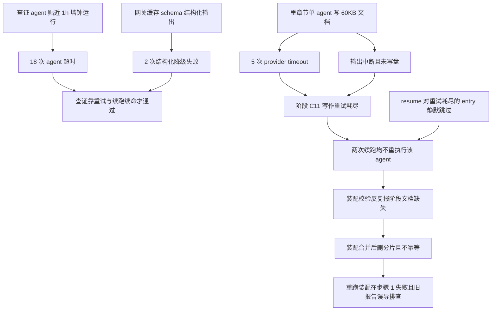

# output-spec-generate 演进报告 v2：首跑复盘与分片写盘优化

> 复盘范围：run-mwep59gd-1（首跑 + 3 次 resume 续跑）+ 3 次独立修复执行（fix-st-c11-doc v1/v2/v3）。
> 本报告覆盖 v2（产出分片写盘）与 v3（查证墙钟加固）两版机制改动；产物内容与 v1 终态同源（同一批查证 evidence），故无多版产物对比评审，评审方式为机制验证 + 机械校验复算。
> 数据口径：journal executions[] 只记失败 attempt（观测为下限）；entry 顶层 = 最后成功 attempt；数字全部由分析脚本复算（temp 目录 os-analysis.mjs，源数据 journal/run-mwep59gd-1.json）。

## 1. 执行元数据

| 版本 | runId | 耗时 | token | 轮次 | 流程结果 |
|------|-------|------|-------|------|---------|
| v1 首跑+续跑 | run-mwep59gd-1 | 子流程跨度：扫描 77.6s / 查证 12635.3s / 产出 10525.0s（UTC 08:10~14:37，合计约 6.5h） | 480380 in / 142553 out（journal 顶层口径，不含失败 attempt 损耗） | 首跑失败 + 3 次续跑 | 首跑失败（查证 ST-C03 结果无效）→ 续跑 1/2 失败（ST-C11 文档缺失）→ 手工修复后放行 |
| v1 修复执行 | run-mwf325bz（v1 单跑）/ run-mwf3k0na（v2 分片）/ run-mwf40sdo（v3 补片） | 631s（单跑失败）+ 1600s（分片三跑）+ 815s（补片 3） | ≈78K（快照口径） | 3 次修复 | ST-C11 文档 100907B 落盘 + 机械校验放行 |
| v2/v3 改动版 | 未执行（机制落地；v2 分片机制已由修复执行验证） | - | - | - | 待下次真实运行 |

## 2. 执行过程全景（时间线）

| 时刻（UTC） | 事件 |
|-------------|------|
| 08:10:07 | 子流程 1 扫描启动（2 个 agent，77.6s 完成，无失败） |
| 08:11:25 | 子流程 2 查证 15 agent 并行启动（并发 16） |
| 09:11 前后 | 14 个查证 agent 撞 1h 墙钟超时（第一波 attempt 失败），自动重试 |
| 10:13 前后 | 第二波超时/降级失败；ST-C03 三次尝试均无有效结果，首跑失败终止 |
| （续跑 1） | ST-C03 查证重跑成功；15 阶段查证全部通过（含此前两波失败者） |
| 11:42:00 | 子流程 3 产出编写 48 任务并行启动 |
| 12:13~14:37 | 大部分任务成功；规格文档 ST-C05（重试后成功）/ST-C11（重试耗尽失败）异常；ST-C15 一次 provider_timeout 后重试成功 |
| （续跑 2/3） | ST-C05 补写成功；ST-C11 被 resume 静默跳过，装配校验反复报文档缺失 |
| 修复 v1~v3 | 单跑 ST-C11 失败（输出中断）→ 分片三跑（片 3 中断）→ 补片 3 成功 + 合并 + 装配放行 |

## 3. 问题执行清单（27 次失败 attempt，观测下限）

| 失败类型 | 次数 | 集中位置 | 说明 |
|----------|------|----------|------|
| agent 超时（1h 墙钟） | 18 | 查证阶段（15 个 agent 中 14 个至少一次） | 查证成功 attempt 平均 2397.8s / 最大 3355.2s，原 3600s 墙钟裕度仅 1.07x，超时是常态而非异常 |
| 结构化降级失败 | 2 | 查证 ST-C03 / ST-C05 | 网关缓存 schema 输出 format unsupported (cached)（与 game-prd-check 阶段 3 同款外部网关问题） |
| provider_timeout（上游过载） | 5 | 规格文档 ST-C05×2 / ST-C11×2 / ST-C15×1 | 全部落在原子项最多的三个重章节（56/31/59），单会话写 60KB 级文档超出上游承载 |
| 输出中断（outputTokens=0） | 2 | 修复 v1 单跑 / 修复 v2 分片 3 | agent status ok 但输出流中断；单跑那次 10.5 分钟全在脑内整理（session 1484 行无一次 write 调用） |

最终失败任务 3 个：规格文档 ST-C11（主 run 重试耗尽，经分片修复补齐）、修复 v1 单跑、修复 v2 分片 3（后两者经重试/单独补跑成功）。另有两类流程级问题（非 agent 失败）：resume 对重试耗尽 entry 静默跳过（两次续跑不重执行 ST-C11）；装配步骤 1 合并后删分片不幂等（重跑装配必 fail-fast 且旧 verify-report 误导排查）。

## 4. 耗时统计

### 4.1 任务耗时 Top 12（全部 attempt 累计，含失败重试损耗）

| # | 任务 | attempt | 总耗时 | 其中成功 attempt |
|---|------|---------|--------|------------------|
| 1 | 查证 ST-C03 发牌 | 3 | 10466.3s | 3324.7s |
| 2 | 查证 ST-C14 番型 | 3 | 10031.3s | 2823.0s |
| 3 | 查证 ST-C15 结算 | 3 | 8931.6s | 1728.3s |
| 4 | 查证 ST-C07 自摸、放铳、抢杠胡 | 3 | 8845.6s | 1644.0s |
| 5 | 查证 ST-C05 吃、碰、杠 | 3 | 8840.9s | 1720.5s |
| 6 | 查证 ST-C11 出牌与响应 | 3 | 8716.2s | 1514.1s |
| 7 | 查证 ST-C10 吃碰禁手 | 2 | 7065.7s | 3460.0s |
| 8 | 查证 ST-C02 财神与牌组 | 2 | 6955.3s | 3355.2s |
| 9 | 查证 ST-C08 飘财 | 2 | 6875.1s | 3270.6s |
| 10 | 查证 ST-C04 操作优先级 | 2 | 6493.2s | 2891.9s |
| 11 | 规格文档 ST-C05 | 3 | 5773.9s | 1318.2s |
| 12 | 规格文档 ST-C11 | 2 | 5228.2s | 无（重试耗尽） |

### 4.2 按任务类别（主 run + 续跑）

| 类别 | 数量 | 成功 | 失败 attempt | 全 attempt 总耗时 | 成功 attempt 平均 |
|------|------|------|-------------|--------------------|-------------------|
| 查证 | 15 | 15 | 20 | 107871.0s | 2397.8s |
| 规格文档 | 15 | 14 | 5 | 22572.5s | 780.4s |
| 补充版 | 15 | 15 | 0 | 11876.1s | 791.7s |
| 索引片段 | 15 | 15 | 0 | 3152.9s | 210.2s |
| 复制 | 2 | 2 | 0 | 554.9s | 277.5s |
| 扫描 | 2 | 2 | 0 | 77.6s | 38.8s |
| 构建配置 | 1 | 1 | 0 | 36.6s | 36.6s |

**结论**：耗时黑洞是查证阶段——跨度 12635s（占总时长 55%），失败 attempt 占全部 27 次中的 20 次；重试损耗惊人（查证全 attempt 107871s 中失败 attempt 占约 71713s，损耗 66%）。其次是产出阶段的规格文档（重章节单会话承载问题）。

## 5. 根因分析

根因分层：

1. **容量类（可归因，v2/v3 修复）**：查证墙钟裕度 1.07x（超时常态）+ 重文档单会话输出超上游承载（provider_timeout/输出中断）。查证 agent 为 explore 只读 + schema 输出 45KB 级 JSON，deepseek-flash 单次跑满 55~60 分钟属正常负载，3600s 墙钟设计过紧。
2. **机制类（可归因，v2 修复）**：产出阶段无落盘闸门，agent 失败/被跳过的问题推迟到子流程 4 装配校验才暴露；模型自发「先全量脑内整理再写盘」行为放大单次响应长度，无 prompt 约束。
3. **runtime 类（脚本层无法根治，已缓解）**：resumeFromRunId 对重试耗尽 entry 静默跳过不重执行——workflow 插件层缺陷，脚本层只能靠当阶段闸门提前拦截。
4. **外部类（不修，缓解）**：网关缓存 format unsupported (cached)（结构化降级失败），与 game-prd-check 阶段 3 同款，根治在网关侧。

## 6. 本版修复验证

### v2 主题：产出分片写盘 + 落盘闸门（已验证，生效）

| # | 改动 | 位置 | 修复的问题 | 验证结论与证据 |
|---|------|------|-----------|----------------|
| 1 | 原子项 >24 的阶段按功能点贪心分组分片编写（单片直写原路径，多片写 runtime/state/doc-parts 后由 merge-stage-doc-parts.mjs 合并） | 3-produce-outputs.js | 重章节单会话写 60KB 文档连续失败 | 生效。分片机制以修复脚本形态真实执行验证：ST-C11（56 原子项）拆 3 片，4/5 片一次落盘成功、1 片重试一次成功，合并产物 100907B 通过机械校验放行 |
| 2 | 全部 15 阶段落盘闸门：分片阶段先 check 每片存在、合并后 check 阶段文档存在；单片阶段直写后 check | 3-produce-outputs.js | agent 返回但未写盘/被 resume 静默跳过时，问题推迟到装配才暴露 | 生效（机制）。splitDocParts 真实 15 阶段数据 15/15 断言通过（功能点守恒、单片边界、每组 ≤24 原子项）；wf-syntax-check 通过 |
| 3 | 写作 prompt 硬性规则 6 强化：直接逐个功能点边写边落盘，禁止先全量脑内整理再写盘；not_found 且 clientLogic 非空时如实保留 | 3-produce-outputs.js | 模型脑内整理 10.5 分钟输出流中断（outputTokens=0） | 生效。同款规则在修复 v2/v3 分片执行中验证（4/5 片首次成功，对比 v1 单跑 0/1） |
| 4 | 规格文档 agent retries 1 → 2 | 3-produce-outputs.js | provider_timeout 重试耗尽（首跑 ST-C11 两次失败即耗尽） | 生效（机制）。修复执行中 1 片输出中断经重试成功 |
| 5 | 新增 merge-stage-doc-parts.mjs（可导入 + CLI 守卫：分片枚举/序号连续/片数校验/U+FFFD 拒绝/合并后删分片 md） | .opencode-workflows/scripts/ | 修复期间临时合并脚本不入库、不可复用 | 生效。example 自检 20/20 通过（合并/缺片/乱码/序号/片数/无关文件/深目录/乱序 10 类场景） |

### v3 主题：查证墙钟加固（机制落地，效果待观察）

| # | 改动 | 位置 | 修复的问题 | 验证结论 |
|---|------|------|-----------|----------|
| 1 | 查证 timeoutMs 3600000 → 7200000 | 2-verify-stages.js | 18 次 1h 墙钟超时（成功 attempt 平均 2398s，裕度仅 1.07x） | 机制落地（2x 裕度）；效果待下次真实执行回填，不冒充已验证 |
| 2 | 查证 retries 1 → 2 | 2-verify-stages.js | 结构化降级失败（网关缓存）与偶发超时重试裕度不足 | 同上 |

## 7. 遗留问题清单

见 `dev-docs/progress-result/output-spec-generate-遗留问题清单.md`（L1~L6）。要点：L2（build-output-spec.mjs 步骤 1 删分片不幂等，续跑必失败）为下版优先修复项；L3 效果待观察；L4（splitDocParts 尾片碎片，ST-C12 拆成 24+2）接受现状；L5（网关缓存）与 L6（journal 观测口径）不修。

## 8. 元结论

- **机制修复（可归因）**：v2 分片写盘 + 落盘闸门 + 边写边落盘约束 + retries 2——修复手法已在真实执行中验证（分片 5 次执行 4 次首次成功、单次失败重试即成功，对比 v1 单会话 3 连败）；v3 查证墙钟 2x 裕度属参数级机制改动，待观察。
- **内容波动（随机，不归因）**：产物内容（15 阶段文档/349 原子项/verdict 分布）与首跑终态同源等价，本次改动不触碰内容层。

## 9. 下一步建议（优先级排序）

1. **v4 修 L2**：build-output-spec.mjs 步骤 1 幂等化（分片全缺且终产物存在时跳过合并），example 补幂等场景——否则任何一次装配成功后的续跑/重跑都会在步骤 1 假失败。
2. **真实执行回填 v3 效果**：下次运行观察查证阶段失败 attempt 数（对比本次 20 次）与总耗时变化；若 7200s 仍不够，评估查证分两步（先拆原子轻输出、再逐功能点查证）。
3. **opencode 插件层反馈 L1**：resume 对重试耗尽 entry 不重执行属 workflow 插件缺陷，建议向上游反馈（脚本层已用当阶段闸门缓解）。
4. **可选 v5**：splitDocParts 分组均衡化（消除 ST-C12 型 24+2 尾片碎片），视 v3 真实执行的成本数据决定。

## 10. 引用说明

- 脚本备份：`.opencode-workflows/workflows/output-spec-generate/3-produce-outputs.v1-org-20261113.js`、`2-verify-stages.v1-org-20261113.js`
- 新工作版：`3-produce-outputs.js`（v2）、`2-verify-stages.js`（v3）、`.opencode-workflows/scripts/merge-stage-doc-parts.mjs`（+ example）
- 产物快照：`spec-workflow/output-spec/quality-compare/v2/`（分片产物 ST-C11 文档 + verify-report + 分片 json）
- runId：run-mwep59gd-1（主 run+续跑）、run-mwf325bz、run-mwf3k0na（runs 记录已滚动清理，数据见本报告快照）、run-mwf40sdo
- 关联经验：`dev-docs/experience/outputspec续跑不重执行重试耗尽agent.md`、`outputspec大文档agent输出中断分片写盘.md`、`workflow-resume-and-report-merge.md`（坑 2 复现更新）
- 档案：`output-spec-generate-优化台账.md` / `优化指标对比.md` / `遗留问题清单.md`（同目录）
