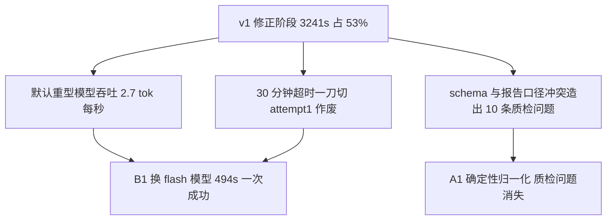

# ui-interaction-prd-extract 演进报告 v2（FX 修正闭环提速）

- 版本：v2（备份：ui-interaction-prd-extract.v2-FX-20261113.js）
- 主题：A1 MISSING 原文栏确定性归一化 + B1/B4 修正 agent 换 flash 模型与 1h 超时
- 依据：dev-docs/design/2026-11-13-ui-prd-check修正报告耗时分析与优化方案.md（落地清单第 1 项）

## 1. 执行元数据

| 版本 | runId | 耗时s | token | 轮次 | 结果 | 自评 |
|---|---|---|---|---|---|---|
| v1 | run-mwee0k70-1 | 6098.5 | 248703 | 1 | passed | RED |
| v2 | run-mwekpt2y-2 | 4151.9 | 204078 | 1 | passed | Y |

多维评审（runId run-mwenfqqo，4 agent，631.2s，25998 tok，单列不与执行 run 混算）。

## 2. 评审总排名（4 维并行评审）

| 维度 | 类型 | 第 1 名 | 关键证据 |
|---|---|---|---|
| 结构合规 | 机制 | v2 | v2 MISSING 原文栏 21/21 规范、矩阵 77=77=77 对账、无乱码；v1 28 块 MISSING 中 18 块不规范（v1/report.md:119、923、959 伪引文）+ 第 996 行 U+FFFD×2 字节级证实 |
| 基准依据质量 | 机制 | v2 | v2 全量 77 条条款号真实存在且为 NN#M 格式；v1 有 9 个虚构条款号 + 6 处表行名引用（06#-xxx）+ 凑数引用（Q36 引 01#18 支撑过按钮拦截） |
| 问题条目内容 | 内容 | v2 | v2 引文逐字命中 + REQ 锚点 + 净增 5 条且新检出约 10 条真实问题（飘分颜色矛盾/换座/摊牌推倒）；v1 漏检这些 |
| 去重与归类 | 内容 | v2 | v1 出现实错归并（Q26 长考提醒层与 Q10 超时体系错误同根因，05#17 vs 05#12 是不同缺陷）+ 主从指认自相矛盾（Q05/Q71）；v2 归并准确、总结给出 8 对合并清单 |

奖牌：v2 金 4，v1 金 0。

## 3. 本版修复验证

| 改动 | 结论 | 复算证据 |
|---|---|---|
| A1 MISSING 原文栏确定性归一化 | 生效 | v2 21/21 MISSING 块原文栏均为「位置"…"。需求文档无对应描述。」（v1 修正后仅 10/28 合规）；agent 自述并入 problem 字段未丢失（内容维度抽查确认） |
| B1 修正 agent 显式 flash 模型 | 生效 | runs 记录：修正报告 model=deepseek-v4.1-flash-official（v1 为默认重型模型）；494s 完成 attempt 1（v1 attempt 2 1441s） |
| B4 超时 30min→1h | 生效 | timeoutMs=3600000，超时作废 0 次（v1 作废 1 次白烧 1800s） |
| 修正阶段总耗时（组合效果） | 生效 | 3241s → 494s（-84.7%，占全程比 53% → 12%） |

附加收益（非本版机制、行为波动）：v2 修正 agent 主动修复了越界条款号 9 处、表行名引用 9 处、回补 REQ 需求点关联 56 条——v1 同样约束下默认模型拒绝修改。确定性保证仍需 v3 闸门。

## 4. 根因分析

- v1→v2 耗时下降分解（时间线复算）：修正阶段 -2747s（3241→494）为主要贡献；其余阶段在 ±10% 内波动（检查 940→1191s、一致性 1151→1321s、去重 737→38s、分片最长 562→854s）——机制改动归因清晰，不受内容波动污染。
- v2 新引入缺陷根因：A1 的 problemText 拼接 `(it.problem || '') + '。缺失说明：' + quoteNote` 未处理 problem 已以句号结尾的情况，产生 6 处「。。缺失说明：」（v2/report.md:150、151、162、163、402、403，涉及 Q03/Q04/Q24）。属 A1 实现缺陷，v3 顺带修复（一行：拼接前去掉 problem 尾部句号）。

## 5. 遗留问题清单（本版时点）

| ID | 严重度 | 状态变化 | 说明 |
|---|---|---|---|
| L1 幻觉条款号残留 | 高 | 报告层面已消除（修正 agent 行为波动修复）→ 机制层面仍无保证，待 v3 闸门 | v2 报告确定性复算 0 个非法条款号 |
| L2 U+FFFD 乱码 | 高 | 报告层面已消除（v2 FFFD=0）→ 修正后无复检的机制缺口待 v3 A4 | — |
| L3 MISSING 原文规范 | 中 | 已修（v2，A1 机制保证 21/21） | — |
| L4 修正 agent 模型与超时 | 高 | 已修（v2，B1/B4） | — |
| L5 修正 prompt 禁改 ruleRef 矛盾 | 中 | 部分缓解（flash 修正 agent 实际会修）→ 待 v3 把修正责任移到确定性闸门 | — |
| L6 reviewOk 语义误导 | 低 | 未修，待 v3（return 拆分拦截明细） | — |
| L7 检查阶段 REQ 需求点关联 0%（新增） | 高 | 未修 | schema 有字段但检查 agent 不填；v2 由修正 agent 事后回补（141 个 REQ id 全部真实），机制上靠修正兜底而非源头产出。后续版本强化检查 prompt/schema 或确定性回补 |
| L8 A1 拼接瑕疵 6 处（新增，v2 引入） | 低 | 待 v3 顺带修复 | 「。。缺失说明：」双句号 |
| L9 内容漏报波动（新增） | 中 | 不修（内容波动，不归因机制） | v2 丢失 v1 已确认的 3 条真实问题（v1 Q27 界面清理顺序/Q46 庄家 13 张时序歧义/Q66 局间准备态），同时新增约 10 条 v1 未覆盖问题；见 playbook 坑 3（机制/内容解耦），内容完整性闸门是独立课题 |
| L10 v1 错误同根因归并（新增） | 低 | 不修（v1 产物已退役） | v1 Q26/Q10 错误合并、Q05/Q71 主从矛盾，随 v1 报告退役不再影响交付 |

## 6. 元结论

- 机制修复生效项（可归因）：修正阶段耗时 -84.7%、超时作废 0、MISSING 原文规范率 10/28 → 21/21、乱码 0、质检问题中「原文栏格式」类消失。
- 内容波动项（不归因）：问题总数 72→77、P1 14→20、CONFLICT 3→8、检出问题集合两版各有增删（v2 +10/-3）、去重质量两版表现不同——检查 agent 内容取舍的随机性，机制改动不背锅也不邀功。

## 7. 下一步建议（v3 设计输入）

1. ruleRef 确定性闸门（A2 validate-rulerefs.mjs 逐条校验 + A3 定向修正 + A4 修正后复检 + C schema 硬约束）——把 v2 靠修正 agent 行为波动达成的「0 非法条款号」变成机制保证。
2. 顺带修 A1 拼接双句号（L8）。
3. L7（REQ 关联源头产出）列为 v4 候选，v3 不混主题。

## 8. 引用说明

- v2 工作版：.opencode-workflows/workflows/ui-interaction-prd-extract.js（备份 ui-interaction-prd-extract.v2-FX-20261113.js）
- 执行记录：.opencode-workflows/runs/run-mwekpt2y-2.json（修正 agent model/timeout/duration 复算来源）
- 评审 run：run-mwenfqqo（4 维并行评审）
- 产物快照：examples/ui-interaction-prd-extract-workflow/quality-compare/v1/、v2/
- 耗时分析（v1 基线）：dev-docs/design/2026-11-13-ui-prd-check修正报告耗时分析与优化方案.md
