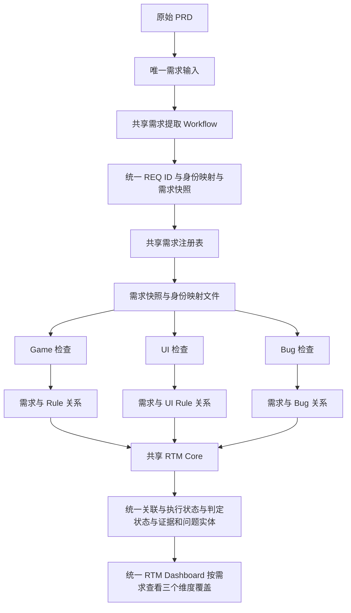

# v4 多检查器架构收敛需求：共享需求接入与 Bug 判定修复

- 日期：2026-11-12
- 来源：用户交叉核对结论（最新代码、提交记录、Workflow 执行日志与实际生成报告四方核对）
- 评估基线：main 分支 HEAD（2026-11-12）
- 核心结论：v4 多检查器架构已进入代码实现阶段但未全部完成；最大缺口是三个 Checker 尚未统一消费共享需求快照，尚未形成统一的需求 × Rule × Bug RTM 数据层

> 注意：提交说明只能说明变更意图，完成状态以当前代码和实际产物为准。

## 一、当前代码提交情况

| 提交 | 主要内容 |
|------|----------|
| 76dca32 | 新增共享 RTM 增量改造计划 |
| 8593455 | 后续实现提交，涉及共享需求提取基础设施 |
| e52f131 | 入库完整 RTM 运行快照 |
| 28f4be4 | 入库 Bug 数据、Workflow 运行记录和 Dashboard 产物 |
| d09d7b4 | 中间实现提交 |
| ad60ee5 | 问题清单新增问题性质列 |

## 二、四个 Workflow 的实现状态

### 1. prd-requirements-extract（基础实现完成）

文件：`.opencode-workflows/workflows/prd-requirements-extract.js`

已实现：

- 扫描 PRD 文档，拆分成原子需求
- 每个源文件独立提取，构建 requirements.json
- 生成源文件 SHA256 清单
- 引文与源文件一致性校验
- 生成提取快照 manifest
- 持久化 identity-map.json

需求 ID 采用三层匹配：

| 匹配方式 | 处理 |
|----------|------|
| exact-match | 原文哈希匹配，复用 ID |
| anchor-match | 来源锚点与相似度匹配 |
| 新需求 | 分配新 ID |

不确定的匹配进入 pending-confirm，不会自动合并。

这部分已经不是单纯的设计文档，而是有独立 Workflow 和 requirements-build.mjs 实现。

### 2. game-prd-check（原有 RTM 已实现）

文件：`.opencode-workflows/workflows/game-prd-check.js`

已实现：需求原子化、Rule 原子化、规则分组检查、分片结果落盘、RTM 组装、稳定 ID、证据校验、需求与 Rule 映射、双指标统计、Dashboard 展示。

**但仍然在自己的 Workflow 中执行需求提取，没有真正改成消费共享提取 Workflow 的产物。**

### 3. ui-interaction-prd-extract（独立检查已实现，共享接入未完成）

文件：`.opencode-workflows/workflows/ui-interaction-prd-extract.js`

已实现：UI 基准读取、客户端代码与 FGUI 逆向基准的独立准备流程、UI 规则分组检查、需求内部一致性检查、问题归并、报告生成与 Dashboard。

**但当前仍然自行扫描 PRD，未接入 prd-requirements-extract。**

### 4. bug-coverage-check（独立检查已实现，仍是旧架构）

文件：`.opencode-workflows/workflows/bug-coverage-check.js`

已实现：历史 Bug 扫描、按模块分组、分批并行审核、PASS / PARTIAL / MISSING / NOT_APPLICABLE / INSUFFICIENT 判定、缺口去重、报告生成、复用 Dashboard 生成器。

**但目前仍然自己读取 PRD，没有消费共享需求快照，也没有生成正式的 bug-catalog.json 和 Bug-REQ 关系表。**

## 三、共享 RTM Core：实际完成情况

这是目前架构上最大的差距。

| 目标能力 | 当前状态 | 说明 |
|----------|----------|------|
| 共享需求提取 | 已实现基础版 | 有独立 Workflow |
| 稳定 REQ-ID | 已实现基础版 | 有三层匹配机制 |
| identity-map 持久化 | 已实现 | requirements-build 单写者 |
| 共享 Schema | 未完成 | 尚未形成统一 RTM Core 契约 |
| requirements-build | 已实现 | 有独立脚本 |
| validate-rtm | 未发现 | 当前未发现该独立脚本 |
| game Checker 消费共享快照 | 未完成 | 仍自行提取 |
| UI Checker 消费共享快照 | 未完成 | 仍自行扫描 PRD |
| Bug Checker 消费共享快照 | 未完成 | 仍自行扫描 PRD |
| 通用 RTM 组装器 | 部分完成 | rtm-assemble.mjs 主要服务于需求 × Rule |
| Bug Catalog | 未发现 | 尚无正式独立资产 |
| Bug-REQ 多对多关系 | 未完成 | 没有正式关系表 |
| 统一 RTM 汇总 | 未完成 | 目前还是各自报告 |

特别注意：

现在虽然有 requirements-build.mjs 和 rtm-assemble.mjs，但它们不是同一个东西：

- **requirements-build.mjs**：负责共享需求快照及需求身份
- **rtm-assemble.mjs**：负责现有游戏需求与 Rule 的矩阵组装

**不能因为这两个脚本已经存在，就认为共享 RTM Core 已经完成。**

## 四、Bug Checker：两个 P0 问题仍然存在

已直接核对最新 bug-coverage-check.js 源码，两个原问题均未修复。

### P0-1：执行失败与判定结果没有分离

当前代码第 374 行附近：

```js
// 兜底补齐：扫描到但审核未返回的缺陷按信息不足登记
const seenIds = {}
for (const v of verdicts) seenIds[String(v.bugId)] = true

for (const b of allBugs) {
  if (seenIds[String(b.bugId)]) continue

  verdicts.push({
    bugId: b.bugId,
    scope: '无法判断',
    verdict: 'INSUFFICIENT',
    reason: '审核未返回该条判定，按信息不足登记',
  })
}
```

问题有两个：

1. Agent 没有返回结果，却被自动登记为 INSUFFICIENT
2. 提示词规定 INSUFFICIENT 可以按 PASS 处理

这会导致没有真正完成检查的 Bug，也被纳入已判定结果。

正确设计应该是：

```json
{
  "bugId": "7141390397",
  "executionStatus": "failed",
  "verdict": null,
  "reason": "审核批次未返回结果"
}
```

**执行状态和业务判定必须分开。**

### P0-2：NOT_APPLICABLE 仍然等同 PASS

当前第 89 行：

```
'NOT_APPLICABLE：非好友房范围...相当于直接 pass。'
```

第 90 行：

```
'INSUFFICIENT：缺陷只有截图...只能按 PASS 处理...'
```

这两条规则都还在。需要修改成：

| 状态 | 正确含义 | 是否计入通过 |
|------|----------|--------------|
| PASS | PRD 明确覆盖 | 是 |
| PARTIAL | 部分覆盖 | 否 |
| MISSING | 完全缺失 | 否 |
| NOT_APPLICABLE | 检查范围不适用 | 否，单独统计 |
| INSUFFICIENT | 证据不足 | 否，待复核 |
| 执行失败 | 没有完成审核 | 不产生 verdict |

### 另外：批次 ID 校验也不完整

当前代码只是：

```js
for (const v of r.bugs) verdicts.push(v)
```

后续使用 seenIds 判断是否存在缺失 ID。但没有完整校验：

- 返回了不存在的 Bug ID
- 同一个 Bug ID 被重复返回
- 一个批次漏掉其他 Bug
- 一个批次返回了其他批次的 Bug
- 原始 Bug 总数与最终有效判定数是否一致

**之前提出的批次完整性校验，还没有实现。**

## 五、实际运行成果（这部分已经比较扎实）

虽然 Bug 架构还没有升级，但它已经实际执行过检查，不是空壳。

### 1. 历史 Bug 检查（卡五星）

| 指标 | 数量 |
|------|------|
| 扫描到的历史 Bug 总数 | 223 |
| PASS | 28 |
| PARTIAL | 23 |
| MISSING | 6 |
| NOT_APPLICABLE | 162 |
| INSUFFICIENT | 4 |
| 归并后的问题数 | 19 |

来源：`examples/bug-check-workflow/report.md`，检查日期 2026-11-11。

**重要区别**：223 条 Bug 的分类是旧 Workflow 的判定结果，不能直接视为 223 条均已通过可靠的执行完整性校验。

### 2. 游戏 RTM（当前最成熟的实现）

最新落盘快照：`examples/game-prd-check-workflow/rtm/runs/run-20261112/`

| 指标 | 数值 |
|------|------|
| 原子需求点 | 363 |
| 原子规则点 | 1,455 |
| 规则检查完成率 | 99.3%（980/987） |
| 规则完整通过率 | 44.3%（437/987） |

| 需求状态 | 数量 |
|----------|------|
| 完整通过 | 55 |
| 存在缺失 | 118 |
| 描述不完整 | 38 |
| 存在冲突 | 36 |
| 未验证 | 116 |

来源：RTM manifest.json。规则完整通过率采用 437/987 的口径；检查完成率采用 980/987 的口径。

**但它仍然只覆盖 Game Rule 维度，还没有将 UI 和 Bug 纳入同一个需求关系模型。**

### 3. 三个 Checker 的组合运行

`.opencode-workflows/runs/run-mwc4mskn-2.json` 中存在 full_check_suite 运行记录，已包含：

- PRD 功能规则检查
- Bug 覆盖检查
- UI 交互逆向与检查

PRD 和 Bug 阶段均有成功记录，UI 逆向也有多个成功批次。**但该运行快照整体状态仍是 running，有多个 UI 任务仍处于运行中。**

结论：已经开始组合调度三个检查维度，但不能据此认定整个组合运行已经完成。

## 六、对照 v4 架构：最终完成度

**v4 架构实施进度：约 45%**（按架构交付项进行的定性估算，不是仓库内的正式进度指标）。

| 阶段 | 状态 |
|------|------|
| T0：现有 RTM 基线保留与修复 | 基本完成 |
| T1：共享需求提取 Workflow | 基础实现完成 |
| T2：Game Checker 接入共享需求 | 未完成 |
| T3：UI Checker 接入共享需求 | 未完成 |
| T4：Bug Checker 接入共享需求 | 未完成 |
| T5：统一 RTM 合并报告 | 未完成 |

## 七、建议：不要推倒重做，而是完成这五件事

按以下顺序执行：

| 优先级 | 任务 | 具体内容 |
|--------|------|----------|
| P0 | 共享需求提取接入 | 三个 Checker 都支持 requirementsPath + extractionRunId |
| P0 | 修复 Bug 判定状态 | 执行状态与 verdict 分离，修复 N/A 和 INSUFFICIENT 口径 |
| P0 | Bug 完整性校验 | 校验缺失、重复、非法 Bug ID |
| P1 | 共享 RTM Core | 统一 Schema、身份索引、关系模型、Validator |
| P1 | Bug RTM | bug-catalog.json + Bug 与 REQ 多对多关系 |
| P2 | 统一汇总 | 同一个 REQ 查看 Game / UI / Bug 三个维度 |

## 八、重要架构决策：统一数据流

**不要让三个 Checker 各自维护一份需求事实。** 最终数据流固定为：



细节约束：

- UI 基准逆向和 Bug Catalog 构建仍然是各自独立的准备工作，**不应该强行合并进需求提取 Workflow**
- 每个维度（Game / UI / Bug）各自维护与 REQ 的关系表，统一汇入共享 RTM Core
- 共享 RTM Core 统一管理：关联、执行状态、判定状态、证据、问题实体

## 最终判断

现在已经完成了 v4 最重要的基础设施雏形，以及三个独立检查器的业务能力。下一阶段真正要做的是**架构收敛，而不是继续增加新的检查功能**。

执行顺序约束：

1. 先不要改 Dashboard，也不要重写三个 Checker
2. 先把 T2、T3、T4 的共享需求接入完成
3. 再设计 T5 的统一 RTM

这样可以最大程度保留目前已经跑通的 363 条需求、1,455 条规则和 223 条历史 Bug 的成果。

## 来源与引用

- GitHub 提交历史（main 分支，2026-11-12）
- `.opencode-workflows/workflows/prd-requirements-extract.js`
- `.opencode-workflows/workflows/game-prd-check.js`
- `.opencode-workflows/workflows/ui-interaction-prd-extract.js`
- `.opencode-workflows/workflows/bug-coverage-check.js`
- `examples/bug-check-workflow/report.md`（卡五星历史 Bug 检查报告，2026-11-11）
- `examples/game-prd-check-workflow/rtm/runs/run-20261112/manifest.json`（游戏 RTM 运行快照）
- `.opencode-workflows/runs/run-mwc4mskn-2.json`（full_check_suite 组合运行记录）
- `dev-docs/design/PrdGameSkill-9426d93-共享RTM增量改造计划.md`（v4 前置设计）
