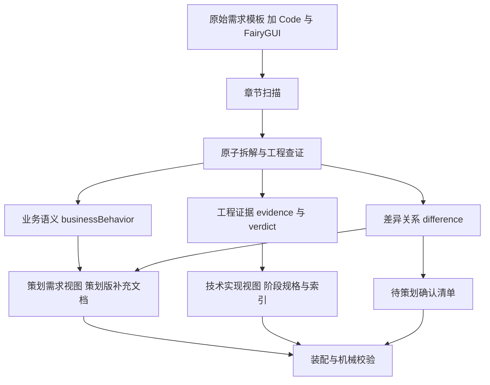

# output-spec-generate 策划需求视图与技术实现视图分离需求

- **日期**：2026-11-14
- **状态**：已确认，待执行（执行计划见 `dev-docs/planning/2026-11-14-outputspec策划视图分离执行计划.md`）
- **改造对象**：`.opencode-workflows/workflows/output-spec-generate/`（四子流程 workflow，不新增独立 Skill）
- **上游依据**：
  - `dev-docs/design/outputspec生成工作流计划.md`（workflow 原始设计）
  - `dev-docs/design/2026-11-13-outputspec工作流需求分析.md`
  - `dev-docs/progress-result/output-spec-generate-演进报告-v2.md`（首跑复盘）
  - 首跑产物：`spec-workflow/output-spec/2026-11-13/1-spec/`（15 阶段 / 90 功能点 / 349 原子项）与 `spec-workflow/output-spec/核心流程杭州麻将好友房AI-补充版本.md`（157KB）

---

## 1. 背景与定位

output-spec-generate workflow 当前做的事情**不是纯粹的「从代码反推 PRD」**，而是：

**已有策划需求模板 → 原子需求拆解 → 客户端代码与 FairyGUI 查证 → 补充实现细节 → 生成规格文档。**

首跑已交付的工程能力（15 个 Stage 并行查证、`confirmed / partial / not_found` 判定、原子项证据记录、超长文档分片写盘、确定性装配校验）经过一次真实全量运行验证，**全部保留，不推倒重来**。

本次改造解决的核心问题：**当前 Workflow 的任务定义本身要求 AI 把代码实现直接写入需求文档**——这不是模型偶然生成了过多代码细节，而是输出契约问题。

同时需要认识到方向性定位：这套工具已经不只是「生成客户端规格」，而是在建立**三者的可验证关系**：

1. 原始策划需求（模板原文）
2. 实际客户端实现（代码与 FairyGUI 证据）
3. 两者之间的关系（一致 / 部分一致 / 冲突 / 未验证）

三者分清之后，下游的 `game-prd-check`、`ui-interaction-prd-extract`、`bug-coverage-check` 才能共享同一组需求 ID（Atom ID），**不会把「代码存在」误判成「需求正确」**。

## 2. 现状架构

| 子流程 | 文件 | 现状 | 本次改造定位 |
|---|---|---|---|
| 章节扫描 | `1-scan-template.js` | 扫描模板 Stage 章节及行号范围 | 不修改 |
| 原子拆解与查证 | `2-verify-stages.js` | 并行拆解 Feature/Atom，Code+FairyGUI 查证 | 需要调整（补业务语义） |
| 产出编写 | `3-produce-outputs.js` | 阶段规格、索引片段、补充版分片 | **主要改造点** |
| 装配与校验 | `4-assemble-verify.js` + `build-output-spec.mjs` | 确定性合并、索引装配、机械校验 | 扩展校验 |
| 主编排 | `output-spec-generate.js` | 顺序调度四子流程、内存链式传参 | 增加 outputMode |

## 3. 问题定义

### 3.1 问题现象（首跑产物实测）

补充版文档 `核心流程杭州麻将好友房AI-补充版本.md`（157KB）中，**219 处**出现「客户端实现：」子列表项，正文大量出现：

- `客户端实现：GameJuDataCmd ...`
- `客户端实现：GameData.setZhuangSeat ...`
- `UI 交互：C_Bank ...`
- `source-code/client/Code/...:31` 形式的源码定位

即：**最终策划需求文档里充满了类名、方法名、协议名、文件路径**，策划无法直接阅读。

### 3.2 根因一：第三阶段的 Prompt 明确要求输出类与代码路径

`3-produce-outputs.js` 的 `supplementPartPrompt()` 中，原始规则要求：

```
'3. 在每条规则语句（列表项/段落）之后补充缩进两个空格的子列表项：',
'   - 有证据：写「  - 客户端实现：{要点}（{file:line}）」，UI 表现另起一条「  - UI 交互：{要点}」',
```

Workflow 直接将技术证据规定为 PRD 正文的一部分。**这是输出契约问题，不是模型能力问题。**

### 3.3 根因二：第二阶段混合了需求与技术实现，缺少业务语义层

`2-verify-stages.js` 的 `STAGE_EVIDENCE_SCHEMA` 原子项结构为：

```
rule / uiRequirement / verdict / clientLogic / uiInteraction / evidence / messages / notes
```

该数据模型本身没有错，但缺少一个关键字段：**`businessBehavior`** —— 将代码行为转换为不依赖具体实现的需求描述。当前从 `rule` 直接走向 `clientLogic` 和 `uiInteraction`，第三阶段再将这些内容写成正文，**根本没有经过「实现细节 → 业务语义」的抽象**。

此外，`verdict` 目前只表示「找到了直接实现证据」，**不能等同于「完整业务规则已得到确认」**。例如：客户端收到吃牌权限后显示按钮（verdict=confirmed），不代表它能证明服务端正确执行了所有吃牌优先级规则。

### 3.4 附加问题：需求与实现的差异被淹没

第三阶段要求「模板原文全部保留，在每条规则后插入客户端实现和 UI 交互」，说明当前产出的补充版本质上是**原始需求的证据增强视图**，不是重新生成的策划 PRD。

因此不能简单把所有代码相关行删掉，否则部分实际发现的客户端行为差异也会消失。典型例子（财神表现）：

- **原始需求**：打出的财神按普通白板展示。
- **实际客户端行为**：牌河中打出的白板财神仍有高亮颜色。
- **差异结论**：需求与实现表现不一致，需要策划确认。

既不能强行把代码行为改写为新需求，也不能为了保留原文而忽略实际差异。需要一个独立字段记录需求与实现的关系。

## 4. 改造目标

**第二阶段保留技术查证并补充业务语义，第三阶段按文档用途进行投影**，而不是把所有数据平铺到一个 Markdown 里。

### 4.1 改造后数据流



### 4.2 三个输出视图

| 输出 | 用途 | 内容边界 |
|---|---|---|
| 策划版补充文档（**新增**） | 策划阅读、评审、确认 | 只写功能规则、玩家可见界面行为、待确认问题；不含类名/方法名/文件路径 |
| 客户端阶段规格（保留） | 客户端开发实现依据 | 保留现有详细技术规格（`spec_stage_*.md`） |
| 工程追溯证据（保留） | 经 Atom ID 查回代码位置与 XML | `feature_index.json` + 阶段规格中的证据字段 |

现有「补充版本」（模板原文 + 客户端实现/UI 交互子项）**保留不动**，定位为「证据增强视图」；策划版是**新增**的第四类产物。

## 5. 需求清单

| 编号 | 需求 | 优先级 | 验收标准 |
|---|---|---|---|
| R1 | 策划版补充文档生成：按 Stage 章节分片编写，合并成完整策划版文档 | P0 | 文档按模板章节结构组织；原文规则语义完整保留；每条规则后附业务化 UI 行为与业务化结果描述 |
| R2 | 策划版无技术泄漏：正文不出现类名、方法名、协议消息名、文件路径、file:line | P0 | 机械正则校验通过（泄漏清单为空），可经 Atom ID 追溯但不内联展示 |
| R3 | 策划版保留真实 UI 行为与实现差异：`uiInteraction` 中有价值的玩家可见行为以业务语言保留；实现与需求不一致处列为「待策划确认」条目 | P0 | 抽查定庄/吃牌/财神表现三章节：白板财神高亮这类差异以「需求原文 vs 实际表现 vs 待确认」形式呈现，既不删原文也不改写规则 |
| R4 | 原子项 Schema 增加 `businessBehavior`（trigger/condition/action/result 业务语义四元组） | P0 | 查证 agent 按新 Schema 返回；校验容忍缺省（兼容旧数据） |
| R5 | 原子项 Schema 增加 `difference`（consistent/partial/conflict/unverified + detail），与 `verdict` 语义分离 | P1 | `verdict` 回答「是否发现客户端实现证据」；`difference` 回答「实际实现是否符合策划需求」；两者独立统计 |
| R6 | 机械校验扩展：策划版技术泄漏检查 + difference 覆盖统计进 verify-report | P1 | `verify-output-spec.mjs` 输出新检查项；泄漏非零时 fail |
| R7 | 主编排增加 `outputMode`，默认兼容旧行为 | P1 | `all`（默认，全产物）/ `planner-only`（复用现有查证结果只补策划版）/ `legacy`（不生成策划版） |
| R8 | 局部验证先行：全量重跑前，用首跑已生成的 `feature_index.json` 对定庄（ST-C01）、吃牌（ST-C05）、财神表现（ST-C02）做第三阶段 Prompt 对照实验 | P0（前置） | 三个检查点通过（见 7.1）后才进入 Schema 正式调整与全量重跑 |

## 6. 数据结构设计（新增字段，非仓库现状）

```json
{
  "id": "AT-ST-C05-001",
  "rule": "吃牌只能吃上家打出的牌",
  "businessBehavior": {
    "trigger": "上家打出可组成顺子的牌",
    "condition": "玩家手中存在合法吃牌组合",
    "action": "玩家可选择吃牌",
    "result": "吃牌成功后展示吃牌组合并进入出牌阶段"
  },
  "uiInteraction": "显示吃、过按钮；多个组合时弹出选择界面",
  "clientLogic": "原有代码实现摘要",
  "evidence": [],
  "difference": "consistent",
  "differenceDetail": "",
  "verification": {
    "clientObserved": true,
    "businessRuleVerified": false,
    "unverifiedReason": "缺少服务端吃牌资格判定证据"
  }
}
```

设计要点：

1. **`verdict` 与 `difference` 不混用**：
   - `verdict`（confirmed/partial/not_found）：是否发现客户端实现证据。
   - `difference`（consistent/partial/conflict/unverified）：实际实现是否符合策划需求。
2. **`verification.clientObserved` 可由 `verdict != not_found` 派生**，落地时由脚本填充派生值，减少 agent 输出负担（执行时允许简化，见执行计划 T2）。
3. **`businessRuleVerified` 只在 difference=consistent 且证据覆盖完整业务规则时为 true**；典型反例：客户端显示吃牌按钮 confirmed，但服务端吃牌优先级规则不可由客户端代码证实。
4. **自洽规则**：`verdict=not_found` 时 `difference` 强制为 `unverified`；`difference=conflict` 时必须携带证据且 detail 非空。

## 7. 局部验证方案（R8，全量改造的前置闸门）

利用首跑已生成的 `feature_index.json`（15 阶段/90 功能点/349 原子项，高成本查证结果），针对**定庄（ST-C01）、吃牌（ST-C05）、财神表现（ST-C02）** 三个功能做第三阶段 Prompt 对照测试。不重跑第二阶段。

### 7.1 三个验收检查点

1. **无技术泄漏**：输出没有代码类名、字段名、文件路径。
2. **信息不丢失**：仍然保留真正有价值的 UI 行为描述与实现差异（如白板财神高亮）。
3. **可追溯**：能通过 Atom ID 追溯到原有代码证据，不丢失任何信息。

三个检查点全部通过后，才进行第二阶段 Schema 的正式调整与全量重跑。

## 8. 约束与非目标

- **非目标**：不新增独立 `game-prd-reverse` Skill；不重构调度器；不修改 `1-scan-template.js`；不改变四子流程拆分与并发结构。
- **保留约束**：现有补充版本、阶段规格、feature_index、stage_manifest 产物形态全部兼容；首跑产物只读，不被新版本覆盖（策划版走独立文件路径）。
- **执行约束**：第二阶段查证成本极高（首跑 15 个 agent 中 14 个至少一次撞 1h 墙钟，后加固到 2h），改造期间禁止无谓全量重跑；实验与全量重跑均由用户手动触发。
- **模型契约**：中文书写、无 Emoji、确定性装配优先于 LLM 转述（沿用现有 workflow 既定原则）。

## 9. 与下游消费方的关系

本改造完成后，`game-prd-check`、`ui-interaction-prd-extract`、`bug-coverage-check` 可以共享同一组 Atom ID：

- 策划版文档：供 `game-prd-check` 做需求侧检查基准（纯业务语言，不再被代码细节污染判定）。
- 差异清单（difference=conflict/partial）：直接生成「待策划确认」工单，供 bug-coverage-check 区分「需求缺陷」与「实现偏差」。
- Atom ID 贯穿三视图：任何一条需求都能从策划文档 → 阶段规格 → 代码证据三方追溯。

## 10. 引用

- 问题分析与改造方案来源：2026-11-14 外部评审结论（本文档第 3~7 节为该结论的固化）
- `dev-docs/design/outputspec生成工作流计划.md`：workflow 原始设计
- `dev-docs/design/2026-11-13-outputspec工作流需求分析.md`：生成前需求分析
- `dev-docs/research/2026-11-13-v3-1spec-结构分析.md`：Stage/Feature/Atom 数据层级依据
- `dev-docs/experience/outputspec大文档agent输出中断分片写盘.md`：分片写盘机制依据
- `dev-docs/experience/outputspec续跑不重执行重试耗尽agent.md`：续跑与超时机制依据
- `dev-docs/progress-result/output-spec-generate-演进报告-v2.md`：首跑复盘数据（27 次失败 attempt、查证耗时占比）
