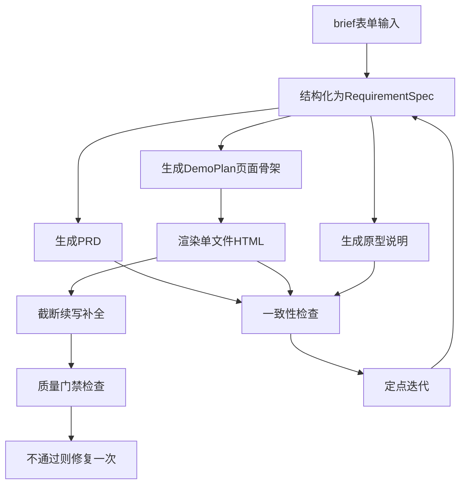

# 调研笔记：prd-pilot 参考项目研究

- 日期：2026-11-06
- 对象：`thirdparties/prd-pilot`（只读调研，未修改任何文件）
- 研究问题：Requirement Spec 数据结构 / 生成链路步骤 / 质量检查内容 / 定点修改的防破坏机制
- 关联项目：Interactive Game PRD（本仓库）

---

## 一、项目概况

### 1.1 定位

PRD Pilot 是一个面向产品经理的 AI 工作台，把模糊想法加工成：Requirement Spec（结构化需求）→ PRD（中文 Markdown）→ 单文件 HTML Demo + 原型说明 → 一致性报告 → 定点迭代方案。核心卖点是"一份共享 Requirement Spec 贯穿生成、校验、迭代"，避免 PRD 与 Demo 各写各的、越改越偏。

### 1.2 技术栈

| 层 | 技术 |
| --- | --- |
| 后端 | FastAPI 0.126 + Pydantic 2 + OpenAI 兼容客户端（默认 DeepSeek，支持 OpenAI/OpenRouter/智谱/硅基流动/Moonshot/Groq/DashScope/Ollama/自定义） |
| 前端 | Vue 3 + Vite + Element Plus + Tailwind，单文件 `App.vue`（927 行） |
| 集成 | FastMCP 薄适配层（stdio/sse/streamable-http），Claude Code skill |
| 测试 | pytest（含确定性 MockLLMService）+ Playwright 冒烟 |

### 1.3 规模

- 后端核心约 2800 行 Python：`llm_service.py` 1829 行（提示词 + 全部规则检查）、`use_cases.py` 266 行、`main.py` 306 行、`mock_llm_service.py` 328 行、`errors.py` 41 行。
- 前端约 1000 行，MCP 适配层 168 行。整体是小型项目，逻辑高度集中。
- API 版本 4.2.0，MIT 协议。

### 1.4 关键架构决策

1. **共享 use_cases 层**：`PRDPilotUseCases` 是唯一业务边界，Web API（`main.py`）、MCP（`mcp_service.py`）、测试三方复用同一套编排，保证行为一致。
2. **确定性 Mock**：环境变量 `PRD_PILOT_USE_MOCK_LLM=1` 时切换 `MockLLMService`，CI 与无 Key 环境可跑全链路测试，且 mock 可模拟超时/质量失败两种异常路径（`mock_llm_service.py`）。
3. **纯规则检查**：一致性检查与质量门禁全部是正则 + 归一化文本匹配，不调用 LLM（README "Current Scope" 明确声明）。
4. **结构化错误**：`WorkflowStageError`（`services/errors.py`）携带 `error_code / stage / retryable / detail`，前端可按阶段提示与重试。

---

## 二、固定问题清单

### 问题 1：Requirement Spec 的数据结构长什么样？

**结论：11 个固定键的扁平 JSON，3 个字符串 + 8 个字符串数组，配三重兜底保证 schema 永不破。**

（1）字段定义（`prd-pilot/backend/services/llm_service.py` 中 `STRUCTURED_KEYS`，`main.py` 中 `RequirementSpec` Pydantic 模型两侧一致）：

| 键 | 类型 | 含义 |
| --- | --- | --- |
| `product_name` | string | 产品名称 |
| `product_type` | string | 产品类型 |
| `target_users` | string[] | 目标用户 |
| `user_pain_points` | string[] | 用户痛点 |
| `core_scenarios` | string[] | 核心场景 |
| `key_features` | string[] | 关键功能 |
| `primary_pages` | string[] | 主要页面 |
| `user_flow` | string[] | 用户流程 |
| `style_preference` | string | 原型风格 |
| `constraints` | string[] | 约束条件 |
| `success_criteria` | string[] | 成功标准 |

（2）格式约束通过系统提示词表达（`REQUIREMENT_SPEC_SYSTEM_PROMPT`）：只返回 JSON、键固定、非字符串字段必须是字符串数组、"若输入不完整可合理推断，但不要输出空数组，至少给出 1 条具体内容"。

（3）三重兜底（这是该结构的精髓）：

1. **Seed 兜底**：`_build_requirement_seed()` 在调 LLM 前先用表单 brief 造一份合法 seed，随提示词一起发给模型作格式示例；LLM 失败时直接 `return self._normalize_spec(seed, seed)`，结构化阶段永不失败。
2. **Normalize 兜底**：`_normalize_spec(raw, seed)` 只认 `STRUCTURED_KEYS` 里的键，字符串字段 strip 后回填 seed 值，数组字段经 `_split_to_list()`（按换行/逗号/顿号切分、去重、去列表符号）后空则回填 seed 首项。
3. **Pydantic 校验**：API 入口的 `RequirementSpec` 模型给所有字段默认值，前端传参残缺也不报 422。

（4）示例：`prd-pilot/docs/examples/campus-secondhand-marketplace.md` 给出完整用例（校园二手交易平台），含 Spec 各字段的具体内容、PRD 要点与一次定点修改的反馈示例。

类比理解：这个 Spec 就像游戏项目的"角色属性表"——不管策划输入多零散，最终都归一到同一张表上；LLM 只负责"填表"，`_normalize_spec` 负责"查表"，缺项填默认值，所以下游（PRD/Demo/检查）永远拿到的表是完整的。

### 问题 2：生成链路分几步？

**结论：主链路 5 步（结构化 → PRD → Demo 三段式 → 原型说明），Demo 内部又分 4 个子阶段；迭代链路是"先改 Spec 再重生成对应产物"。**

主链路（编排见 `use_cases.py`，实现见 `llm_service.py`）：

1. **结构化** `structure_requirement`：brief 表单（16 个自由文本字段，`main.py` 的 `ProductBrief`）→ seed 兜底 → LLM 抽 JSON → normalize → Requirement Spec。
2. **生成 PRD** `generate_prd`：Spec → 固定 7 节中文 Markdown（产品名称 / 背景与目标 / 目标用户 / 核心场景 / 功能需求表[模块、需求描述、优先级、验证方式] / 业务流程[必须含 Mermaid] / Demo 验证点 / 风险与待确认项），提示词 `PRD_SYSTEM_PROMPT` 要求命名与 Spec 一致。
3. **生成 Demo** `generate_demo`，内部 4 子阶段：
   - `generate_demo_plan`：Spec + PRD + 风格指南 → JSON 页面骨架（`pages[]`含 name/purpose/key_modules/entry_actions/exit_actions、`main_flow`、`key_states`、`interaction_requirements`、`visual_direction`），独立超时 45s；
   - `_render_demo_html`：Spec + Plan + PRD → 单文件 HTML（内联 CSS/JS、禁 CDN、禁止死按钮），超时 90s；
   - `_complete_html_if_needed`：检测 `</body></html>` 缺失则取末尾 12000 字符让模型续写，最多 2 次，`_append_non_overlapping()` 做最大重叠检测避免重复拼接；仍不完整抛结构化错误；
   - `_finalize_demo_html`：跑质量门禁，不过则 `_repair_demo_html_once` 修复一次（只修报告指出的问题），再不过抛 `demo_quality_failed`（HTTP 422）。
4. **生成原型说明** `generate_prototype_outline`：Spec + PRD + Demo HTML + Plan → 4 节 Markdown（页面结构 / 关键模块 / 用户操作路径 / 验证目标）。
5. **一致性检查** `check_consistency`：Spec + PRD + Demo + 原型说明 → 规则化报告（见问题 3）。

迭代链路（`iterate_prd` / `iterate_demo`）：构造结构化 `change_request` → `revise_requirement_spec` 先更新 Spec → 基于新 Spec 重新生成 PRD 或 Demo（Demo 重新走完整 finalize 管道）→ 重生成原型说明 → `build_change_metadata` 产出变更元数据。

类比理解：这条链路像工厂流水线——Spec 是图纸，PRD 和 Demo 是两条产线，每条产线末端都有质检工位（门禁），不合格品退回返修一次，再不合格整批报废（结构化报错）而不是带病出厂。

### 问题 3：质量检查检查什么？

**结论：两层检查，全部纯规则（正则 + 归一化文本包含匹配），每项输出 pass/warning/fail + 命中/缺失清单 + 证据，问题可映射为修复动作。**

（1）Demo 质量门禁 `_assess_demo_quality`（生成时自动跑，`llm_service.py`）：

| 检查项 | 判定规则 |
| --- | --- |
| `html_integrity` HTML 完整性 | 含 `</body>` 和 `</html>` |
| `interaction_signals` 关键按钮交互 | `<button` 数量 >= 2 且交互信号（onclick/addEventListener/data-view/classList/switchView 等 12 种正则）>= 3 |
| `flow_connectivity` 主线连通 | Spec 的 primary_pages 在 HTML 可见文本中命中 >= 2 页，且流程关键词（总览/任务/详情/结果/反馈/空状态等）命中 >= 4 |
| `feedback_states` 反馈状态覆盖 | 反馈关键词（草稿/评审/通过/驳回/空状态/loading/success 等）命中 >= 3 |
| `feature_alignment` 功能映射 | key_features 在 Demo 或 PRD 中的命中率：>= 80% pass，>= 40% warning |

打分：pass=1.0、warning=0.65、fail=0 加权平均；总分 >= 75 且无 high 级问题才算 pass。另有一条捷径：HTML 完整 + 按钮 >= 2 + 信号 >= 3 + 页面命中 >= 2 + 反馈 >= 2 时保底 85 分。

（2）一致性检查 `check_consistency`（用户手动触发，跨四份产物）：

| 检查项 | 判定规则 |
| --- | --- |
| `page_coverage` 页面覆盖 | primary_pages 每页在 Demo 或原型说明中的命中情况 |
| `feature_coverage` 功能覆盖 | key_features 必须**同时**出现在 PRD 和 Demo 才算覆盖 |
| `flow_connectivity` 流程连通 | 交互信号正则计数 >= 3 且页面命中 >= 2 |
| `naming_consistency` 命名一致 | 页面名+功能名在 PRD 与原型说明中**双双**命中 |
| `prototype_alignment` 原型一致 | 页面+场景在原型说明/Demo 中的覆盖 |
| `scenario_coverage` 场景缺失 | core_scenarios 在 PRD 与原型说明中的覆盖 |

打分权重 pass=1.0、warning=0.55、fail=0，加权平均转百分制，>= 85 high / >= 60 medium。

（3）每个问题（issue）统一携带：`type / title / severity / evidence / suggestion / affected_pages / target_module / change_type`，并被 `_build_demo_quality_action` 转成 `repair_actions`——即"问题清单"直接就是"修改指令清单"，检查与迭代闭环。

文本匹配的关键实现是 `_normalize_text()`：去掉所有空白、标点、中英文标点后小写比较，避免"首页/总览页"因分隔符写法不同而漏判。

局限（README 与 ROADMAP 自认）：关键词命中率式检查精度有限，ROADMAP 已把"AI 评分一致性"列为 v0.6+ 计划。

类比理解：这套检查像"查字典式的对账"——拿 Spec 这本总账，逐条去 PRD/Demo 里搜关键词，搜到打勾搜不到记账；能抓住"漏了、没写"，抓不住"写了但写错了"。

### 问题 4：定点修改如何做到不破坏其他部分？

**结论：不是真 diff，而是"结构化变更指令 + 先改共享 Spec + 提示词约束 + Schema 锁定 + 门禁兜底"五层机制。**

1. **结构化变更指令**：`change_request = {change_type, target_module, affected_pages, instruction}`。`change_type` 是 8 个枚举（`CHANGE_TYPE_LABELS`：调整目标用户/新增页面/删除功能/调整布局层级/切换原型风格/强化数据展示/精简 PRD/梳理关键流程），不是自由文本，从源头压缩了 LLM 理解偏差。
2. **单一事实源先行**：迭代时先用 `SPEC_ITERATION_PROMPT` 让 LLM 只改 Requirement Spec（约束"键必须与原始完全一致，只修改与指令相关的字段，affected_pages 优先体现到 primary_pages 或 user_flow"），PRD/Demo 再基于新 Spec 重生成。这样三个产物天然一致，不会出现"改了 Demo 忘了改 PRD"。
3. **Schema 锁定**：LLM 返回的修订 Spec 立即过 `_normalize_spec(revised, seed=原spec)`——模型想删字段、加字段、留空都会被拉回合法形状。
4. **提示词约束重生成范围**：`PRD_ITERATION_PROMPT`："保持原有合理内容，只对相关部分做定点修改；如果指令只影响局部，不要整份重写成完全不同的内容。" `DEMO_ITERATION_PROMPT`："只修改相关页面、模块、交互或视觉层次，不要无差别推翻重做；affected_pages 优先调整。"
5. **门禁兜底**：`iterate_demo` 的产物与首次生成走同一个 `_finalize_demo_html`（补全 + 质量门禁 + 一次修复），修改导致质量劣化会被 422 拦截，不会"改好了 A 弄坏了 B 还悄悄交付"。
6. **变更元数据可追溯**：`build_change_metadata()` 结合 `CHANGE_SECTION_HINTS`（change_type → 应影响章节的映射表）返回 `change_summary / changed_sections / affected_pages`，UI 明示这轮改了什么、影响哪些页面。

诚实的局限评估：
- PRD 迭代没有结构化校验，"不要整份重写"纯靠提示词，LLM 违约时无人拦截（只有 Demo 有门禁）。
- 没有 diff/版本历史/回滚（ROADMAP 把 visual diff 和 iteration history 列为后续计划），每轮修改返回的是完整重生成产物。
- `affected_pages` 未填时按 change_type 用启发式规则猜测（`build_change_metadata`），可能猜偏。

类比理解：它像"发新版本而不是打补丁"——拿到修改单后，先改图纸（Spec），再照新图纸重新印整份 PRD/整页 Demo，靠提示词告诉印刷厂"只动这几页"，靠质检（门禁）保证成品整体仍达标。好处是永远不会有补丁打歪导致的文件损坏；代价是每次都是全量重生成，且"只动这几页"执行得严不严全看模型自觉。

---

## 三、对 Interactive Game PRD 项目的可借鉴点

1. **共享结构化 Spec 作为单一事实源**：与本项目的核心诉求一致。游戏 PRD 同样可以定义一份固定 schema 的 Game Spec（核心循环、系统清单、关卡结构、美术风格等），所有章节生成与修改都以它为锚点，这是 prd-pilot 最值得搬的思想。
2. **LLM JSON 输出的"seed + normalize"兜底模式**：先本地造合法 seed 随提示词发给模型、失败时直接用 seed、返回后强 normalize。成本低（两个函数），能根治"模型返回缺字段/格式漂移"问题，适合任何要求 LLM 输出结构化数据的环节。
3. **"生成 → 门禁 → 一次修复 → 结构化失败"管道**：每阶段独立超时与错误码、失败可重试标记，比"生成完直接给用户"可控得多；一次修复上限也避免了无限重试烧 token。
4. **检查结果映射为 repair_actions 的闭环设计**：问题对象直接携带 `change_type/target_module/affected_pages`，检查报告即修改指令。游戏 PRD 的"一致性检查"（如系统与章节覆盖、术语一致）可复用这个"issue 即 action"的结构。
5. **change_type 枚举 + 影响范围元数据**：定点修改用枚举类型而非自由描述，配合"影响章节提示表"，让迭代范围可预期、可展示。
6. **大文本截断续写方案**：`_complete_html_if_needed` 的"尾部窗口续写 + 最大重叠检测拼接"对生成超长游戏 PRD 文档（被 token 截断）场景直接有参考价值。
7. **确定性 Mock LLM**：用环境变量切换 mock 实现，CI 与演示环境不依赖 API Key；本项目的 skill 流程若要自动化测试可参考。
8. **use_cases 薄层复用**：业务编排独立成层，Web/MCP/skill 三端共享；本项目未来若同时提供 Claude skill 与 MCP，同样值得把编排逻辑与提示词分离。

---

## 四、三档结论

### 档位一：复用代码 —— 基本不适用

理由：MIT 协议允许复用，但技术栈不匹配——prd-pilot 是 Python FastAPI + OpenAI 客户端的 Web 服务，本项目是 Claude skill + Markdown 工作流，没有可运行其代码的宿主；核心逻辑集中在 1829 行单文件，与本项目目录约定、文档驱动方式不同。仅有两三个小函数（`_append_non_overlapping` 重叠拼接、`_normalize_text` 归一化匹配、`_split_to_list` 列表清洗）思路可抄，但每个只有十几行，按本项目语言重写比移植更快。**结论：不搬代码，只抄函数思路。**

### 档位二：借鉴思想 —— 主要收益区（推荐）

- 共享 Spec 单一事实源（问题 1、4 的核心机制）；
- seed + normalize 的结构化输出兜底；
- 生成-门禁-修复-结构化失败的管道与错误模型；
- issue 即 repair_action 的检查闭环；
- change_type 枚举与影响范围元数据。
以上五点均可直接映射到 Interactive Game PRD 的生成、检查、迭代三个环节，实现成本低、收益明确。

### 档位三：不采用 —— 明确排除

- **全栈 Web 应用形态**（FastAPI + Vue + iframe 预览）：本项目不需要自建 UI 和常驻服务，定位是 skill/文档工作流。
- **纯提示词约束的"定点修改"**：实测机制上 PRD 迭代无任何结构性防重写手段，对本项目这种长文档场景风险更高；若要定点修改，应使用更强的锚点/章节级 diff 或模板化章节替换，不能照搬。
- **关键词命中率式质量检查作为最终判据**：中文游戏术语同义变体多，命中率误报漏报都严重；可作为启发式预筛，不作为门禁阈值。prd-pilot 自己也在 ROADMAP 承认要转向 AI 评分。
- **MCP 服务层与多 Provider 预设表**：本项目当前无此需求，属于超前建设。

---

## 引用说明

本笔记全部结论来自以下源码与文档（均为 `thirdparties/prd-pilot` 下相对路径）：

- `README.md`：项目定位、核心工作流、API 清单、Current Scope 声明
- `prd-pilot/backend/services/llm_service.py`：STRUCTURED_KEYS、全部系统提示词、_normalize_spec/_build_requirement_seed、_assess_demo_quality、check_consistency、_complete_html_if_needed、CHANGE_TYPE_LABELS/CHANGE_SECTION_HINTS
- `prd-pilot/backend/services/use_cases.py`：五步主链路与两条迭代链路的编排
- `prd-pilot/backend/main.py`：ProductBrief（16 字段）与 RequirementSpec Pydantic 模型、API 路由
- `prd-pilot/backend/services/errors.py`：WorkflowStageError 结构化错误模型
- `prd-pilot/backend/services/mock_llm_service.py`：确定性 mock 与异常路径模拟
- `mcp/mcp_service.py`：MCP 薄适配层（复用 use_cases）
- `prd-pilot/docs/examples/campus-secondhand-marketplace.md`：Requirement Spec 完整示例
- `.claude/skills/prd-pilot/SKILL.md`：Claude Code skill 工作流约定
- `ROADMAP.md`：一致性检查 AI 评分、版本历史等后续计划（用于评估现状局限）
