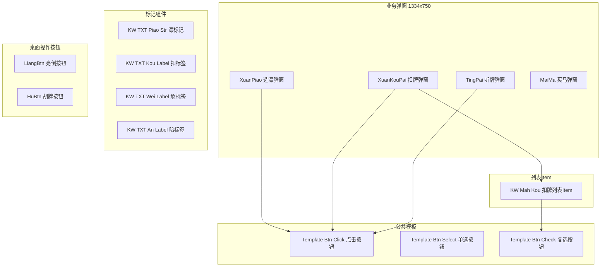

# 卡五星（好友房）· UI 交互

> 本套文档的**唯一 UI 视图**：页面布局 / 动画 / 交互 / 文案。规则判定细节不重复，一律链回 00~07。
>
> `⚠️` 需注意 / 需复核

---

## 内容对照表

| 编号 | 章节 | 内容 |
|---|---|---|
| 1 | 文档定位与组织 | 范围、与规则文档分工、**关键时长总览** |
| 2 | 对局前 · 桌面布局 | 桌面元素、座位规则 |
| 3 | 开局 · 定庄 · 方位信息 | 开局动画、庄家标签、骰子、方位、倒计时、上楼展示 |
| 4 | 玩家头像信息 | 头像、庄标、房主标、积分、昵称、状态、漂 |
| 5 | 发牌与手牌区域 | 发牌动画、手牌显示、自动理牌、出牌后理牌 |
| 6 | 玩法信息与牌河 | 剩余张数、牌河布局 |
| 8 | 打漂 | 选漂 UI、固定漂 |
| 9 | 行牌操作 | 摸 / 补 / 提 / 出、出牌方式、碰 / 杠 / 胡按钮与动画、多操作状态 |
| 10 | 亮倒 · 扣牌 | 扣牌界面、亮倒布局、动画 |
| 11 | 听牌提示 | 提示触发、胡牌信息框、标签体系 |
| 12 | 反馈区域 · toast 清单 | 提醒与浮动提示全量 |
| 13 | 对局结束 | 正常结束、荒庄流局、买马 |
| 14 | 结算界面 | 小结算、详情、大结算、对局后桌面 |
| 15 | 辅助功能 | 快捷聊天、菜单与设置、托管、局内个人信息、对局流水 |
| 16 | 特效与细节品质 | 摸牌成牌型特效、听牌特效 |
| 17 | 配置 × 流程联动矩阵 | 配置变化对 UI 流程的影响 |
| 18 | 文案 / toast / 弹窗全量清单 | 逐条文案与时长 |
| 19 | UI 测试检查清单 | 按阶段分组的可断言检查点 |
| A | 附录 A · AutoGen 组件实现对照 | 组件结构、FairyGUI 属性字段、章节映射（差异清单见工程内 `08-UI交互-差异清单.md`） |

---

## 一、文档定位与组织

### 1.1 范围

| ✅ 收录 | ❌ 不收录 |
|---|---|
| 桌面元素显示规则与显隐时机 | 组件实现、状态管理 |
| 交互流程（点击、滑动、超时）| 性能指标 |
| 动画表现与时长 | 规则判定细节（链回 00~07）|
| 文案、toast、弹窗、停留时长、可见性 | 结算公式与算分逻辑 |
| 配置变化对 UI 流程的影响 | 代码与字段名 |

### 1.2 与规则文档分工

| 问题 | 看哪里 |
|---|---|
| 什么牌型可胡、判哪种番型、多少倍 | [番型](04-番型.md)、[胡牌类型](05-胡牌类型.md) |
| 怎么算分、收谁的分、封顶怎么截 | [结算](06-结算.md) |
| 亮倒 / 扣牌 / 危牌的**规则条件** | [基础规则 §五](01-基础规则.md) |
| 亮倒 / 扣牌 / 危牌的**界面怎么画、怎么点** | **本篇 §十** |
| 创房有哪些开关、默认值是什么 | [配置](07-配置.md) |
| 桌面长什么样、动画多久、文案是什么 | **本篇** |
| 界面组件怎么实现、FairyGUI 字段名是什么 | **附录 A** |

### 1.3 关键时长总览

> 本表为全篇时长口径汇总，各时长在各对应章节展开为可验收条目。

| 阶段 / 环节 | 时长 | 出处 |
|---|---|---|
| **对局开始动画** | 玩家信息由小到大出现 → 上移离屏 → 从屏外进入 → 中间显示「对局开始」→ 稍作停留 → 整体快速减淡消失，直接进入摇骰发牌 | §3.2.1 |
| **选漂 UI 出现** | **瞬间出现** | §2.0 |
| **漂 UI 飞行** | **1 秒** | §2.0 |
| **定庄 · 骰子点数展示** | **1 秒** | §2.0 |
| **发牌** | **1 秒**（按定方位从正确起始位置发牌至各人）| §2.0 |
| **理牌** | **0.5 秒**（牌扣下 → 抬起，展示理牌结果）| §2.0 |
| **骰子停留** | 手牌拿完后骰子停止转动并展现数字，**停留 1 秒**后消失 | §3.2.5 |
| **出牌流光亮起** | **1 秒**（头像处流光动效）| §2.0 |
| **方位闪烁提醒** | **1 秒** | §2.0 |
| **牌堆中刚打出的牌箭头动效** | **1 秒** | §2.0 |
| **抓牌 · 排序插入** | **0.5 秒** | §2.0 |
| **抓牌 · 牌平移** | **0.3 秒** | §2.0 |
| **碰牌动画** | **1 秒** | §2.0 |
| **明杠 / 暗杠 / 补杠动画** | 各 **1 秒** | §2.0 |
| **亮倒 · 出牌动画后出现【亮倒】文字** | 出牌动画 **0.5 秒**后开始 | §2.0 |
| **亮倒文字动画** | **1 秒** | §2.0 |
| **胡牌 · 番型动画** | **1.5 秒** | §2.0 |
| **胡牌 · 点炮动画** | **1 秒** | §2.0 |
| **胡牌 · 一炮多响动画** | **1 秒** | §2.0 |
| **胡牌总时长** | **2~3 秒** | §2.0 |
| **买马 UI 停留** | **1.5 秒**后关闭，直接打开小结算 | §2.0、§3.3 |
| **对局结束文字** | 约 **1.3 秒**，文字停留 **0.5 秒** | §3.3 |
| **荒庄文字** | **1.3 秒** | §3.3 |
| **荒庄未听牌飘字 → 小结算** | 持续 **1.3 秒**后出小结算 | §3.3 |
| **发言过快提示** | 停留 **1 秒**后消失 | §3.2.11 |
| **漏胡不胡提示** | **1.5 秒**后消失 | §3.2.11 |
| **摸牌成牌型特效** | **0.5 秒** | §3.7.1 |
| **听牌特效** | **0.5 秒** | §3.7.2 |
| **托管的等待时间** | **1 秒** | §3.6.6 |
| **自动摸打等待** | **1 秒** | §3.6.6 |

---

## 二、对局前 · 桌面布局

### 2.1 桌面元素

| 元素 | 对局前 | 对局中 | 说明 |
|---|---|---|---|
| **牌墙** | **不显示** | **不显示** | 所有卡五星**无牌墙**，设置中也没有牌墙开关 |
| **剩余张数** | 不显示 | **显示** | 复用杭麻 |
| **座位** | 显示 | 显示 | 见 §2.2 |
| **方位（东/南/西）** | **无方位展示** | 确认庄家并开始摸牌后显示 | 见 §3.3 |
| **玩家头像区** | 未入座时为空 | 显示头像 / 庄标 / 房主标 / 积分 / 昵称 / 状态 / 漂 | 见 §四 |
| **牌河** | 空 | 按出牌顺序从左至右摆放 | 见 §6.2 |
| **手牌区** | 空 | 按发牌与理牌规则展示 | 见 §五 |

> **整体布局复用杭麻好友房**（需求 §2.6.1）。

### 2.2 座位规则

| 人数 | 座位布局 | 方位 |
|---|---|---|
| **2 人** | 固定**一上一下**：下方自己，上方**对家** | 东 / 南 |
| **3 人** | 固定**左、下、右**：下方自己，左侧**上家**，右侧**下家** | 东 / 南 / 西 |

- 房主创建房间后，后续加入房间的玩家按**逆时针顺序入座**，开局后与房主的逆时针顺序关系相同；**座位固定**。

### 2.3 无创房面板交互

创房面板（人数 / 封顶 / 漂分 / 买马 / 马数 / 频道 / 亮倒 / 规则 / 定庄 等）的**业务语义与默认值**见 [配置](07-配置.md)。本篇不重复展开面板结构。

---

## 三、开局 · 定庄 · 方位信息

### 3.1 开局动画

| 项 | 内容 |
|---|---|
| **触发** | 每次开房**首局**播放开局动画；之后开局**直接进入摇骰发牌** |
| **展示内容** | 玩家个人信息：头像、昵称、积分（**初始 0**）|
| **动画流程** | 玩家信息根据各自位置对应上下左右，**由小到大出现**后**往上离开屏幕**，随后**从屏幕外进入**；同时中间显示「**对局开始**」字样；之后稍作停留后整体页面**快速减淡消失**，直接进入摇骰发牌阶段 |
| **入座顺序** | 房主创建房间后，后续加入的玩家按逆时针顺序入座，并在开局后和房主的逆时针顺序关系相同；座位固定 |

### 3.2 定庄 UI

| 项 | 内容 |
|---|---|
| **开始时机** | **发牌开始后、骰子滚动停下时** |
| **表现** | 庄家头像上**直接出现【庄】标志**，**无过程动画** |

### 3.3 方位信息

方位区包含 **骰子、方位、倒计时、上楼** 四项信息。

#### 3.3.1 骰子

| 项 | 内容 |
|---|---|
| **显示时机** | 发牌时显示 |
| **表现** | 两个骰子环绕转动；在用户拿到所有手牌后，骰子停止转动并展现数字，**停留 1 秒**后消失 |

> 骰子在发牌时显示；两个骰子环绕转动；在用户拿到所有手牌后，骰子停止转动并展现数字，停留 1 秒后消失。

#### 3.3.2 方位展示

| 状态 | 表现 |
|---|---|
| **无方位** | 未开局默认为无方位展示；重新开局后，未指定某个玩家操作时不显示方位 |
| **有方位** | 确认庄家并开始摸牌时，显示对应方位：庄为**东**，其他玩家根据人数按逆时针依次显示**南西**（3 人则仅显示南、西）；之后方位**不再变化**，直到重新匹配重置成无方位展示 |
| **方位高亮** | 某个玩家轮到出牌时，其对应方位**闪烁高亮动画**；期间即使其他玩家在该玩家出牌后可进行碰 / 杠 / 胡操作，**也不会改变高亮方位** |
| **对局结束** | **无方位高亮** |

#### 3.3.3 倒计时

| 项 | 内容 |
|---|---|
| **显示形态** | 显示玩家可操作的倒计时，**最多两位数** |
| **配色** | **默认蓝色**；当倒计时为 **03、02、01、00** 时**为黄色** |
| **重置规则（自己视角）** | 有碰 / 杠 / 胡等操作时，自己视角的倒计时需**重置成可操作的倒计时**。 例：左边玩家打出三条后，自己可执行碰操作，则倒计时重置成初始值 |
| **不变化（他人视角）** | 当别人有碰 / 杠 / 胡等操作时，**别人视角的倒计时无变化** |

#### 3.3.4 上楼展示

| 项 | 内容 |
|---|---|
| **显示时机** | 如果开启上楼规则且该局符合上楼，则在**骰子停止的同时**展示 |
| **显示位置** | 在**骰子上方** |
| **文案** | 「**上楼X2**」或「**上楼X4**」（2 还是 4 根据具体倍数定）|

---

## 四、玩家头像信息

### 4.1 显示说明

| 编号 | 内容 | 显示说明 |
|---|---|---|
| 1 | **玩家头像** | 同步的头像或随机生成头像展示 |
| 2 | **庄家标签** | 本家或上家为庄，则庄家图标显示在**头像右上方** |
| 3 | **房主标记** | 房主头像上需显示房主标记 |
| 4 | **当前积分** | 显示规则：**5 位数以个为显示单位，6 位数以万为显示单位**；根据玩法规则展示当前积分，**可为负数** |
| 5 | **玩家昵称** | 游戏中**常显**；最多显示 **10 个字符**（中文占 2 字符，英文 / 符号 / 数字占 1 字符），超出第 7~8 个字符显示「..」 |
| 6 | **玩家状态 —— 操作状态** | 头像处**流光动效** |
| 6 | **玩家状态 —— 离线状态** | 头像处覆盖**断线图标**，且显示断线计时，格式为分秒「**00:00**」，**每次断线重新计时**。 备注：在当前动画播放过程中有玩家离线切后台等，**不会因此中断原本的动画流程** |
| 6 | **玩家状态 —— 托管状态** | 头像处覆盖托管图标（**自动摸打的托管不需要显示**）|
| 7 | **漂** | 创房面板开启打漂后，玩家漂的信息会显示在**头像旁**；显示为【漂0】【漂1】【漂2】【漂5】【漂10】 |

### 4.2 交互说明

| 操作 | 交互 |
|---|---|
| **点击自己头像** | 弹出**局内个人信息**，查看个人信息（在玩家头像附近展示）|
| **点击他人头像** | 弹出**局内个人信息**，查看玩家信息并可使用**互动道具** |

---

## 五、发牌与手牌区域

### 5.1 发牌逻辑

| 项 | 内容 |
|---|---|
| **方向** | 从庄家位开始，**逆时针**顺序 |
| **节奏** | 每人发 **4 张 / 次**，共 **3 轮**；再从庄家位开始逆时针每人发 **1 张**；最后给庄家位发 **1 张** |
| **获取节奏** | 所有玩家获取手牌的节奏**一致**。 **庄家**：4+4+4+1+1（4 组）；**非庄家**：4+4+4+1（4 组）|

> 发牌从庄家位开始按逆时针顺序进行；每人每次发 4 张、共 3 轮，再从庄家位开始逆时针每人发 1 张，最后给庄家位发 1 张；所有玩家获取手牌的节奏一致，庄家为 4+4+4+1+1（4 组），非庄家为 4+4+4+1（4 组）。

### 5.2 发牌动画

| 视角 | 表现 |
|---|---|
| **己方手牌** | 按照**从左到右**排列，出现时为**扣在桌面上**，随后**向上翻开**（牌一帧出现，扣在桌面上持续 **0.1 秒**，向上翻开动画持续 **0.1 秒**）|
| **节奏衔接** | 第一组开始向上翻开时，第二组朝下的牌出现，按同样节奏扣住 0.1 秒、向上翻 0.1 秒；后续按相同节奏进行，直到 4 组牌全部翻开 |
| **庄家最后两张** | 右侧的一张会与前 13 张**有距离**，放置在**摸牌位置** |
| **他人手牌** | 只有**出现动画**，出现后就**立起**，**无翻开动画**；庄家的最后一张同样放置在庄家的摸牌位置 |
| **同步性** | 每组牌出现的时间，桌上**所有玩家同步** |
| **发牌总时长** | **1 秒** |

### 5.3 手牌显示

| 项 | 内容 |
|---|---|
| **麻将子** | 复用杭麻麻将子 |
| **庄家手牌** | **14 张**，从左至右花色依次为 **筒 → 条 → 中 → 发 → 白**；从左至右大小为 **1~9**；最后一张牌置于手牌**最右侧且与手牌保持距离** |
| **闲家手牌** | **13 张**，从左至右花色依次为 **筒 → 条 → 中 → 发 → 白**；从左至右大小为 **1~9** |
| **他人视角** | 其他玩家手牌按 13 张摆放；庄家手牌按 14 张样式摆放，最后一张牌置于手牌最右侧且与手牌保持距离 |

### 5.4 自动理牌

| 项 | 内容 |
|---|---|
| **触发** | 所有玩家发牌完毕后 |
| **表现** | 将手牌**扣下整理好顺序后立起** |
| **理牌时长** | **0.5 秒** |

### 5.5 出牌后理牌

每个**打牌回合结束（出牌后）**重新理牌，将刚摸进且未打出的牌插入至手牌中。

| 方式 | 触发场景 | 动画拆解 |
|---|---|---|
| **插入式** | 打出牌后，若有牌需要插入原手牌**第 1 张至倒数第 2 张**位置 | 打出去的牌位置空出后，要插入的牌**变斜提起**；同时手牌中的牌自动往打出去的空位**对齐移动**并空出要插入的位置；变斜的牌提起后**平移到**要插入的位置上方，随后**变竖落下**。排序插入时长 **0.5 秒** |
| **平移式** | 打出牌**非最右侧隔开的牌**，且其他牌无需改变排序 | 打出去牌的空位由右侧的牌**往左平移**，最右侧隔开的牌也以同样速度往左靠，最终排靠在一起。平移时长 **0.3 秒** |

**插入位置**：插入的牌**已有多张**时**随机插入位置**；**仅有一张**时根据牌的**排序顺序**插入。

---

## 六、玩法信息与牌河

### 6.1 玩法信息

| 编号 | 内容 | 显示说明 |
|---|---|---|
| 1 | **剩余张数** | 复用杭麻 |

> **牌墙**：所有卡五星**不要牌墙**，设置中**也不要牌墙开关**。

### 6.2 牌河

| 项 | 内容 |
|---|---|
| **摆放顺序** | 牌河根据玩家出牌顺序**从左至右**依次摆放 |
| **3 人布局** | 自己居中每排放置 **12~13 张**，左右两个玩家每排 **7 张**，共放置 **3 排** |
| **2 人布局** | 自己和对家都居中每排放置 **13~14 张**，共放置 **3 排** |
| **不展示的情况** | 打出牌若被其他玩家**碰、杠、胡**，则**不在牌堆中展示** |
| **高亮规则** | 新摸到的牌或提起单张牌，若出牌河和碰牌区域存在**同样的牌**，则**高亮显示** |
| **最近打出的牌** | 有**菱形光柱漂浮动画**，时长 **1 秒** |

> 美术可根据摆放效果调整每排数量。

---

## 八、打漂

> 规则细节见 [基础规则 §6.1](01-基础规则.md)。本节只写 UI 表现。

### 8.1 各模式的 UI 表现

| 模式 | 表现 |
|---|---|
| **不漂** | 无打漂环节、不计漂分 |
| **固定漂** | 开局的同时，玩家头像旁**直接出现选漂结果**；**无过程动画**，并同时开始打骰子 |
| **首局定漂** | 仅每个大局的**第一小局**执行【选漂】环节，后续每个小局开局时流程同【固定漂】|
| **自由漂（每局选漂）** | 每个小局执行【选漂】环节 |

### 8.2 选漂动画

| 编号 | 内容 | 显示说明 |
|---|---|---|
| 1 | **选漂** | 本格含 3 条独立规则：触发时机 / UI 展示 / 结束衔接。 ① 触发时机：**小局开局后**。 ② UI 展示：每个玩家屏幕出现**各个漂的选项**（**选漂 UI 瞬间出现**）；主视角下其他玩家头像旁出现【**选漂中...**】文字；玩家点击选项完成选漂；选漂后在**头像旁出现选漂结果**，**其他玩家直接可见**。 ③ 最后一个玩家选漂完成的同时：选漂结果出现 → 所有玩家的选漂文字**缩小、移动到头像旁漂 UI 的位置**（**漂 UI 飞行 1 秒**）→ **开始打骰子** |
| 2 | **固定漂** | 开局的同时，玩家头像旁直接出现选漂结果；**无过程动画**，并同时开始打骰子 |
| **结束** | — | 打漂结束后，开始**打骰子 + 发牌 + 定庄**环节 |

---

## 九、行牌操作

### 9.1 摸牌 / 补牌

| 项 | 内容 |
|---|---|
| **摸牌位置** | 与一般手牌**间隔 1/4 牌距离**；**不再有牌墙** |
| **摸牌动画** | 从手牌最右侧**从上往下缓冲落下**，**1 帧效果** |
| **摸牌时机** | 摸牌需在**上一家打出牌的同时**摸牌——肉眼可见上家打出牌的瞬间下家摸牌 |
| **补牌位置** | 从牌堆抓一张牌，与一般手牌间隔 1/4 牌距离 |
| **补牌动画** | 从手牌最右侧从上往下缓冲落下，**1 帧效果** |

### 9.2 提牌

| 项 | 内容 |
|---|---|
| **触发** | 单击牌面 |
| **效果** | 对应牌**提起**，提起高度约为牌高度的**四分之一**；玩家**每次只能提起 1 张牌** |
| **放下** | 玩家点击**非牌面空白处**可将被提起牌放下；**点击该牌牌面不能将其放下** |
| **滑动选择** | 可滑动选择多张牌，手牌依次提起，每次只会提起 1 张；手指离开手牌，则**最终手指离开的对应牌提起**，滑动选中的牌**逐张提起放下** |
| **联动** | 提起【打出可听牌】时，**弹出听牌提示页面** |

### 9.3 出牌

| 项 | 内容 |
|---|---|
| **移动过程** | 打出去的牌**可见牌的移动过程**，**2 帧**的肉眼表现效果 |
| **本家摆放** | 打出牌放置于该玩家面前牌堆中 |
| **流光提示** | 出牌时玩家**头像处增加流光提示**，时长 **1 秒** |
| **方位闪烁** | 玩家出牌时**方位处增加闪烁提醒**，时长 **1 秒** |
| **其他家 · 放大出牌开启（默认开）** | 出牌时**放大展示**，并打出放置于该玩家面前牌堆中；**下一个玩家有操作行为后消失** |
| **其他家 · 放大出牌关闭** | 直接放置于该玩家面前牌堆中；打出去的牌可见牌的移动过程，**0.5 秒**左右 |
| **他人手牌一致性** | 其他家打出的牌**始终是摸到的那张牌** |

**出牌方式**：

| 方式 | 默认 | 交互 |
|---|---|---|
| **双击出牌** | **默认开启** | 出牌阶段点击**已提起**的牌可将该牌打出 |
| **单击出牌** | 默认关闭 | 出牌阶段点击**不可听牌**的牌，则直接将其打出，无需提起。开启时，若轮到自己出牌前有牌提起，则**自动下落** |
| **滑动出牌** | **默认关闭** | 出牌阶段**向上滑动手牌超过提起高度**可显示该牌透明状态牌，并且随手指移动；手指松开可将该牌打出；如将牌移回提起高度水平线则透明牌消失、撤回打出 |

> **互斥**：双击出牌与单击出牌**互斥**；滑动出牌**不互斥**。

**超时**：

| 情况 | 托管行为 |
|---|---|
| **有提起的牌** | 走托管逻辑——打新摸进来的牌 |
| **无提起的牌** | 走托管逻辑——打新摸进来的牌 |

### 9.4 碰牌

| 项 | 内容 |
|---|---|
| **按钮** | 玩家手牌右上方显示操作按钮：【碰】+【过】 |
| **手牌高亮** | 手牌中可碰牌**高亮**，其他**暗置**（如果有胡则不需要暗置）|
| **动画** | 对应碰牌玩家**手牌面前播放**，时长 **1 秒** |
| **摆放** | 从左往右根据本局操作顺序放置，**放于手牌左侧**（手牌左侧平移放置）；展示牌面 |
| **方位箭头** | 碰牌上方显示【箭头】，指向对应碰牌方位：碰对家 **↑** / 碰上家 **←** / 碰下家 **→** |
| **超时** | 配置开启托管，**超时默认【过】** |

### 9.5 杠牌

| 类型 | 按钮 | 动画 | 摆放 |
|---|---|---|---|
| **直杠** | 【碰】+【杠】+【过】 | 明杠玩家前**不显示刮风字样**，显示对应杠的文字即可；中央显示动画（**1 秒**），之后显示飘分动画 | 点杠：对家 **↑** / 上家 **←** / 下家 **→** |
| **补杠（明杠）** | 【杠】+【过】 | 同上 | 杠牌上方显示【**补**】 |
| **暗杠** | 【杠】+【过】 | 暗杠玩家前显示**暗杠字样**；中央显示动画（**1 秒**），之后显示飘分动画 | 杠牌从左往右根据操作顺序放置，放于手牌左侧；**下三张牌背、上一张牌面**根据配置正 / 反堆叠展示 |

> 直杠按钮为【碰】+【杠】+【过】；明杠玩家前不显示刮风字样，显示对应杠的文字即可；中央显示动画（1 秒），之后显示飘分动画；点杠时箭头指向对应方位：对家 ↑、上家 ←、下家 →。

**通用规则**：

| 项 | 内容 |
|---|---|
| **手牌高亮** | 手牌中可杠牌高亮，其他暗置（如果有胡则不需要暗置）|
| **点击操作** | 单杠：点击【杠】完成操作；点击【过】放弃；配置开启托管，**超时默认【过】** |
| **摆放顺序** | 从左往右根据本局操作顺序放置，放于手牌左侧；**可点击手牌中的牌直接出牌** |
| **补牌联动** | **杠牌动画播放同时摸牌（补牌）** |
| **抢杠胡边界** | 若是补杠且有人选择是否抢杠胡，则**不播放动画、不播放飘分**，直到抢杠胡玩家完成选择，再根据杠和胡走对应流程 |

### 9.6 胡牌

| 胡牌类型 | 显示说明 |
|---|---|
| **自摸** | 玩家手牌右上方显示操作按钮：【自摸】+【过】；在【自摸】选项**左侧**显示本次胡的牌和本次胡牌的倍数（自摸按自摸显示）；如有倍数封顶，则显示【**封顶**】，且倍数也仅显示封顶倍数 |
| **点炮** | 玩家手牌右上方显示操作按钮：【胡】+【过】；在【胡】选项上显示本次胡的牌和本次胡牌的倍数（非自摸不含自摸）；如有倍数封顶，则显示【封顶】，且倍数也仅显示封顶倍数 |

| 交互 | 动画效果 | 摆放效果 |
|---|---|---|
| **自摸**：点击【自摸】完成操作；点击【过】放弃。配置开启托管，**超时则默认胡** | 光柱动效 → 番型动画（**1.5 秒**，对应方位玩家手牌前播放）→ 飘分（**正分为黄色，负分为灰色**）。**此环节不可直接出牌** | 摊开摆放在**自己手牌右侧**，间隔 1/4 牌距离，显示**手掌标记** |
| **点炮、抢杠胡**：点击【胡】完成操作；点击【过】放弃 | 点炮动画（**1 秒**）→ 光柱动画 → 番型动画（**1.5 秒**，对应方位玩家手牌前播放）→ 飘分（正分为黄色，负分为灰色）| 摊开摆放在自己手牌右侧，间隔 1/4 牌距离；自己角度显示对应点牌玩家的**方位箭头**：胡对家 **↑** / 胡上家 **←** / 胡下家 **→** |
| **一炮多响** | 一炮多响动画（**1 秒**）→ 光柱动画 → 番型动画（**1.5 秒**，对应方位玩家手牌前播放）→ 飘分 | — |

> **胡牌总时长**：**2~3 秒**（含点炮/一炮多响动画 + 番型动画 + 飘分）。

> 自摸时玩家手牌右上方显示操作按钮：【自摸】+【过】，并在【自摸】选项左侧显示本次胡的牌和本次胡牌的倍数（自摸按自摸显示），如有倍数封顶则显示【封顶】且倍数仅显示封顶倍数；点击【自摸】完成操作、点击【过】放弃，配置开启托管时超时则默认胡；动画流程为光柱动效 → 番型动画（1.5 秒，对应方位玩家手牌前播放）→ 飘分（正分为黄色，负分为灰色），此环节不可直接出牌；胡牌摊开摆放在自己手牌右侧，间隔 1/4 牌距离，显示手掌标记。

**一炮多响的特殊显示**：

| 视角 | 表现 |
|---|---|
| **放炮玩家 / 围观** | 一炮多响动画 → 光柱动画 → **所有玩家所胡番型** + 飘分 |
| **胡牌玩家** | 一炮多响动画 → 光柱动画 → **自己所胡番型** + 飘分 |

### 9.7 多操作状态

| 状态 | 显示说明 | 交互说明 |
|---|---|---|
| **可多杠** | 玩家手牌右上方显示「**可杠牌选择框** +【杠】+【过】」；配置开启托管，**超时默认不杠** | 点击选择需要杠的牌，点击【过】则放弃此次操作并隐藏杠选择；**可直接点击出牌，不用选择** |
| **碰、杠、胡、亮 多状态** | 玩家手牌右上方增加按钮，根据不同情况展示多个按钮，**从左至右优先级显示顺序为：【碰】→【杠】→【亮】→【胡】/【自摸】→【过】**；有胡牌的多状态，配置开启托管，**超时默认胡牌** | 点击任意按钮完成对应操作逻辑，点击【过】则放弃此次操作；**有自摸按钮时，不可直接出牌** |

### 9.8 番型播放优先级

| 顺序 | 规则 |
|---|---|
| 1 | 在玩家**手牌前**播放对应番型动画 |
| 2 | 手牌中有多种番型时，**优先播放特殊番型**，单次**最多播放一个**番型动画 |
| 3 | **特殊番型** = 海底捞月（海底炮）、杠上开花、杠上炮、抢杠胡 |
| 4 | 胡牌回合触发多个特殊番型动画时，**优先播杠相关**（杠上开花、杠上炮、抢杠胡）|
| 5 | 无特殊番型时，每次仅播放 **1 个当前手牌中倍数最大的普通番型**动画；多个普通番型倍数相同时，按**番型 ID 顺序**播放 |

### 9.9 飘分播放

| 项 | 内容 |
|---|---|
| **显示单位** | **5 位数以个为显示单位，6 位数以万为显示单位** |
| **配色** | **正分为黄色，负分为灰色** |
| **结算时机** | **杠类分数立刻结算**；**胡牌时，胡牌总得分一起结算** |

---

## 十、亮倒 · 扣牌

> 规则条件见 [基础规则 §五](01-基础规则.md) 与 [打牌操作 §十、§十一](03-打牌操作.md)。本节只写界面与交互。

### 10.1 亮倒入口

| 项 | 内容 |
|---|---|
| **触发** | 摸牌或补牌后，若满足亮倒条件，出现【**亮**】+【过】 |
| **听牌标签** | 亮倒同时，**听牌标签正常展示** |

### 10.2 扣牌界面

| 项 | 内容 |
|---|---|
| **进入** | 本家点击【亮】之后：**所有碰杠胡交互按钮消失**；听牌提示箭头**不会消失**；**首先进行扣牌判断**——无则进入「亮倒-打牌」界面，有则打开扣牌界面 |
| **遮罩** | 扣牌时，自己手牌上方展示**半透明遮罩** |
| **标题** | 【**请选择扣牌**】 |
| **候选区** | 手中**所有可以扣的牌**，以**单张**形式展示在标题下方；**顺序与手牌中左到右顺序一致**；每张牌**右下角有个选中的圆圈** |
| **手牌区** | 遮罩下方手牌中：**可扣的牌不变**，其余牌**全部带遮罩** |
| **按钮** | 牌下方展示【**取消**】【**选择完成**】两个按钮（⚠️ 需求另处 §3.2.9.2 作「选择亮牌」；本节 §3.2.10.3 为扣牌流程**专门规格节**且流程描述亦用「选择完成」，**已择「选择完成」**）|

**交互**：

| 操作 | 结果 |
|---|---|
| **点击某张候选牌 —— 选中** | 右下角圆圈中出现**绿色对号**，同时手牌中对应的**三张牌出现【扣】的标签** |
| **点击某张候选牌 —— 取消选中** | 绿色对号消失，手牌中【扣】标签消失 |
| **点击【取消】** | 扣牌 UI 消失，且**桌面交互按钮不会再出现**（**等同于【过】**）|
| **点击【选择完成】** | 判断扣下所有选中的刻子后，剩余牌是否可打出一张牌后听牌。 · **不可以** → 取消所有选中，并弹出提示「**当前扣牌没有胡口！**」 · **可以听牌** → UI 消失，切换到「亮倒-打牌」界面 |

### 10.3 亮倒界面

| 项 | 内容 |
|---|---|
| **扣牌展示** | 如有选择扣住的牌，扣住的牌带【**扣**】标签，且带遮罩，**不可打出** |
| **可听牌亮起** | 手牌中**打出后可听的牌会亮起**，并带听牌提示标签；**其余牌全部带遮罩**。 · **危牌不会被排除在「亮起」之外、不加遮罩**（**显示层口径**；点击时仍按危牌规则阻断出牌，见下方「交互」表） · **扣下的牌不带该标签** · **危牌被扣下，标签切换为【扣】** |
| **提示文案** | 出现提示：「**请选择胡口**」 |
| **取消按钮** | 右上角出现取消按钮 |

**交互**：

| 操作 | 结果 |
|---|---|
| **点击取消按钮** | **等同于【过】**，回到正常出牌界面：【扣】标签消失、遮罩消失、正常展示所有听牌提示、可正常提牌出牌 |
| **点击亮起的牌 —— 非危牌** | 根据玩家设置正常执行提牌、出牌等操作 |
| **点击亮起的牌 —— 是危牌** | 出现 toast「**打出该牌将会放炮！**」，并**阻断出牌** |
| **点击有遮罩的牌** | **无效果** |

### 10.4 亮倒布局

| 视角 | 布局 |
|---|---|
| **自己** | 手牌**全部推到左侧碰杠牌区靠右的正上方**，摆自己**所有的听牌**（**听牌不占用牌张，仅做展示**）；多张听牌时展示顺序与听牌提示中一致（**可胡牌为 0 也会展示**）。 **部分亮**：未亮出的牌带**黑色蒙版**，带【**暗**】的标签；手牌**左侧先按顺序摆放所有【暗】的牌，右侧再按顺序摆放非暗牌** |
| **他人** | 牌会推倒，推倒的视角和胡牌推倒一致。 **胡牌**：左右两侧玩家的胡牌靠近下方摆放；对面的玩家胡牌在碰杠牌区上方；对面玩家与自己左右相对摆放。 **部分亮**：未亮的牌为**背面朝上**的状态，且背面朝上的牌在对应玩家的**左侧**，亮出的牌在**右侧** |

### 10.5 扣牌布局

| 视角 | 布局 |
|---|---|
| **自己** | **非部分亮**时，扣牌规则与部分亮的暗牌一致，只是标签从【暗】改为【扣】。 **部分亮**时，扣牌按照【暗】牌展示，标签也为【暗】 |
| **他人** | 扣住的牌按部分亮时的暗牌展示 |
| **摸牌** | 此时每个玩家摸得的牌位置**不变**，且仍为**立着** |

### 10.6 亮倒动画

| 项 | 内容 |
|---|---|
| **出牌的同时** | 手牌**取消遮罩** → 开始播放**亮倒文字** → 下家摸牌 |
| **左侧可胡牌** | 展示**外圈有个光圈静图** |
| **亮倒文字动画时长** | **1 秒**（出牌动画 0.5 秒后开始出现【亮倒】文字）|

### 10.7 亮倒后的标签体系

| 标签 | 含义 | 展示位置 |
|---|---|---|
| 【**危**】 | 未亮倒玩家手中，是任一亮倒玩家胡的牌 | 牌**左上角** |
| 【**扣**】 | 亮倒时扣下的刻子 | 牌**左上角**，带遮罩 |
| 【**暗**】 | 亮倒后未亮的牌（部分亮模式）| 牌**左上角**，带蒙版 |

### 10.8 胡牌后的手牌复位

胡牌后全部手牌按照手牌顺序**重新摆放**，随后**全部推到**，**去掉所有标签和蒙版**。

---

## 十一、听牌提示

### 11.1 提示触发

| 触发场景 | 说明 |
|---|---|
| **可听牌状态** | 向听数为 1 时，打出可听牌的牌**上方展示听牌提示标签**；**提起提示牌时**，该牌上方出现**听牌提示弹窗**；点击其他提示牌可以切换提示内容；点击空白处或非提示牌或点击【听】按钮**关闭弹窗** |
| **已听牌状态** | 听牌后，手牌上方显示【**听牌**】及【**自动摸打**】/ 2 倍起胡 番数不足按钮；**层级注意不要挡牌** |

### 11.2 听牌标签（箭头 / 多 / 优 / 大）

| 项 | 内容 |
|---|---|
| **优先级** | **优 > 大 > 多 > 箭头**；同一个牌点同时满足时**仅显示最高优先级**的图标 |
| **实时变化** | 听牌标签会根据**可胡牌的张数和倍数实时变化**，张数最少按 **0 张**，倍数最少按 **1 倍** |
| **示例** | 原本 1 条胡 2 倍、其他牌都胡 1 倍，原本 1 条应显示「大」，但由于牌都被打完了，因此 1 条**仅显示箭头**（按 1 倍算）|

| 标签 | 触发规则 | 示例 |
|---|---|---|
| **箭头** | 打出成听只有 **1 张**时仅显示箭头；若有多个牌点，且**张数、倍数都相同**则都显示箭头 | 打 1筒满足 1 个 2 倍 3 张；打 2筒满足 1 个 2 倍 3 张 → **都显示箭头** |
| **多** | 多张牌点满足打出成听，**胡牌张数最多**的牌点，且**至少比最少的多 2 张及以上**，则显示「多」；若有多张牌点同时满足则都显示「多」；同一个牌点有多张，则**最右侧**的牌显示「多」 | 打 1筒可胡 3 张；打 2筒可胡 5 张；打 3筒可胡 6 张 → **仅 3筒显示「多」** |
| **大** | 多张牌点满足打出成听，**胡牌倍数最大**的牌点（可胡多张只要有一张满足即可）显示「大」；若有多张牌点同时满足则都显示「大」；同一个牌点有多张，则**最右侧**的牌显示「大」 | 打 1万胡 4 倍 1 张；打 2万胡 2 倍 2 张；打 3万胡 4 倍 1 张 → **1万和3万显示「大」**。 ⚠ **需求原例使用「万」子，本玩法牌张不含万**（§1.1）——该例**仅示排序逻辑**，用例编写时请以本玩法实际花色（筒/条）代入 |
| **优** | 多张牌点满足打出成听，且**有多张满足「大」的条件**，则**符合「大」又符合「多」**标记的牌显示「优」 | 打 1条胡 4倍3张、4倍4张、2倍3张；打 5条胡 4倍2张 → **1条显示「优」**（倍数最高 4 倍、张数最多）|

**混合示例**：

| 场景 | 标签 |
|---|---|
| 打 4条胡 2倍4张；打 8条胡 4倍2张；打 1条胡 4倍4张 | 4条显示**多**（4 张 > 2 张）；8条显示**大**（4 倍最大）；1条显示**优**（倍数最大且张数最多）|
| 打 1条胡 4倍1张；打 4条胡 2倍1张；打 6条胡 2倍2张、2倍3张；打 2筒胡 4倍2张；打 5筒胡 4倍2张 | 1条显示**大**；4条显示**箭头**；6条显示**多**（胡 5 张最多）；最右侧 2筒显示**大**，其他 2筒显示**箭头**；最右侧 5筒显示**大**，其他 5筒显示**箭头** |

### 11.3 胡牌信息框

| 项 | 内容 |
|---|---|
| **尺寸** | 胡牌显示框距自己手牌的高度**固定**；张数越多则胡牌显示框**宽度和高度越大**；若超过 **3 排**则可支持**上下滑动** |
| **内容** | 共有：**可胡张数、可胡牌信息**（牌面、可胡牌的倍数、可胡牌的张数）|
| **排序** | 当有多个牌可胡牌时，一排最多显示 **4 个**，从左到右依次按**倍数大小**排序；同样倍数按 **筒(1-9) → 条(1-9) → 中 → 发 → 白** 的顺序 |
| **牌面展示** | 当胡的牌是指定的牌时显示具体的牌面；若该牌数量为 **0**（已亮出的牌 + 手牌 = 4），则**牌面变暗** |
| **倍数计算** | 计算倍数时，**不计对亮、不计番型加分项**，**计算自己的亮倒、不计算他人亮倒**（**此为本信息框的预测倍数口径**；结算时对亮按加倍项计、番型加分项选 ×2 档按 §2.4 计，见 [番型 §5.2 / §6.6](04-番型.md)）|
| **可胡牌倍数** | 当胡的牌是指定的牌时显示具体的倍数（**不算自摸倍数**，计算自己的亮倒，不计算他人的亮倒）；胡牌倍数**不超过房间配置封顶倍数**，若超过则显示房间设置封顶倍数 |
| **封顶倍数展示** | 若有封顶倍数，则**左下角固定展示房间封顶倍数** |

### 11.4 自动摸打勾选

| 项 | 内容 |
|---|---|
| **展示时机** | 听牌按钮展示时，右侧显示【**自动摸打**】勾选按钮 |
| **状态** | 有**未选中**和**选中**两种状态 |

### 11.5 交互说明

| 操作 | 说明 |
|---|---|
| **点击听牌提示框外任意位置** | 关闭听牌提示弹框 |
| **新摸牌 / 出牌时** | 关闭听牌提示弹框 |
| **自动摸打** | 自动摸打同托管逻辑；听牌时可点击勾选「自动摸打」，勾选后则进入托管；期间可再次点击取消勾选，或点击「取消托管」按钮取消 |

---

## 十二、反馈区域 · toast 清单

### 12.1 反馈区域

| 编号 | 功能 | 说明 |
|---|---|---|
| 1 | **庄家出牌提醒** | 「**您是庄家，请优先出牌**」。庄家进行出牌、杠牌、胡牌操作时，提醒消失 |
| 2 | **闲家等待庄家首出** | 「**等待庄家优先出牌**」。庄家有操作行为时，提醒消失 |
| 3 | **番型播放** | 在玩家手牌前播放对应番型动画；优先级规则见 §9.8 |
| 4 | **飘分播放** | 影响结算会飘分：5 位数以个为显示单位，6 位数以万为显示单位；**正分为黄色，负分为灰色**；杠类分数立刻结算；胡牌时胡牌总得分一起结算 |
| 5 | **规则提醒** | 进行游戏规则的快捷提醒 |
| 6 | **发言过快提醒** | 气泡文本和语音播放完毕前再次点击则屏幕中央显示 tips 提示文字「**您发言太快了，请休息一下吧！**」，停留 **1 秒**消失 |
| 7 | **漏胡不胡** | 触发漏胡不胡后，出现浮动提示：「**当前未过手，无法胡牌**」，**1.5 秒**后消失 |
| 8 | **番数不足** | 番数不足无法捉炮时，出现浮动提示：「**番数不足，无法捉炮！**」 |
| 9 | **危牌** | 打出危牌时：「**打出该牌将会放炮！**」 |
| 10 | **扣牌失败提示** | 「**当前扣牌没有胡口！**」 |

### 12.2 toast 全量清单

见 [§十八 文案 / toast / 弹窗全量清单](#十八文案--toast--弹窗全量清单)。

---

## 十三、对局结束

### 13.1 正常结束（有人胡牌）

| 步骤 | 表现 |
|---|---|
| 1 | **所有玩家摊牌展示**（对家按真实视角倒着）|
| 2 | 胡牌动画结束后，根据胡牌顺序在**对应玩家面前展示胡**；**本局无人胡牌则不显示** |
| 3 | 胡牌人以「**胡 / 自摸**」文字展示 |
| 4 | 桌面中间播放「**对局结束**」文字动画，约 **1.3 秒**；「对局结束」文字停留 **0.5 秒** |
| 5 | **买马判断**：若本局触发买马 → 直接弹出买马 UI（出现方式 / 中马表现 / 文案 / 停留见 §13.3）；若本局未触发买马 → 胡牌动画结束后，直接弹出小结算 |

### 13.2 荒庄流局

| 步骤 | 表现 |
|---|---|
| 1 | 所有玩家**摊牌展示**（对家按真实视角倒着）|
| 2 | 展示【**荒庄**】文字，持续 **1.3 秒** |
| 3 | 随后看**有无未听牌玩家**： · **无未听牌玩家** → 直接出小结算 · **有未听牌玩家** → 所有未听牌玩家**同时飘字：未听牌** 　- **查叫**：触发查叫时，未听牌文字出现的同时展示**查叫的分数**，动画与持续时长同杭麻 　- **亮倒赔付**：如果触发亮倒赔付，则在查叫后，触发亮倒赔付的玩家展示【**亮倒荒庄**】文字并赔付，展示**加分和扣分**，动画、持续时间与杭麻一致 · 持续 **1.3 秒**后，出小结算界面 |

### 13.3 买马 UI

| 项 | 内容 |
|---|---|
| **出现方式** | 直接弹出买马 UI，**UI 与牌同时出现** |
| **中马表现** | 中的马带**金色边且亮起** |
| **文案** | 同时出现「**中X马**」的文字 |
| **停留** | 持续 **1.5 秒**后，界面关闭，直接打开小结算 |

---

## 十四、结算界面

> 结算文案的内容规则见 [结算 §十五](06-结算.md)。本节只写界面结构、布局与交互。

### 14.1 小结算界面

#### 14.1.1 触发逻辑

**对局结束**后，进入小结算界面。

#### 14.1.2 界面结构

| 模块 | 说明 |
|---|---|
| **背景** | 背景根据本玩家的**胜负**展示对应的颜色 |
| **正上方文字** | 根据本玩家的**胜负**展示对应的文字 |
| **胜负判定** | 本玩家分数 **≥ 0 → 胜利**，显示【**恭喜获胜**】的文字和胜利的底色；本玩家分数 **< 0 → 失败**，显示【**遗憾失利**】和失败的底色 |

**功能布局**：

| 编号 | 元素 | 交互 |
|---|---|---|
| 1 | **返回按钮** | 点击后关闭小结算界面，回到牌桌 |
| 2 | **安全中心 UI** | 点击后在小结算界面上方打开安全中心界面 |
| 3 | **页面标题** | 根据玩家得分显示【恭喜获胜】或者【遗憾失利】|
| 4 | **房号** | 显示房号 |
| 5 | **小局结束时间** | 展示**月、日和时分秒**（24 小时制）|
| 6 | **手牌详情区** | 见 §14.1.3 |
| 7 | **长按查看牌桌** | **非交互区域长按**均可隐藏小结算界面 |
| 8 | **关闭按钮** | 点击关闭小结算界面，回到牌桌 |
| 9 | **主按钮 —— 最后一小局** | 显示为【**查看结算**】，点击后进入**大结算界面** |
| 10 | **主按钮 —— 非最后一小局** | 显示为【**继续游戏**】，点击后关闭小结算界面并准备 |
| 11 | **洗牌 ICON** | 展示洗牌动画图标，无交互 |

#### 14.1.3 手牌详情区

| 项 | 内容 |
|---|---|
| **整体** | 按照**三个玩家**确定每个玩家信息区的高度；**2 人时复用 3 人高度** |
| **庄家标签** | 庄家头像的**左上角**展示【**庄**】标签 |
| **漂展示** | 开启【漂】功能时，每个玩家头像**右上角**展示漂数（**漂X**），X 为数字，**1~2 位数** |
| **结算信息文字** | **所有玩家，仅自己展示**结算信息文字；内容规则见 [结算 §十五.1~§十五.5](06-结算.md) |
| **总得分** | 展示玩家本小局的总得分；**如果输时触发番型封顶，则额外增加【封顶】标识**（**赢的玩家不展示**）|
| **胡牌页签** | 见 [结算 §十五.4](06-结算.md) |
| **详情按钮** | 玩家**自己的**结算信息右侧，有详情按钮（**固定展示**）；点击后打开详情页签；文字显示规则见 [结算 §十五.6](06-结算.md) |
| **手牌交互** | 功能交互**不变** |

### 14.2 大结算界面

| 项 | 内容 |
|---|---|
| **复用** | 复用杭麻的大结算功能 |
| **数据统计类型** | 修改为卡五星类数据统计：**自摸 X 次 / 点炮 X 次（一炮多响只算一次）/ 亮倒 / 未听**（口径见 [结算 §十五.7](06-结算.md)）|
| **战绩周报** | 卡五星玩法统计的特殊游戏次数使用「**亮倒次数**」 |

### 14.3 对局后桌面

**复用杭麻**：对局结束后桌面保持展示，玩家可查看牌桌信息。

---

## 十五、辅助功能

### 15.1 快捷聊天

**没有方言，其余复用杭麻。**

- 界面包含分类页签（如「普通话」「表情」「历史语音」）与预设聊天文本列表（如「快点吧，等的花都谢了」「搏一搏，单车变摩托」「还让不让我摸牌啦」「哎呀，手误打错牌啦」等）。

### 15.2 菜单

| 项 | 内容 |
|---|---|
| **复用** | 菜单复用 2.0 菜单 |
| **麻将类差异** | 麻将类玩法**不需要【托管】按钮** |
| **菜单项** | 如「超级防作弊」「玩法征集」「设置」「规则」「退出」|

### 15.3 游戏内设置

**无方言选项，其余复用杭麻。**

| 模块 | 项 | 交互 / 功能 |
|---|---|---|
| **声效** | **音乐** | 点击切换开关状态；控制所有音乐的播放 |
| **声效** | **音效** | 点击切换开关状态；控制所有音效是否播放（**包含打牌语音**）|
| **声效** | **震动** | 本格含 2 条独立规则：开关行为 / 震动触发点。 点击切换开关状态；控制震动效果是否启用。 **震动触发点**：仅 **1 项** ——「**房间满人**」（需求 §3.6.3.2 表尾）。需求该表只列「触发位置 1」、**未给位置 2 及以后** → **该规则即 1 个触发点，规格完整**；编号为表单模板残留，**不推定为缺漏**|
| **声效** | **方言** | **去掉方言**（无此项）|
| **游戏** | **单击出牌** | 默认**关闭**；打开则启用单击出牌；功能见 §9.3 |
| **游戏** | **滑动出牌** | 默认**关闭**；打开则启用滑动出牌；功能见 §9.3 |
| **游戏** | **特效** | 关闭后影响：① 胡 / 自摸 / 碰 / 杠按钮**无光环特效**；② **所有番型仅显示「胡 / 自摸」**；③ **所有杠动画都仅显示「杠」** |
| **游戏** | **牌墙** | **无该选项**，默认去掉牌墙 |
| **游戏** | **出牌放大** | 选择开启则开启出牌放大；选择关闭则关闭出牌放大 |

**触发与关闭**：打开左上角菜单后点击【设置】可打开设置界面；点击右上角【X】关闭设置界面。

> **默认值依据**：以本表（需求 §3.6.3.2 游戏内设置）为准 —— 单击出牌**默认关闭**、滑动出牌**默认关闭**、双击出牌为默认出牌方式。需求 §3.2.10.1 手牌操作章行文中的「滑动出牌（默认开）」为叙述性括注，**以设置表为准**。

### 15.4 局内个人信息

**复用线上。**

**触发**：点击自己或他人头像，在玩家头像附近展示个人信息。

### 15.5 对局流水

**复用杭麻。**

### 15.6 托管

| 触发场景 | 托管逻辑 |
|---|---|
| **触发托管** | 本格含 6 条独立规则：提牌限制 / 打牌 / 危牌择牌 / 全危牌 / 碰杠 / 胡。 托管状态下**无法进行提牌操作**，仍可选择碰 / 杠 / 胡 / 过的操作，但操作后**则会取消托管状态**。 **打牌**：按摸打逻辑出牌，**等待 1 秒**打出摸到的牌。 · 摸到的牌是**危牌**时，在非危牌中**从左到右选择第一张打出** · 手牌**全是危牌**时，等待 1 秒打出摸到的牌 **碰 / 杠**：等待 1 秒后取消。 **胡**：等待 1 秒后胡牌 |
| **听牌后勾选自动摸打**（**头像不展示托管**）| 本格含 4 条独立规则：打牌 / 危牌退出 / 碰杠 / 胡。 **打牌**：按摸打逻辑出牌，等待 1 秒打出摸到的牌。 · 摸到的牌是危牌时，**退出自动摸打**；退出自动摸打后，如果进入托管，按托管逻辑执行 **碰 / 杠**：等待 1 秒后取消。 **胡**：等待 1 秒后自动胡牌 |
| **亮倒后** | 本格含 3 条独立规则：打牌 / 杠 / 胡。 **打牌**：等待 1 秒打出摸到的牌。 **杠**：触发后**等待玩家操作**。 **胡**：触发后**等待玩家操作** |
| **亮倒后，且同时触发托管时** | 按照托管的逻辑执行；**亮倒后危牌标签去除，不用考虑危牌情况** |

---

## 十六、特效与细节品质

### 16.1 摸牌成牌型特效

| 项 | 内容 |
|---|---|
| **触发逻辑** | 摸牌在**牌落地后**，形成指定牌型即播放对应的手牌特效 |
| **防重复** | 相同牌点的牌在**上次摸牌触发过同样的牌型**不会连续播放两次。 例：摸 5筒凑成 456 播放一次，打出 5筒，下次摸牌 5筒又凑成 456，则**不会触发**；但若是和其他牌组成**其他牌型**则不限制 |
| **时长** | 对应符合规则的牌播放特效，持续时间 **0.5 秒** |

**牌型组成规则**：

| # | 规则 | 示例 |
|---|---|---|
| 1 | 摸到**夹张**后单独成顺子，则该顺子播放特效（如组成牌型的牌点有多张，则**只有和摸到的牌的相邻两张牌点**播放）| 没有 357筒、有 46筒后摸到 5筒 → 456 播放；没有 357筒、有 4466筒后摸到 5筒 → **仅中间的 46 和 5** 播放特效 |
| 2 | 摸到的牌的**相邻牌点无法组成顺子**，且该牌**已有两张可组成刻子**，则该刻子播放特效 | 4556 摸到 5 **不符合**（4 和 6 都可以组成 456）；3455 摸到 5 **不符合**（4 可以组成 345）；**455 摸到 5 符合**（45 不能组成顺子）|
| 3 | 摸到的牌**已有三张，可组成杠**，则该杠播放特效 | 34555 摸到 5 |

### 16.2 听牌特效

| 项 | 内容 |
|---|---|
| **触发逻辑** | 打出一张牌后**叫听**，则**直接播放听牌特效**（**不需要等插牌、平移动画完成**）；**亮倒时不播放** |
| **防重复** | 上一次出牌已经成听，本次出牌后继续成听则**不会重复播放** |
| **表现** | 沿用广麻特效：出现**上下边框**，**流光从左到右滑过手牌**，**不包含已碰、杠的牌** |
| **时长** | 过程 **0.5 秒** |

---

## 十七、配置 × 流程联动矩阵

| 配置变化 | 对 UI 流程的影响 |
|---|---|
| **漂分**：不漂 → 固定漂 | 头像旁直接出现漂结果，**无打漂环节** |
| **漂分**：不漂 → 首局定漂 | 仅**大局第一小局**出现选漂 UI；后续小局同固定漂 |
| **漂分**：不漂 → 自由漂 | **每小局**开局出现选漂 UI |
| **买马**：不买马 → 自摸买马 / 亮牌自摸买马 | 胡牌后新增**买马 UI**（停留 1.5 秒）；**马数**选项由隐藏变显示 |
| **买马**：不买马 | **马数**选项**隐藏不展示** |
| **上楼**：未勾选 → 勾选 | 符合上楼时，**骰子上方**展示「上楼X2 / 上楼X4」 |
| **人数**：3 人 → 2 人 | 桌面座位由「左、下、右」变为「一上一下」；牌河布局由「自己 12~13 / 左右 7」变为「自己和对家 13~14」；小结算手牌详情区**复用 3 人高度** |
| **【卡五星专属】双亮**：3 人勾选 → 改 2 人开局 | 规则自动失效 |
| **【卡五星专属】包牌**：3 人勾选 → 改 2 人开局 | 规则自动失效 |
| **少于12张不亮**：勾选 | 牌堆牌 < 12 张后**不再出现【亮】按钮** |
| **部分亮**：勾选 | 亮倒后仅听口相关牌亮出，其余扣下；扣牌标签按【暗】展示 |
| **特效**：关闭 | 胡 / 自摸 / 碰 / 杠按钮**无光环特效**；**所有番型仅显示「胡 / 自摸」**；**所有杠动画仅显示「杠」** |
| **出牌放大**：关闭 | 其他家出牌**不放大展示**，直接放置于面前牌堆；移动过程约 0.5 秒 |
| **单击出牌**：打开 | 点击不可听牌的牌直接打出，无需提起；轮到自己出牌前有牌提起则自动下落 |
| **滑动出牌**：关闭 | 向上滑动手牌不再显示透明状态牌 |

---

## 十八、文案 / toast / 弹窗全量清单

> **时长口径**：需求仅对部分条目给出明确时长，其余按**同类型条目**统一取值 —— **浮动提示 / toast 类 = 1.5 秒**（对齐 §3.2.11 #7「漏胡不胡」的既有值）；**弹窗类 = 停留至用户操作**；**结果文字类 = 常驻至下一动作**。

| # | 文案 | 类型 | 触发时机 | 停留时长 | 可见性 |
|---|---|---|---|---|---|
| 1 | **对局开始** | 居中文字 | 每次开房**首局**的动画流程中 | 稍作停留后整体快速减淡消失 | 全体 |
| 2 | **选漂中...** | 头像旁文字 | 自由漂 / 首局定漂模式下，其他玩家未完成选漂时 | 直到该玩家完成 | 全体 |
| 3 | **漂0 / 漂1 / 漂2 / 漂5 / 漂10** | 头像旁标签 | 创房面板开启打漂后 | 常显 | 全体 |
| 4 | **上楼X2 / 上楼X4** | 骰子上方文字 | 开启上楼且该局符合上楼，骰子停止的同时 | 与骰子展示同步 | 全体 |
| 5 | **您是庄家，请优先出牌** | 反馈区提醒 | 庄家进行出牌、杠牌、胡牌**操作前** | 直到庄家有操作行为 | 庄家 |
| 6 | **等待庄家优先出牌** | 反馈区提醒 | 闲家等待庄家首出 | 直到庄家有操作行为 | 闲家 |
| 7 | **请选择扣牌** | 扣牌界面标题 | 本家点击【亮】且存在可扣的刻子时 | 直到完成或取消 | 仅自己 |
| 8 | **请选择胡口** | 亮倒界面提示 | 进入「亮倒-打牌」界面时 | 直到出牌或取消 | 仅自己 |
| 9 | **当前扣牌没有胡口！** | 弹窗提示 | 点击【选择完成】后判断剩余牌无法听牌时 | **停留至用户操作**（弹窗类口径）| 仅自己 |
| 10 | **打出该牌将会放炮！** | toast | ① 亮倒界面点击危牌时（**阻断出牌**）；② 一般出牌阶段打出危牌时 | **1.5 秒**（toast 类口径）| 仅自己 |
| 11 | **当前未过手，无法胡牌** | 浮动提示 | 触发漏胡不胡后 | **1.5 秒** | 仅自己 |
| 12 | **番数不足，无法捉炮！** | 浮动提示 | 番数不足无法捉炮时 | **1.5 秒**（同 #11 浮动提示口径）| 仅自己 |
| 13 | **您发言太快了，请休息一下吧！** | 屏幕中央 tips | 气泡文本和语音播放完毕前再次点击 | **1 秒** | 全体 |
| 14 | **胡 / 自摸** | 玩家面前文字 | 胡牌动画结束后 | **常驻至下一动作**（结果文字类口径）| 全体 |
| 15 | **对局结束** | 居中文字动画 | 有人胡牌后 | 约 **1.3 秒**，文字停留 **0.5 秒** | 全体 |
| 16 | **荒庄** | 居中文字 | 牌摸完无人胡牌 | **1.3 秒** | 全体 |
| 17 | **未听牌** | 飘字 | 荒庄后存在未听牌玩家时，所有未听牌玩家同时飘字 | 与查叫展示同步，持续 **1.3 秒** | 全体 |
| 18 | **亮倒荒庄** | 飘字 | 荒庄触发亮倒赔付时，在**查叫之后**展示 | 动画与持续时间同杭麻 | 全体 |
| 19 | **中X马** | 买马界面文字 | 本局触发买马时，与买马 UI 同时出现 | 与买马 UI 同步（**1.5 秒**）| 全体 |
| 20 | **恭喜获胜** | 小结算标题 / 背景文字 | 本玩家分数 **≥ 0** | 直到关闭 | 仅自己 |
| 21 | **遗憾失利** | 小结算标题 / 背景文字 | 本玩家分数 **< 0** | 直到关闭 | 仅自己 |
| 22 | **查看结算** | 小结算主按钮 | **最后一小局** | 常显 | 仅自己 |
| 23 | **继续游戏** | 小结算主按钮 | **非最后一小局** | 常显 | 仅自己 |
| 24 | **封顶** | 标识 | 在胡牌按钮旁及结算总得分处展示；胡牌时的倍数封顶 / 结算总得分处（**仅输时展示**）| 常显 | 全体 / 仅自己 |
| 25 | **自摸 / 被自摸 / 捉炮胡 / 点炮 / 一炮多响 / 包牌 / 查叫 / 被查叫 / 首亮赔付** | 结算页签 | 在小结算手牌详情区展示，点击详情按钮后按页签展示；按 [结算 §十五.4](06-结算.md) 的对局结果 | 常显 | 仅自己 |
| 26 | **杠上杠 \*Y** | 结算详情第二行 | 在结算详情第二行展示杠上杠倍数 Y；该杠触发杠上杠时 | 常显 | 仅自己 |
| 27 | **（封顶）** | 结算详情文字 | 在结算详情分数下方展示（封顶）标识；胡分触发封顶时 | 常显 | 仅自己 |
| 28 | **数坎 / 漂 / 买马 / 荒庄赔付 + [对象] + 分数** | 结算详情行 | 在结算详情行展示对应项 + [对象] + 分数；明细按 [结算 §十五.6](06-结算.md) | 常显 | 仅自己 |
| 29 | **04:00 形式的断线计时** | 头像处文字 | 玩家离线时，每次断线重新计时 | 直到重连 | 全体 |

---

## 十九、UI 测试检查清单

> 每条均给出**前置条件 / 操作 / 期望结果**三要素，可直接转为用例。

### 19.1 对局前

| # | 前置条件 | 操作 | 期望结果 |
|---|---|---|---|
| 1 | 2 人房 | 进入桌面 | 座位为**一上一下**（下方自己、上方对家）；方位仅东 / 南 |
| 2 | 3 人房 | 进入桌面 | 座位为**左、下、右**（下方自己、左侧上家、右侧下家）；方位为东 / 南 / 西 |
| 3 | 任一房 | 进入桌面 | **不显示牌墙**；设置中**无牌墙开关** |
| 4 | 任一房 | 观察桌面 | 未开局时**无方位展示** |

### 19.2 开局 / 定庄 / 方位

| # | 前置条件 | 操作 | 期望结果 |
|---|---|---|---|
| 5 | 创建房间后首局 | 观察 | 播放开局动画：玩家信息由小到大出现 → 上移离屏 → 从屏外进入 → 中间显示「对局开始」→ 快速减淡消失 |
| 6 | 第二小局起 | 观察 | **不播放开局动画**，直接进入摇骰发牌 |
| 7 | 任一局 | 观察骰子 | 两个骰子环绕转动；手牌拿完后停止并展现数字，**停留 1 秒**后消失 |
| 8 | 任一局 | 观察定庄 | 骰子滚动停下时，庄家头像上**直接出现【庄】标志，无过程动画** |
| 9 | 任一局 | 轮到某玩家出牌 | 其对应**方位闪烁高亮**；期间他人可碰 / 杠 / 胡，**高亮方位不变** |
| 10 | 任一局 | 对局结束 | **无方位高亮** |
| 11 | 勾选「上楼」且本局符合上楼 | 观察骰子 | 骰子停止的**同时**，骰子上方展示「上楼X2」或「上楼X4」 |
| 12 | 任一局 | 观察倒计时 | 默认蓝色；为 03/02/01/00 时**变黄色** |
| 13 | 他人打出可碰的牌 | 观察自己视角倒计时 | 倒计时**重置为初始值** |
| 14 | 自己出牌后他人有操作 | 观察他人视角倒计时 | 他人视角倒计时**无变化** |

### 19.3 发牌 / 手牌

| # | 前置条件 | 操作 | 期望结果 |
|---|---|---|---|
| 15 | 任一局 | 观察发牌 | 从庄家位开始**逆时针**，每人 4 张 × 3 轮 → 每人 1 张 → 庄家再 1 张 |
| 16 | 任一局 | 观察己方发牌动画 | 牌扣在桌面 **0.1 秒** → 向上翻开 **0.1 秒**；4 组按相同节奏进行 |
| 17 | 任一局 | 观察他人手牌 | 只有**出现动画**，出现后**立起**，**无翻开动画** |
| 18 | 任一局 | 观察庄家最后一张 | 与手牌保持距离，放置在**摸牌位置** |
| 19 | 发牌完毕 | 观察 | 手牌**扣下整理后立起**（自动理牌）|
| 20 | 任一局 | 观察手牌顺序 | 从左至右**筒 → 条 → 中 → 发 → 白**；同花色内 1~9 |
| 21 | 打出中间位置的牌 | 观察理牌 | 插入式或平移动画按 §5.5 规则执行 |

### 19.5 打漂

| # | 前置条件 | 操作 | 期望结果 |
|---|---|---|---|
| 29 | 配置固定漂 | 小局开局 | 头像旁**直接出现漂结果，无过程动画**，同时开始打骰子 |
| 30 | 配置首局定漂 | 大局第一小局 | 出现选漂 UI；其他人头像旁显示「选漂中...」 |
| 31 | 配置首局定漂 | 大局第二小局起 | **无选漂 UI**，同固定漂 |
| 32 | 配置自由漂 | 每小局开局 | 每小局都出现选漂 UI |
| 33 | 配置不漂 | 开局 | **无打漂环节** |
| 34 | 选漂 UI 出现 | 最后一个玩家完成选漂 | 选漂结果出现 → 选漂文字缩小移动到头像旁 → 开始打骰子 |

### 19.6 行牌操作

| # | 前置条件 | 操作 | 期望结果 |
|---|---|---|---|
| 35 | 上家出牌 | 观察 | 下家**在上家出牌的瞬间**摸牌 |
| 36 | 任一局 | 观察摸牌动画 | 从手牌最右侧**从上往下缓冲落下，1 帧** |
| 37 | 任一局 | 单击一张手牌 | 该牌提起，高度约为牌高的**四分之一**；**每次只能提起 1 张** |
| 38 | 有牌提起 | 点击非牌面空白处 | 提起的牌**放下** |
| 39 | 有牌提起 | 点击该牌牌面 | **不能放下** |
| 40 | 任一局 | 向上滑动手牌超过提起高度 | 显示该牌**透明状态牌**并随手移动；松手打出；移回水平线则撤回 |
| 41 | 其他家出牌，放大出牌开启 | 观察 | 出牌**放大展示**；**下一个玩家有操作后消失** |
| 42 | 其他家出牌，放大出牌关闭 | 观察 | 直接放置于面前牌堆；移动过程约 **0.5 秒** |
| 43 | 他人出牌 | 观察其打出的牌 | **始终是摸到的那张牌** |
| 44 | 可碰 | 观察 | 手牌右上方显示【碰】+【过】；可碰牌高亮、其他暗置（有胡时不暗置）|
| 45 | 可碰 | 点击【碰】 | 碰牌动画在对应玩家手牌面前播放；牌放于手牌**左侧**；上方显示**方位箭头** |
| 46 | 可直杠 | 观察 | 手牌右上方显示【碰】+【杠】+【过】 |
| 47 | 可补杠 / 暗杠 | 观察 | 手牌右上方显示【杠】+【过】 |
| 48 | 可补杠 | 点击【杠】 | 杠牌上方显示【**补**】；动画播放同时摸牌 |
| 49 | 可暗杠 | 点击【杠】 | 暗杠玩家前显示**暗杠字样**；摆放为**下三张牌背、上一张牌面** |
| 50 | 补杠且有人可抢杠胡 | 观察 | **不播放动画、不播放飘分**，直到抢杠胡玩家完成选择 |
| 51 | 可多杠 | 观察 | 显示「可杠牌选择框 +【杠】+【过】」；**可直接点击出牌不用选择** |
| 52 | 碰、杠、胡、亮多状态 | 观察按钮顺序 | 从左至右为【碰】→【杠】→【亮】→【胡】/【自摸】→【过】 |
| 53 | 可自摸 | 观察 | 【自摸】左侧显示本次胡的牌与倍数；**不可直接出牌** |
| 54 | 触发倍数封顶 | 观察胡按钮 | 显示【封顶】，且倍数**仅显示封顶倍数** |
| 55 | 一炮多响 | 放炮玩家视角观察 | 展示**所有玩家**所胡番型 + 飘分 |
| 56 | 一炮多响 | 胡牌玩家视角观察 | 展示**自己**所胡番型 + 飘分 |
| 57 | 飘分出现 | 观察配色 | **正分黄色，负分灰色** |
| 58 | 胡牌触发多个特殊番型 | 观察番型动画 | **优先播杠相关**（杠上开花 / 杠上炮 / 抢杠胡）|

### 19.7 亮倒 / 扣牌

| # | 前置条件 | 操作 | 期望结果 |
|---|---|---|---|
| 59 | 满足亮倒条件 | 观察 | 出现【亮】+【过】；**听牌标签正常展示** |
| 60 | 满足亮倒条件 | 点击【亮】 | **所有碰杠胡按钮消失**；听牌提示箭头**不消失**；进入扣牌判断 |
| 61 | 无可扣的刻子 | 点击【亮】 | **跳过扣牌**，直接进入「亮倒-打牌」界面 |
| 62 | 有可扣的刻子 | 点击【亮】 | 打开扣牌界面：手牌上方半透明遮罩；标题「请选择扣牌」；候选牌单张展示；手牌中不可扣牌带遮罩 |
| 63 | 扣牌界面 | 点击某张候选牌 | 右下角出现**绿色对号**；手牌中对应的**三张牌出现【扣】标签** |
| 64 | 扣牌界面 | 再次点击已选牌 | 对号消失；手牌中【扣】标签消失 |
| 65 | 扣牌界面 | 点击【取消】 | 扣牌 UI 消失；**桌面交互按钮不会再出现**（等同于【过】）|
| 66 | 扣牌界面，选中的组合无法听牌 | 点击【选择完成】 | 取消所有选中；弹出提示「**当前扣牌没有胡口！**」 |
| 67 | 扣牌界面，选中的组合可以听牌 | 点击【选择完成】 | UI 消失，切换到「亮倒-打牌」界面 |
| 68 | 亮倒-打牌界面 | 观察 | 打出后可听的牌**亮起**且带听牌标签；其余牌带遮罩；出现提示「请选择胡口」；右上角有取消按钮 |
| 69 | 亮倒-打牌界面 | 点击取消按钮 | 等同于【过】，回到正常出牌界面（【扣】标签消失、遮罩消失、听牌提示恢复）|
| 70 | 亮倒-打牌界面 | 点击亮起的牌（非危牌）| 按玩家设置正常执行提牌 / 出牌 |
| 71 | 亮倒-打牌界面 | 点击亮起的牌（是危牌）| 出现 toast「**打出该牌将会放炮！**」，**阻断出牌** |
| 72 | 亮倒-打牌界面 | 点击有遮罩的牌 | **无效果** |
| 73 | 亮倒出牌 | 观察动画 | 手牌**取消遮罩** → 播放**亮倒文字** → 下家摸牌；左侧可胡牌有**光圈静图** |
| 74 | 他人亮倒 | 观察其手牌 | 牌**推倒**，视角与胡牌推倒一致；**部分亮**时未亮的牌**背面朝上且在左侧** |
| 75 | 他人亮倒 | 观察自己手牌 | 是亮倒玩家胡牌的牌，**左上角添加【危】标签** |
| 76 | 自己亮倒 | 观察自己手牌 | **【危】标签去掉**；扣下的牌带【扣】标签与遮罩 |
| 77 | 部分亮模式亮倒 | 观察自己手牌 | 未亮的牌带**黑色蒙版**与【暗】标签；**暗牌排在左侧、非暗牌排在右侧** |
| 78 | 任一玩家胡牌 | 观察 | 全部手牌按手牌顺序**重新摆放** → **全部推到** → **去掉所有标签和蒙版** |

### 19.8 听牌提示

| # | 前置条件 | 操作 | 期望结果 |
|---|---|---|---|
| 79 | 向听数为 1 | 观察手牌 | 打出可听牌的牌上方展示**听牌提示标签** |
| 80 | 向听数为 1 | 提起提示牌 | 该牌上方出现**听牌提示弹窗** |
| 81 | 弹窗已打开 | 点击其他提示牌 | 切换提示内容 |
| 82 | 弹窗已打开 | 点击空白处 / 非提示牌 / 【听】按钮 | 关闭弹窗 |
| 83 | 已听牌 | 观察 | 手牌上方显示【听牌】及【自动摸打】按钮；**不挡牌** |
| 84 | 同一牌点同时满足多标签 | 观察 | 按**优 > 大 > 多 > 箭头**仅显示最高优先级 |
| 85 | 多张可胡牌 | 观察信息框 | 一排最多 4 个，按**倍数大小**排序；同倍数按**筒 → 条 → 中 → 发 → 白** |
| 86 | 某牌数量为 0 | 观察信息框 | 该牌**牌面变暗** |
| 87 | 有封顶 | 观察信息框左下角 | **固定展示房间封顶倍数** |
| 88 | 胡牌信息框超过 3 排 | 上下滑动 | 支持上下滑动 |
| 89 | 听牌提示展示 | 观察右侧 | 显示【自动摸打】勾选按钮（未选中 / 选中两态）|

### 19.9 反馈 / toast

| # | 前置条件 | 操作 | 期望结果 |
|---|---|---|---|
| 90 | 本家是庄 | 未出牌时观察 | 显示「您是庄家，请优先出牌」；**庄家有操作后消失** |
| 91 | 本家是闲 | 庄家未出牌时观察 | 显示「等待庄家优先出牌」；**庄家有操作后消失** |
| 92 | 漏胡状态 | 尝试胡牌 | 浮动提示「当前未过手，无法胡牌」，**1.5 秒**后消失 |
| 93 | 番型 × 加倍项 = 1 | 尝试捉炮 | 浮动提示「番数不足，无法捉炮！」 |
| 94 | 手中有危牌与非危牌 | 尝试打出危牌 | 提示「打出该牌将会放炮！」 |
| 95 | 语音播报中 | 再次点击发言 | 屏幕中央 tips「您发言太快了，请休息一下吧！」，**1 秒**后消失 |

### 19.10 对局结束 / 结算

| # | 前置条件 | 操作 | 期望结果 |
|---|---|---|---|
| 96 | 有人胡牌 | 观察 | 所有玩家**摊牌展示**（对家按真实视角倒着）；胡牌顺序对应玩家面前展示胡 |
| 97 | 有人胡牌 | 观察桌面中间 | 播放「对局结束」文字动画约 **1.3 秒**，文字停留 **0.5 秒** |
| 98 | 本局触发买马 | 观察 | 弹出买马 UI（UI 与牌**同时出现**）；中的马**金色边且亮起**；显示「中X马」；**1.5 秒**后关闭，直接打开小结算 |
| 99 | 本局未触发买马 | 观察 | 胡牌动画结束后**直接弹出小结算** |
| 100 | 荒庄 | 观察 | 摊牌展示 → 展示【荒庄】持续 **1.3 秒** |
| 101 | 荒庄且无未听牌玩家 | 观察 | **直接出小结算** |
| 102 | 荒庄且有未听牌玩家 | 观察 | 所有未听牌玩家**同时飘字「未听牌」**；勾选查叫时同时展示查叫分数；触发亮倒赔付时在**查叫后**展示「亮倒荒庄」并显示加分 / 扣分；持续 **1.3 秒**后出小结算 |
| 103 | 本局得分 ≥ 0 | 观察小结算 | 显示【恭喜获胜】与胜利底色 |
| 104 | 本局得分 < 0 | 观察小结算 | 显示【遗憾失利】与失败底色 |
| 105 | 小结算界面 | 长按**非交互区域** | 隐藏小结算界面 |
| 106 | 小结算界面 | 点击返回按钮 | 关闭小结算，回到牌桌 |
| 107 | **最后一小局** | 观察小结算主按钮 | 显示【查看结算】，点击进入大结算 |
| 108 | **非最后一小局** | 观察小结算主按钮 | 显示【继续游戏】，点击关闭小结算并准备 |
| 109 | 小结算手牌详情 | 观察 | 庄家头像**左上角**显示【庄】；开启漂时头像**右上角**显示【漂X】 |
| 110 | 小结算手牌详情 | 观察 | **仅自己**展示结算信息文字；自己右侧有**详情按钮** |
| 111 | 本小局输且触发封顶 | 观察总得分 | 总得分处额外增加【**封顶**】标识 |
| 112 | 小结算界面 | 点击详情按钮 | 打开详情页签，顺序为**杠分 → 胡分 → 荒庄查叫** |
| 113 | 2 人局小结算 | 观察手牌详情区高度 | **复用 3 人高度** |
| 114 | 进入大结算 | 查看统计数据 | 统计项为**自摸 X 次 / 点炮 X 次 / 亮倒 / 未听**；一炮多响的**点炮只算一次** |

### 19.11 辅助功能 / 特效

| # | 前置条件 | 操作 | 期望结果 |
|---|---|---|---|
| 115 | 打开菜单 | 观察 | **无【托管】按钮** |
| 116 | 打开设置 | 观察声效区 | **无【方言】选项** |
| 117 | 打开设置 | 观察游戏区 | **无【牌墙】选项** |
| 118 | 设置中关闭【特效】 | 观察 | 胡 / 自摸 / 碰 / 杠按钮**无光环特效**；**番型仅显示「胡 / 自摸」**；**杠动画仅显示「杠」** |
| 119 | 任一局 | 观察快捷聊天 | **无方言选项**，其余同杭麻 |
| 120 | 触发托管 | 观察打牌 | **等待 1 秒**打出摸到的牌 |
| 121 | 触发托管且摸到的牌是危牌 | 观察 | 在**非危牌中从左到右选择第一张**打出 |
| 122 | 触发托管且手牌全是危牌 | 观察 | 等待 1 秒打出**摸到的牌** |
| 123 | 听牌后勾选【自动摸打】 | 观察头像 | **不展示托管图标** |
| 124 | 自动摸打中摸到危牌 | 观察 | **退出自动摸打**；如进入托管则按托管逻辑执行 |
| 125 | 亮倒后（无托管）触发杠 / 胡 | 观察 | **等待玩家操作**，不自动执行 |
| 126 | 亮倒后且触发托管 | 观察 | 按托管逻辑执行；**不考虑危牌** |
| 127 | 摸牌后组成夹张顺子 | 观察特效 | 对应牌播放特效，持续 **0.5 秒** |
| 128 | 上次摸牌已触发同样牌型 | 观察 | **不连续播放两次**（组成其他牌型不限制）|
| 129 | 打出一张牌后叫听 | 观察 | **直接播放听牌特效**（不等插牌 / 平移动画完成）；**亮倒时不播放**；上下边框 + 流光从左到右滑过手牌（**不含已碰、杠的牌**），过程 **0.5 秒** |
| 130 | 上次出牌已成听，本次继续成听 | 观察 | **不重复播放**听牌特效 |

---

## 附录 A、AutoGen 组件实现对照

> 本附录收录 `assets/AutoGen` 包（package id `915m1n5x`）的组件结构、FairyGUI 属性字段与正文章节的映射关系。属性字段直接对应编辑器导出的 XML（如 `size`、`xy`、`fontSize`、`fillColor`、`Button.mode` 等），可作为编辑器二次编辑与代码绑定的依据。全屏弹窗统一 1334 x 750 画布基准。

### A.1 章节 × 组件映射表

| 正文章节 | 业务场景 | 组件 | 说明 |
|---|---|---|---|
| §4.1 #7 | 头像旁漂标记 | KW_TXT_Piao_Str | 设置漂一 漂二 漂十等文本，头像右上角 |
| §8.2 | 选漂 | XuanPiao | 不漂/漂1/漂2/漂5/漂10 单选，选完关窗 |
| §9.6 | 胡牌按钮 | HuBtn | 【胡】/【自摸】操作按钮 |
| §9.7 | 多操作状态【亮】 | LiangBtn | 满足亮倒条件时出现 |
| §10.2 | 扣牌界面 | XuanKouPai | 标题/候选列表/取消/选择完成 |
| §10.2 | 扣牌候选 Item | KW_Mah_Kou | 列表 Item，含右下角选中圈 |
| §10.3 | 亮倒界面（请选择胡口） | TingPai | 选牌确认胡口 / 取消 |
| §10.7 | 【扣】标签 | KW_TXT_Kou_Label | 牌左上角，扣住的刻子 |
| §10.7 | 【危】标签 | KW_TXT_Wei_Label | 牌左上角，他人亮倒后的点炮牌 |
| §10.7 | 【暗】标签 | KW_TXT_An_Label | 牌左上角（对齐正文 §10.7） |
| §13.3 | 买马 UI | MaiMa | 买马牌列表 + 中X马描述 |
| §9.4 / §9.5 / §9.7 | 碰 / 杠 / 过按钮 | Template_Btn_Click | 公共点击按钮模板 |
| — | 按钮模板 | Template_Btn_Select | 单选（Radio）模板 |
| — | 扣牌选中圈 | Template_Btn_Check | 复选（Check）模板，绿色选中圆 |

### A.2 组件关系图

### A.3 公共模板属性

#### A.3.1 Template_Btn_Click（点击按钮模板，package 内 exported=true）

普通点击按钮。up 态绿色矩形，down/over/selectedOver 态橙色矩形；按下整体缩放至 0.8；标题白色 30 号居中。

| 属性 | 值 | 说明 |
|---|---|---|
| size / pivot | 150,70 / 0.5,0.5 | 组件尺寸 / 中心轴点 |
| extention | Button | 按钮扩展 |
| Button.mode | Common（默认） | 普通点击模式 |
| Button.downEffect / downEffectValue | scale / 0.8 | 按下缩放动效 |
| controller `button` | pages 0,up / 1,down / 4,over / 5,selectedOver | 状态控制器 |

| 子元素 | name | 类型 | 关键属性 |
|---|---|---|---|
| n1 | up | graph | type=rect, size=150,70, fillColor=#ff669900, gearDisplay pages=0, relation width-width,height-height |
| n3_oup1 | down | graph | type=rect, size=150,70, fillColor=#ffff9900, gearDisplay pages=1,4,5, relation width-width,height-height |
| n2 | title | text | size=150,70, fontSize=30, color=#ffffff, align=center, vAlign=middle, autoSize=none, text=空 |

#### A.3.2 Template_Btn_Select（单选按钮模板，package 内 exported=true）

结构与 Template_Btn_Click 一致，差异为 `Button.mode=Radio`（单选互斥），控制器初始 `selected=2`（selectedOver 默认选中样式）。up 态 fillColor=#ff4caf50，down 态 #ffff9900，title 同上。

#### A.3.3 Template_Btn_Check（checkbox 按钮模板）

30x30 圆形复选按钮，`Button.mode=Check`。down/selectedOver 态叠加绿色选中圆，对应正文 §10.2「右下角圆圈中出现绿色对号」的选中表现。

| 属性 | 值 | 说明 |
|---|---|---|
| size | 30,30 | 组件尺寸 |
| Button.mode | Check | 复选模式，点击在 up 与 selected 态切换 |
| controller `button` | pages 0,up / 1,down / 2,over / 3,selectedOver | 状态控制器 |

| 子元素 | name | 类型 | 关键属性 |
|---|---|---|---|
| n0_oup1 | n0 | graph | type=eclipse, size=30,30, touchable=false, lineSize=0, fillColor=#fff0f0f0, gearDisplay pages=0 |
| n1_oup1 | n1 | graph | type=eclipse, size=30,30, touchable=false, lineSize=0, fillColor=#fffafafa, gearDisplay pages=2 |
| n2_oup1 | n2 | graph | type=eclipse, size=30,30, touchable=false, lineSize=0, fillColor=#ffcccccc, gearDisplay pages=1,3 |
| n3_oup1 | Check | graph | type=eclipse, size=30,30, touchable=false, lineSize=0, fillColor=#ff00ff00（绿色选中圆）, gearDisplay pages=1,3 |

（各 graph 均带 relation width-width,height-height）

### A.4 业务组件属性

> 孝感玩法专属组件（XuanZiPai 选字牌弹窗、KW_TXT_Zi_Str 字牌标记）已移出本文档，见 FGUI 工程 `assets/AutoGen/components/xiaoganwanfa/`。

#### A.4.2 XuanPiao（选漂弹窗 → §8.2）

| 子元素 | name | 类型 | 关键属性 | 业务说明 |
|---|---|---|---|---|
| n16_oup1 | KW_BTN_Piao_0 | component (Template_Btn_Click) | xy=215,437, Button title=不漂 | 漂 0 |
| n17_oup1 | KW_BTN_Piao_1 | component (Template_Btn_Click) | xy=409,437, Button title=漂1 | 漂 1 |
| n18_oup1 | KW_BTN_Piao_2 | component (Template_Btn_Click) | xy=604,436, Button title=漂2 | 漂 2 |
| n19_oup1 | KW_BTN_Piao_5 | component (Template_Btn_Click) | xy=795,437, Button title=漂5 | 漂 5 |
| n20_oup1 | KW_BTN_Piao_10 | component (Template_Btn_Click) | xy=993,436, Button title=漂10 | 漂 10 |

单选一种，选完界面关闭（正文 §8.2）；本组件无标题与倒计时元素。

#### A.4.3 XuanKouPai（扣牌弹窗 → §10.2）

| 子元素 | name | 类型 | 关键属性 | 业务说明 |
|---|---|---|---|---|
| n14_oup1 | KW_TXT_Title | text | xy=557,190, size=256,57, fontSize=42, color=#ffffff, align=center, vAlign=middle, autoSize=none, text=请选择扣牌, relation width-width,height-height | 标题（与正文一致） |
| n18_oup1 | KW_Pai_List | list | xy=199,281, size=992,202, layout=row, overflow=scroll, colGap=60, defaultItem=ui://915m1n5xoup119（KW_Mah_Kou）, align=center, vAlign=middle, autoClearItems=true, 预置 3 个 item | 扣牌多选候选列表 |
| n16_oup1 | KD_BTN_Confirm | component (Template_Btn_Click) | xy=766,543, Button title=选择完成 | 确认（与正文文案一致） |
| n17_oup1 | KD_BTN_Cancel | component (Template_Btn_Click) | xy=444,544, Button title=取消, titleColor=#ff0000 | 取消：扣牌 UI 消失，且**桌面交互按钮不再出现**（等同【过】，对齐正文 §10.2） |

#### A.4.4 KW_Mah_Kou（扣牌列表 Item → §10.2）

| 子元素 | name | 类型 | 关键属性 | 业务说明 |
|---|---|---|---|---|
| n0_oup1 | KW_Back | graph | xy=0,0, size=98,131, type=rect | 牌背底图 |
| n1_oup1 | KW_Value | loader | xy=1,9, size=95,120 | 动态加载麻将图片资源 |
| n2_oup1 | KW_Check | component (Template_Btn_Check) | xy=64,98 | 选中圈，位于 Item 右下角（与正文「右下角圆圈」一致） |

#### A.4.5 TingPai（听牌弹窗 → §10.3）

| 子元素 | name | 类型 | 关键属性 | 业务说明 |
|---|---|---|---|---|
| n14_oup1 | KW_TXT_Title | text | xy=541,389, size=256,57, fontSize=42, color=#ffffff, align=center, vAlign=middle, autoSize=none, text=请选择胡口, relation width-width,height-height | 亮倒界面提示文案，与正文 §10.3 一致 |
| n17_oup1 | KW_BTN_Cancel | component (Template_Btn_Click) | xy=1144,40（右上角，对齐正文 §10.3）, Button title=取消, titleColor=#ff0000 | 取消确认胡口 |

#### A.4.6 MaiMa（买马弹窗 → §13.3）

| 子元素 | name | 类型 | 关键属性 | 业务说明 |
|---|---|---|---|---|
| n14_oup1 | KW_TXT_Title | text | xy=567,108, size=256,89, fontSize=68, color=#ffffff, align=center, vAlign=middle, autoSize=none, text=买马, relation width-width,height-height | 标题 |
| n18_oup1 | KW_Pai_List | list | xy=199,281, size=992,202, layout=row, overflow=scroll, colGap=60, defaultItem=ui://915m1n5xoup11f（KW_Mah_Maima）, align=center, vAlign=middle, autoClearItems=true | 买马牌列表 |
| n19_oup1 | KW_TXT_Ma_Desc | text | xy=571,524, size=256,89, fontSize=68, color=#ffffff, align=center, vAlign=middle, autoSize=none, text=中10马, relation width-width,height-height | 中X马描述（与正文一致） |

#### A.4.7 LiangBtn（亮倒按钮 → §9.7）

圆形按钮 150x150，中央 90 号大字「亮」，按下缩放 0.8。pivot=0.5,0.5；Button 默认模式 + downEffect=scale/0.8；controller `button` pages 0,up / 1,down / 2,over / 3,selectedOver。

| 子元素 | name | 类型 | 关键属性 |
|---|---|---|---|
| n0_oup1 | n0 | graph | type=eclipse, size=150,150, touchable=false, lineSize=0, fillColor=#fff0f0f0, gearDisplay pages=0 |
| n1_oup1 | n1 | graph | type=eclipse, size=150,150, touchable=false, lineSize=0, fillColor=#fffafafa, gearDisplay pages=2 |
| n2_oup1 | n2 | graph | type=eclipse, size=150,150, touchable=false, lineSize=0, fillColor=#ffcccccc, gearDisplay pages=1,3 |
| n3_oup1 | n3 | text | size=150,150, fontSize=90, align=center, vAlign=middle, autoSize=none, text=亮, relation width-width,height-height |

#### A.4.8 HuBtn（胡牌按钮 → §9.6）

结构与 LiangBtn 完全一致（150x150 圆形，downEffect scale 0.8），中央文字为「胡」（已修正，见工程内 `08-UI交互-差异清单.md` 第 4 条）。子元素同 A.4.7，n3_oup1 text=胡。

#### A.4.9 标记组件（→ §4.1 / §10.7）

| 组件 | size | 子元素结构 | 视觉 |
|---|---|---|---|
| KW_TXT_Piao_Str | 78,29 | KW_TXT_Piao_Str (text, fontSize=20, color=#ffffff, align=center, autoSize=none, text=漂10, relation width-width,height-height) + KW_Bg (graph, type=rect, fillColor=#6bffffff) | 半透明白底白字，挂头像右上角 |
| KW_TXT_Kou_Label | 29,29 | KW_Bg (fillColor=#6bff0000) + KW_TXT_Desc_Str (text, fontSize=20, color=#ffffff, align=center, autoSize=none, text=扣, relation width-width,height-height) | 半透明红底白字「扣」，牌左上角 |
| KW_TXT_Wei_Label | 29,29 | 同上结构，fillColor=#6bff6600，text=危 | 半透明橙底白字「危」，牌左上角 |
| KW_TXT_An_Label | 29,29 | 同上结构，fillColor=#6b666666，text=暗 | 半透明灰底白字「暗」，牌左上角（对齐正文 §10.7） |

#### A.4.10 KW_Mah_Maima（买马列表 Item → §13.3）

| 子元素 | name | 类型 | 关键属性 | 业务说明 |
|---|---|---|---|---|
| n0_oup1 | KW_Back | graph | xy=0,0, size=98,131, type=rect | 牌背底图 |
| n1_oup1 | KW_Value | loader | xy=1,9, size=95,120 | 动态加载麻将图片资源 |
| n2_oup1 | KW_Glow | graph | xy=-3,-3, size=104,137, type=rect, touchable=false, lineSize=3, lineColor=#ffffd700, fillColor=#26ffd700, **visible=false** | 中马高亮件（金边 + 轻亮蒙层），默认隐藏，由代码按中马状态显示 |

- 与 KW_Mah_Kou 的区别：**无 KW_Check 选中圈**（买马不需要选中态）
- 中马表现：正文 §13.3 要求「中的马带**金色边且亮起**」，由 `KW_Glow` 承担（当前为通用图形实现；颜色/粗细与「亮起」动效待美术稿补充）

**对接约定（代码侧）**

1. 中马：`KW_Glow.visible = true`（未中马保持 `false`）
2. 若美术改给九宫格高亮图：把 `KW_Glow` 由 `graph` 换成 `loader`（**name 不变**），代码接口不变
3. 「亮起」的动效表现，以及金边颜色/粗细、亮层透明度：**待美术稿补充**（当前为通用图形静态高亮）

#### A.4.11 模板组件（AutoGen 包内公共件）

| 组件 | size | controller pages | 结构 |
|---|---|---|---|
| Template_Btn_Click | 150,70（pivot 0.5,0.5） | 0,up / 1,down / 4,over / 5,selectedOver / 8,disabled / 9,selectedDisabled | up graph #ff669900（pages 0,4）+ down graph #ffff9900（pages 1,5）+ title text fontSize=30；Button downEffect=scale 0.8 |
| Template_Btn_Select | 150,70（pivot 0.5,0.5） | 0,up / 1,down / 4,over / 5,selectedOver | up graph #ff4caf50（pages 0,1,4,5）+ down graph #ffff9900（pages 1,5）+ title text fontSize=30；Button **mode=Check**（单选 Radio 互斥） |
| Template_Btn_Check | 30,30 | 0,up / 1,down / 2,over / 3,selectedOver / 4,disabled / 5,selectedDisabled | 三个 eclipse graph（#fff0f0f0 pages 0；#fffafafa pages 2；#ffcccccc pages 1,3）+ `Check` eclipse graph #ff00ff00（pages 1,3，选中绿对号）；Button mode=Check |

> 说明：本次已用脚本按当前 `assets/AutoGen/components/*.xml` 全量核对 A.4 各表并同步；`package.xml` 共登记 17 个组件（含新增 `oup11f = KW_Mah_Maima.xml`）。
