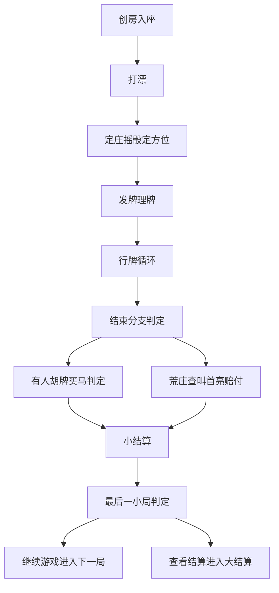

# 产品需求文档（PRD）——卡五星（好友房）

<!--
  模板改编自 game-ui-design-workflow (MIT License)
  https://github.com/mickorz/game-ui-design-workflow templates/spec-kit/prd.md
  改编说明：增加「事实溯源」要求与 GDD 关联列。
-->

> 职责边界：本文件只回答「产品要做什么」（功能、场景、流程、验收）。玩法细节（番型判定、算分公式、倍数口径）一律引用 `GDD.md` 对应规则，不在本文重复展开；页面交互细节与控件级状态机留给 `Interaction.md`，本文只到「对应页面/系统」粒度。唯一事实来源为 `source-analysis.md`；原文未定义的内容一律写「待确认」，不编造。

## 文档状态

- status: draft
- version: 0.1
- owner:
- last_updated: 2026-11-09

> status 只允许 draft / pending-human / approved。approved 必须由人工确认，AI 不得自行标记。

## 事实溯源汇总

### 引用事实（SRC 段范围）

本文件引用 `source-analysis.md` 的以下 SRC 段：

- SRC-001~099（01-基础规则）：入座方位、发牌理牌、漂/马/坎、亮倒/扣牌/危牌基础约束（经 GDD 转引，本文直接引用时以 SRC 为准）
- SRC-100~189（02-游戏流程）：创房入座、开局动画、打漂、定庄摇骰、发牌行牌、胡牌/荒庄分支、买马、结算续局全流程
- SRC-200~1047（03-打牌操作）：摸/提/出牌/碰/杠/胡/过/亮倒/扣牌/漏胡/托管操作与超时
- SRC-400~499（05-胡牌类型）：番数门槛提示、漏胡提示、胡牌按钮信息
- SRC-500~594（06-结算）：结算顺序、页签标签、封顶标识、荒庄查叫、包牌、大结算统计
- SRC-600~699（07-配置）：创房配置项全量、默认值、互斥联动、人数联动（本文「配置功能」章的主要事实来源）
- SRC-700~987（08-UI交互）：页面/控件/反馈文案/辅助功能/听牌提示/结算展示（本文功能需求表的主要事实来源）

引用截图：IMG-001 / IMG-002 / IMG-101 / IMG-601（创房面板实拍，仓库内均缺失）。凡默认值依据为截图的条目均已注明「AI 无法读取截图数值，需人工提供文本补充」，冻结前必须由人工按面板逐项抄录「配置项 / UI 类型 / 选中值 / 选项集」文本。

### GDD 关联约定

- 优先引用 GDD 编号规则：GDD-Rxxx（基础规则）/ GDD-Dxx（推导规则）/ GDD-Uxx（待确认事项）。
- GDD 中无编号的章节（操作规则、番型与胡牌条件、结算规则、核心循环等）以「GDD〈章节名〉」格式引用；纯辅助 UI 条目 GDD 无对应规则时标注「—」，完全依赖 SRC 事实。

### 推导内容（DERIVED）

本文件不新增推导。凡引用 GDD 推导规则处（GDD-D01~D26）直接沿用其推导依据与已裁决口径，不回退、不改写。

### 待确认（UNKNOWN/CONFLICT）清单

以下待确认项影响本文验收口径，实现与测试前必须由产品/人工确认：

| 待确认项 | 影响 | 关联 |
|---|---|---|
| 全量创房面板默认值（人数 3 人/局数 8 局/模式 正常/封顶 8 倍/买马 亮牌自摸买马/马数 买一马/频道 全频道/定庄 房主庄/对亮*2 默认勾选/其余开关默认不选）证据链均为截图 | 配置默认值冻结 | GDD-U01、IMG-601 |
| 局数选项集（8/16/24/32）与模式选项集（正常/简洁）仅存在于面板截图，无文本兜底 | 配置选项集冻结 | GDD-U02、IMG-601 |
| 定庄默认值=房主庄唯一证据为截图 | 定庄默认值冻结 | GDD-U03、IMG-001/IMG-101 |
| 「少于12张不亮」默认不选佐证为截图 | 亮倒组默认值冻结 | GDD-U04、IMG-002 |
| 回手杠被标注「（配置）」但三张创房表均无开关 | 杠限制实现口径 | GDD-U05 |
| 暗四归「刻子+顺子」结构限制标注「做成配置」但无开关 | 番型配置入口 | GDD-U06 |
| 倒计时初始时长/各场景秒数未定义 | 倒计时验收数值 | GDD-U08 |
| 骰子点数的游戏意义（随机坐庄随机源/方位判定）未定义 | 摇骰环节验收 | GDD-U09 |
| 大局/小局结构未定义（影响首局定漂与最后一小局判定） | 打漂与小结算主按钮 | GDD-U10 |
| 漂分公式「漂数」取值来源未明示（推断=玩家所选漂值） | 漂分展示 | GDD-U12 |
| 非托管场景的超时行为未定义 | 超时异常路径 | GDD-U16 |
| 过碰/过杠原文未定义（按「过手至摸牌解除」推导） | 行牌限制 | GDD-U17 |
| 加分项是否计入番数门槛未明示（按公式字面实现） | 捉炮门槛 | GDD-U13 |
| 2 人局方位标签与座位位置映射未明示 | 2 人模式验收 | 源文件 AMB-108 |
| 庄标显示条件原文仅写「本家或上家为庄」 | 玩家信息区验收 | 源文件 AMB-703 |
| 买马「中马亮起」动效与金边参数待美术稿补充 | 买马 UI 验收 | 源文件 AMB-710 |
| 「菱形光柱」与「箭头动效」是否同一动效待确认 | 牌河出牌展示 | 源文件 AMB-711 |

## 概述

- 项目 ID：`mahjong`
- 产品目标：为「卡五星（好友房）」2~3 人好友房私局提供产品功能层完整规格——定义创房配置（含全量配置项与互斥联动）、开局流程（入座/打漂/定庄/摇骰/方位/发牌）、行牌操作（摸提出/碰/杠/胡/过/亮倒/扣牌）、听牌提示、结算（含荒庄/查叫/包牌/首亮赔付/买马）、托管与超时、反馈 toast 与辅助功能的「产品要做什么」与可验收标准，作为 Interaction.md、Interaction-Contract.yaml 与测试用例的上游输入。
- 成功指标（可验证）：
  1. 覆盖率：必含功能清单（创房配置、开局流程、打漂、行牌操作、亮倒扣牌、听牌提示、结算、托管超时、反馈 toast、辅助功能、2 人适配等）全部有对应需求条目；每条需求均可追溯到 SRC 事实与 GDD 规则/章节，抽查可复现。
  2. 可测性：每条验收标准均可改写为「前置条件 + 操作 + 期望结果」的测试场景，并与 08-UI 交互 §19 检查清单（#1~130，SRC-968）建立映射。
  3. 零编造：原文未定义的默认值、开关、数值一律标注「待确认/需人工提供文本补充」，本文不出现任何推测数值。
- 非目标（明确不做）：
  1. 不展开玩法判定与算分公式：番型判定流水线、加倍项/加分项数值、封顶公式、漂马坎杠算法均引 GDD，本文不重复。
  2. 不定义页面布局尺寸、控件级状态机、动画帧级参数（归 Interaction.md；本文仅引用产品验收所需的时长/文案口径）。
  3. 不定义客户端与服务端的事件契约、字段与状态转移（归 Interaction-Contract.yaml）。
  4. 不包含服务端架构、网络协议、性能与兼容性指标。
  5. 不包含孝感卡五星、十堰卡五星变体专属规则与开关（本套仅覆盖卡五星好友房变体，SRC-097 / SRC-675 / SRC-676）。
  6. 不虚构原文未定义的配置开关、默认值与文案；相关项一律标「待确认」。

## 用户与场景

| 角色 | 目标 | 关键场景 | 来源事实 |
|---|---|---|---|
| 房主 | 创建好友房、按偏好配置玩法、邀请好友开局 | 创房面板逐项配置（含默认值）并开局；首局按定庄配置坐庄 | SRC-104、SRC-600~628、SRC-018 |
| 加入玩家 | 入座并完成完整对局（打漂、行牌、胡牌或荒庄、结算） | 逆时针固定入座；选漂；碰/杠/胡/过；亮倒扣牌；小结算与大结算 | SRC-105~107、SRC-110~116、SRC-155、SRC-174~186 |
| 离线/挂机玩家 | 断线重连不丢局；暂时离手由托管或自动摸打代打且不点炮 | 断线计时与重连；各类超时默认行为；托管危牌择牌 | SRC-737、SRC-095、SRC-1041~1046 |

## 功能需求

> ID 规则：P0 = PRD-0xx（核心玩法闭环与规则强相关功能，缺失即不可上线）；P1 = PRD-1xx（重要辅助与适配功能）；P2 = PRD-2xx（打磨项与实现参考）。「对应页面/系统」为承接粒度（页面或系统级），控件级细节归 Interaction.md。

### P0（必须）

| ID | 需求 | 对应页面/系统 | 关联 GDD 规则 | 验收标准 | 来源事实 |
|---|---|---|---|---|---|
| PRD-001 | 创房面板提供基础配置：人数单选（2 人/3 人）、局数单选（8/16/24/32 局）、模式单选（正常/简洁）；默认 3 人/8 局/正常（默认值依据截图 IMG-601：AI 无法读取截图数值，需人工提供文本补充；局数与模式选项集亦仅截图佐证） | 创房面板 | GDD-U01、GDD-U02 | 分别创建 3 人房与 2 人房，房内可入座人数与所选项一致；创建 8 局房，第 8 小局小结算主按钮为【查看结算】；切换局数与模式不改变任何算分规则 | SRC-600、SRC-601、SRC-636、SRC-637、SRC-627 |
| PRD-002 | 封顶配置：单选 8/16/32/64/不封顶，默认 8 倍（截图依据需人工提供文本补充）；选项集不含 128 倍（实拍下拉冲突已裁决） | 创房面板 | GDD-D25、GDD〈结算规则·封顶〉 | 选 64 倍时番型×加倍项超过 64 被截断为 64；选「不封顶」时三龙七对 128 倍不被截断；漂/马/坎/杠在任何封顶档位下均不截断 | SRC-602、SRC-630、SRC-638、SRC-639、SRC-640 |
| PRD-003 | 漂分配置四模式：不漂/自由漂/固定漂（下拉 1/2/5/10）/首局定漂；整体默认「固定漂 2」为需求明文（实拍冲突已裁决取明文） | 创房面板 | GDD-D24、GDD〈漂分〉 | 默认选中固定漂 2；选固定漂时无选漂环节且开局即头像旁显示【漂2】；选自由漂每小局出现选漂 UI；选不漂时全局无漂 UI 且漂分恒为 0 | SRC-603、SRC-642、SRC-643、SRC-629 |
| PRD-004 | 买马配置三档（自摸买马/亮牌自摸买马/不买马，默认 亮牌自摸买马〔截图依据需人工提供文本补充〕）与马数配置四档（买一马/买一送一/买5马/买6马，默认 买一马〔截图依据同上〕）；选「不买马」时马数选项隐藏不展示 | 创房面板 | GDD-U01、GDD〈马分〉 | 选不买马后马数不可见；选亮牌自摸买马后仅亮牌状态自摸胡触发买马环节；买一马时剩余牌不足则不买马；买5马一张不中按 6 马计分 | SRC-604、SRC-605、SRC-645、SRC-646、SRC-647、SRC-677 |
| PRD-005 | 频道配置：单选 全频道/半频道，默认全频道（截图依据需人工提供文本补充）；频道决定明/暗四归是否触发 | 创房面板 | GDD-U01、GDD〈频道〉 | 半频道下胡的那张牌必须为四归第四张才计四归番型；全频道下结构符合即计；频道切换不影响封顶 | SRC-606、SRC-649、SRC-360、SRC-361 |
| PRD-006 | 亮倒组开关 5 项：部分亮/少于12张不亮/对亮*2（默认勾选）/胡牌必须亮倒/双亮（仅 3 人可勾选）；全部默认值依据截图 IMG-601：AI 无法读取截图数值，需人工提供文本补充；「亮倒自动胡」本变体无此选项（创房表序号 14 跳号） | 创房面板 | GDD-U01、GDD-U04、GDD〈操作规则·亮倒〉 | 勾选「胡牌必须亮倒」后未亮倒玩家不可胡；勾选「部分亮」后亮倒仅听口相关牌亮出、其余按【暗】展示；勾选「少于12张不亮」且牌堆剩余小于 12 张后不再出现【亮】按钮 | SRC-607、SRC-608、SRC-609、SRC-610、SRC-611、SRC-612、SRC-650~655 |
| PRD-007 | 规则开关组 10 项：高分玩法/数坎/卡五星*4/碰碰胡*4/海底捞炮*2/杠上花炮*4（同一勾选覆盖抢杠胡）/包牌（仅 3 人）/上楼/查叫/三元七对*8（取消勾选则该番型不参与判定）；默认均不选（截图依据需人工提供文本补充） | 创房面板 | GDD-U01、GDD-D17、GDD-D23 | 默认态按基础番型表计分（无高分换档/坎分/海底/上楼/查叫/包牌/三元七对）；勾选数坎后坎分进入最终得分；勾选上楼后符合条件时骰子停止同时展示「上楼X2/X4」；未勾选三元七对时三元七对牌型不成立 | SRC-613~622、SRC-627、SRC-628、SRC-667 |
| PRD-008 | 定庄配置：单选 随机庄/房主庄，默认房主庄（截图 IMG-001/IMG-601 依据：AI 无法读取截图数值，需人工提供文本补充） | 创房面板 | GDD-R013、GDD-U03 | 选房主庄首局房主为庄；选随机庄首局庄家随机；第二小局起按轮庄规则与该配置无关 | SRC-623、SRC-018、SRC-124、SRC-674 |
| PRD-009 | 创房面板互斥与显隐联动：勾选高分玩法后卡五星*4/碰碰胡*4/杠上花炮*4/三元七对*8 变灰且自动取消勾选（取消高分玩法后恢复可选）；「胡牌必须亮倒」与「双亮」互斥不可同勾；人数选 2 人时包牌与双亮置灰且取消勾选、选 3 人恢复可选（默认均不选）；买马选「不买马」时马数隐藏 | 创房面板 | GDD-U01、GDD〈数值与配置·人数联动〉 | 逐项切换后置灰与自动取消勾选状态正确；3 人房勾选包牌后改 2 人开局，包牌规则不生效（以人数为准，面板勾选态与生效态允许不一致）；2 人房内包牌/双亮全程不生效 | SRC-658、SRC-654、SRC-426、SRC-632、SRC-646、SRC-677、SRC-682、SRC-691 |
| PRD-010 | 人数联动：切换人数后起手合计与发牌后余量随人数变化（3 人 40/44 张、2 人 27/57 张）、方位取值范围变化（2 人东/南、3 人东/南/西）、漂分收分对象数量随人数变化 | 创房面板与牌桌 | GDD-R015、GDD-R019、GDD-D02 | 2 人房发牌后剩余张数显示 57、3 人房显示 44；切人数后方位标签集合断言正确；面板其余配置项默认值不随人数变化（包牌/双亮默认不选） | SRC-631、SRC-633、SRC-634、SRC-635、SRC-679、SRC-683 |
| PRD-011 | 入座：房主创建房间后，后续加入者按逆时针顺序入座且座位固定；2 人固定与房主对家一上一下（下方自己、上方对家），3 人固定为房主下家与上家（下方自己、左侧上家、右侧下家） | 牌桌座位区 | GDD-R016 | 3 人房按加入顺序落座位置断言正确；2 人房上下布局断言正确；整个房局期间座位不随局变动 | SRC-021、SRC-105、SRC-106、SRC-107、SRC-631、SRC-712 |
| PRD-012 | 开局动画：每次开房首局播放「对局开始」动画（玩家头像/昵称/积分按位置由小到大出现、上移离屏、屏外进入、中间「对局开始」文字、停留后减淡消失），积分初始 0；之后各局开局直接进入摇骰发牌 | 牌桌开局流程 | GDD〈核心循环·进入房局〉 | 首局断言动画播放且积分显示 0；第二局断言无开局动画、直接进入摇骰发牌 | SRC-108、SRC-109、SRC-714、SRC-715、SRC-716、SRC-939 |
| PRD-013 | 打漂四模式 UI 流程：不漂（无环节不计漂分）；固定漂（开局同时头像旁直接出现漂结果并同时打骰子）；首局定漂（仅大局第一小局选漂、后续同固定漂）；自由漂（每小局选漂）；选漂选项集为 不漂/漂1/漂2/漂5/漂10，选漂 UI 瞬间出现、未完成玩家头像旁显示【选漂中...】、最后一人完成的同时漂 UI 飞行 1 秒至头像旁并开始打骰子；「漂数」与所选漂值的映射待确认 | 牌桌打漂环节 | GDD-U12、GDD〈核心循环·打漂〉 | 四种模式各开局一次，流程差异断言正确；选漂结果常显于头像旁（漂0~漂10）；自由漂下第二小局仍出现选漂 UI、首局定漂下不出现 | SRC-074~077、SRC-110~116、SRC-766~772、SRC-941 |
| PRD-014 | 定庄与庄标：首局按定庄配置产生庄家；同桌继续按轮庄规则（单个胡牌者庄、一炮多响点炮者庄、荒庄连庄、多人抢杠胡由补杠者庄）；发牌开始后骰子滚动停下时庄家头像上直接出现【庄】标志（无过程动画） | 牌桌定庄环节 | GDD-R013、GDD-R014、GDD-D06 | 四种结束形态（单胡/一炮多响/荒庄/多人抢杠胡）后下一局庄家归属断言正确；庄标出现时机为骰子停止时 | SRC-017~019、SRC-118~123、SRC-181~183、SRC-717、SRC-718 |
| PRD-015 | 方位展示：庄=东，其余按人数逆时针依次南、西（3 人=东/南/西、2 人=东/南）；确认庄家开始摸牌时显示，之后不变直到重新匹配重置；轮到出牌的玩家方位闪烁高亮 1 秒、他人碰杠胡不改变高亮、对局结束无高亮；2 人局方位标签与座位位置的映射待确认 | 牌桌方位区 | GDD-R015 | 3 人房三方位值与 2 人房两方位值断言正确；重新匹配前方位不随局变化；出牌轮转时高亮跟随 | SRC-020、SRC-127、SRC-128、SRC-129、SRC-708、SRC-710、SRC-711、SRC-721~724 |
| PRD-016 | 摇骰与上楼展示：发牌时显示两个骰子环绕转动，玩家拿齐所有手牌后停止转动并展现数字、停留 1 秒后消失；勾选「上楼」且该局符合上楼条件（上局荒庄或一炮多响、或本局双骰同点）时，骰子停止同时上方展示「上楼X2/X4」；骰子点数的游戏意义待确认 | 牌桌方位区（骰子/上楼） | GDD-R017、GDD-U09 | 上楼条件①与条件②分别触发时倍数文案断言正确（同触发为 X4）；未勾选上楼时不展示；骰子停留 1 秒后消失 | SRC-125、SRC-126、SRC-133、SRC-135、SRC-720、SRC-729、SRC-730、SRC-942 |
| PRD-017 | 倒计时：显示玩家可操作倒计时，最多两位数、默认蓝色、为 03/02/01/00 时变黄；他人打出牌使自己可碰/杠/胡时自己视角倒计时重置为初始值，他人有操作时他人视角倒计时无变化；各场景初始秒数待确认 | 牌桌方位区（倒计时） | GDD-U08 | 倒计时进入 03~00 区间时颜色变黄断言正确；自己获得碰/杠/胡机会时倒计时重置断言正确 | SRC-130、SRC-131、SRC-132、SRC-725~728 |
| PRD-018 | 发牌：从庄家位开始逆时针发牌（每人 4 张共 3 轮，再每人 1 张，最后给庄家位发 1 张）；庄家 14 张、闲家 13 张，庄家最后一张置于手牌最右侧摸牌位；全桌获取节奏同步、发牌总时长 1 秒；本玩法无牌墙、仅展示剩余张数（对局前不显示） | 牌桌发牌流程 | GDD-R002、GDD-R003、GDD-R004、GDD-R005、GDD-R019 | 发牌后庄/闲手牌张数断言正确；3 人起手合计 40 张余量 44、2 人起手合计 27 张余量 57；对局前后无牌墙元素 | SRC-002~005、SRC-136~143、SRC-705、SRC-706、SRC-742~749 |
| PRD-019 | 手牌排列与理牌：手牌从左至右花色依次筒、条、中、发、白，同花色内 1~9；发牌完毕所有玩家自动理牌（0.5 秒）；每个打牌回合出牌后，将摸进未打出的牌插入手牌（插入式 0.5 秒/平移式 0.3 秒；同点多张随机插入、单张按序插入） | 手牌区 | GDD-R025 | 手牌排序断言正确（含字牌位置）；出牌后摸进的牌插入到排序正确位置 | SRC-148~151、SRC-1033~1036、SRC-751~758 |
| PRD-020 | 摸牌与补牌：上家打出牌的瞬间下家摸牌（肉眼同步）；摸牌与杠后补牌均置于手牌最右侧、与一般手牌间隔 1/4 牌距；补牌从牌堆倒序取 1 张、视为摸牌、剩余张数额外减 1 | 手牌区与行牌系统 | GDD-R011 | 摸牌时机与位置断言正确；每次杠后牌堆剩余张数额外减 1 断言正确 | SRC-202~206、SRC-269~271、SRC-773~776 |
| PRD-021 | 提牌：单击牌面提起（约 1/4 牌高、每次仅 1 张）；点击非牌面空白处放下、点击该牌牌面不能放下；可滑动依次选择多张、手指离开手牌时最终触达的牌提起；提起可听牌时联动弹出听牌提示 | 手牌区 | GDD〈操作规则〉 | 提起/放下/滑动选择/听牌联动四项交互断言正确 | SRC-218~221、SRC-777~780 |
| PRD-022 | 出牌三方式：双击出牌默认开启（点击已提起的牌打出）；单击出牌默认关闭（开启后点击不可听牌直接打出、轮到自己出牌前提起的牌自动下落）；滑动出牌默认关闭（上滑超过提起高度显示透明牌随手指移动、松手打出、移回提起高度水平线则撤回）；双击与单击互斥、滑动不互斥；默认值以设置表裁决为准 | 手牌区与局内设置 | GDD〈操作规则·摸牌与打牌〉 | 三种方式开启/关闭组合下的出牌行为断言正确；双击与单击互斥断言正确；滑动关闭后上滑无透明牌 | SRC-213~217、SRC-788~791、SRC-912、SRC-913、SRC-918 |
| PRD-023 | 碰：任意一家打出一张牌、手上有 2 张相同即可碰（不限上家、危牌可碰）；碰后 3 张成刻子亮于手牌左侧（按本局操作顺序摆放、牌面朝上、带方位箭头）并取得出牌权须再打出 1 张；手牌右上方显示【碰】【过】、可碰牌高亮其余暗置（有胡时不暗置） | 手牌区与碰牌区 | GDD-R007 | 可碰任何一家断言正确；碰后取得出牌权且必须再打一张断言正确；碰超时（托管开启）默认过 | SRC-010、SRC-229~238、SRC-793~798 |
| PRD-024 | 三种杠与杠分实时飘分：直杠（他人打出牌且手中有相同 3 张；打出者支付 2 倍底分）；明杠/补杠（碰牌后后续摸到第 4 张、当前回合不可杠；其他玩家各支付 1 倍）；暗杠（非碰牌后的出牌阶段手有 4 张相同；其余玩家各支付 2 倍、展示三张牌背一张牌面）；杠分实时结算并即时飘分、小局结束不额外再算；手牌右上方显示【杠】【过】 | 手牌区与杠牌区 | GDD-R008、GDD-R009、GDD-R010 | 三类杠的杠分金额与赔付方向断言正确（术语按本玩法口径：明杠=补杠、直杠=大明杠）；杠动画播放同时飘分 | SRC-007、SRC-008、SRC-026~029、SRC-239~246、SRC-799~806、SRC-826 |
| PRD-025 | 杠通用限制与杠上杠：牌堆剩余 0 不可杠；未亮倒时危牌不可明杠（补杠）、直杠与暗杠可以；亮倒后杠限制按 GDD（已碰牌补杠口径存在冲突、待确认）；回手杠两条常驻规则（原文标注可配置但无开关、待确认）；杠上杠连杠倍率为基础杠分乘 2 的（连杠次数减 1）次方、可跨玩家连续、补牌后打出无人杠则中断清零；多杠状态显示可杠牌选择框（托管超时默认不杠）；结算详情对触发杠上杠的杠展示「杠上杠 Y 倍」 | 手牌区与杠牌区 | GDD-R012、GDD-U05、GDD-U18 | 牌堆剩 0 时杠按钮不出现；连续三次杠的杠分按 1/2/4 倍断言正确；中断后从 1 倍重新起算断言正确 | SRC-031~037、SRC-041~044、SRC-255~261、SRC-268、SRC-817、SRC-581、SRC-964 |
| PRD-026 | 抢杠胡流程：补杠时若有人可抢杠胡，则不播放杠动画、不播放飘分，直到抢杠方完成选择后再按杠成立或抢杠胡成立走对应流程；抢杠胡成立时明杠玩家视为未杠成功、已实时收取的该杠杠分回退、杠上杠中断、下一局由补杠者坐庄、不触发上楼（玩法细节归 GDD） | 手牌区与结算系统 | GDD-D05、GDD-D06、GDD-D07 | 补杠被抢时动画挂起至选择完成断言正确；抢杠胡成立后各方分数回退、下一局补杠者坐庄断言正确 | SRC-047~052、SRC-267、SRC-460~462、SRC-465、SRC-806 |
| PRD-027 | 胡与自摸：支持 8 种和牌方式的产品入口（自摸/点炮/抢杠胡/杠上花/杠上炮/海底捞/海底炮/一炮多响）；【自摸】按钮左侧显示本次胡的牌与倍数、【胡】按钮上显示本次胡的牌与倍数（均按自摸/非自摸口径显示），倍数触发封顶时显示【封顶】且仅显示封顶倍数；有自摸按钮时不可直接出牌；自摸/点炮牌摊开摆放于手牌右侧并显示方位箭头 | 手牌区操作按钮 | GDD〈胡（8 种和牌方式）〉、GDD〈胡牌限制层〉 | 番型×加倍项等于 1 时只出现【自摸】无【胡】（捉炮门槛）；勾选海底捞/炮*2 前海底场景不出现海底按钮倍数加成；封顶场景按钮倍数显示为封顶值 | SRC-273~293、SRC-438~441、SRC-807~815 |
| PRD-028 | 过：每次碰/杠/胡/亮倒操作机会均显示对应【过】按钮，点击即放弃该次机会 | 手牌区操作按钮 | GDD〈操作规则·过与漏胡〉 | 各操作场景下【过】按钮存在且点击后不再获得该次机会断言正确 | SRC-297、SRC-298 |
| PRD-029 | 漏胡与过碰过杠：可胡不胡即为漏胡，漏胡玩家摸牌前不可胡牌、摸牌（含杠后补牌）后解除，触发时浮动提示「当前未过手，无法胡牌」1.5 秒；过碰/过杠（过手至摸牌解除的同口径限制）原文未定义、按推导口径实现并标注待产品确认 | 行牌系统与反馈层 | GDD-U17 | 漏胡后他人再打同张牌时不可胡断言正确；自己摸牌后恢复可胡断言正确；漏胡提示文案与时长断言正确 | SRC-093、SRC-094、SRC-096、SRC-429~434、SRC-1037~1040 |
| PRD-030 | 多状态按钮与一炮多响展示：多状态时手牌右上方按钮从左至右依次为【碰】【杠】【亮】【胡】或【自摸】【过】；胡类优先于碰杠（同一张牌既有胡又有碰时胡优先）；一炮多响展示：放炮玩家与围观视角显示所有玩家所胡番型与飘分、胡牌玩家视角仅显示自己所胡番型；飘分正分黄色、负分灰色 | 手牌区操作按钮 | GDD〈操作优先级与多状态〉、GDD-D21 | 同时可碰可胡时按钮顺序与胡优先断言正确；一炮多响两家分别计分断言正确 | SRC-236、SRC-280、SRC-286、SRC-294~296、SRC-484、SRC-814~818 |
| PRD-031 | 亮倒触发：三种触发（打出一张非危牌后可听牌；手牌中全是危牌；自摸时每次展示）；摸牌或补牌后满足条件出现【亮】【过】且听牌标签正常展示；勾选「少于12张不亮」且牌堆剩余小于 12 张后不再下放亮倒权限（不出现【亮】） | 手牌区操作按钮 | GDD〈操作规则·亮倒〉 | 三种触发场景各验证一例断言正确；牌堆降至 12 张以下后【亮】按钮不再出现断言正确 | SRC-053、SRC-058、SRC-651、SRC-1001~1004、SRC-827、SRC-828、SRC-936 |
| PRD-032 | 亮倒流程：点【亮】后所有碰杠胡交互按钮消失（听牌提示箭头不消失），随后进行扣牌判断——无可扣刻子直接进入「亮倒-打牌」界面、有可扣刻子则打开扣牌界面；亮倒后明牌、不可改牌只能摸打且只能打出维持听牌的牌；胡的牌成为其他未亮倒玩家危牌、自己的危牌标签去除 | 手牌区与亮倒系统 | GDD〈操作规则·亮倒〉 | 点亮后按钮消失与听牌箭头保留断言正确；亮倒后打出非维持听牌的牌被拦截断言正确 | SRC-054、SRC-1005~1007、SRC-1011、SRC-829、SRC-852 |
| PRD-033 | 扣牌界面：自己手牌上方展示半透明遮罩；标题【请选择扣牌】；候选区将手中所有可扣的牌以单张形式展示在标题下方、顺序与手牌左到右一致、每张右下角有选中圆圈；手牌区可扣的牌不变、其余牌全部遮罩；遮罩下方展示【取消】【选择完成】按钮；点击候选牌在选中/取消间切换（绿色对号与手牌对应三张【扣】标签同步出现/消失） | 扣牌弹窗 | GDD〈操作规则·扣牌〉 | 界面元素与选中联动断言正确；候选区顺序与手牌顺序一致断言正确 | SRC-1026、SRC-1027、SRC-830~836、SRC-945 |
| PRD-034 | 扣牌校验：点【选择完成】后判断扣下所有选中刻子后剩余牌打出一张是否可听；不可听则取消所有选中并弹提示「当前扣牌没有胡口！」（停留至用户操作）；可听则界面消失切换到「亮倒-打牌」；可扣判断规则（去掉刻子后仍满足打出一张非危牌后可听、多组同扣需复检）与扣下张数归 GDD | 扣牌弹窗 | GDD〈操作规则·扣牌〉 | 需求示例场景（3 筒与 9 筒同时扣不满足条件被拒绝）复现断言正确；校验通过后听牌按剩余亮出的牌决定断言正确 | SRC-1020、SRC-1022~1025、SRC-1029、SRC-838、SRC-947 |
| PRD-035 | 取消等价过：扣牌界面点【取消】等同【过】且桌面交互按钮不会再出现；「亮倒-打牌」界面右上角取消等同【过】回到正常出牌界面（【扣】标签消失、遮罩消失、正常展示所有听牌提示、可正常提牌出牌） | 扣牌弹窗与亮倒界面 | GDD〈操作规则·扣牌〉 | 两处取消后的界面状态断言正确；取消后本轮不再出现亮倒/扣牌机会断言正确 | SRC-1000、SRC-1028、SRC-837、SRC-842、SRC-843 |
| PRD-036 | 亮倒-打牌界面：扣住的牌带【扣】标签且带遮罩、不可打出；手牌中打出后可听的牌亮起并带听牌提示标签、其余牌全部遮罩；出现提示「请选择胡口」；危牌不被排除在「亮起」之外（显示层正常亮起与计标），点击时仍按危牌规则阻断；点击有遮罩的牌无效果；被扣的危牌标签切换为【扣】且不带听牌提示标签 | 亮倒界面 | GDD〈操作规则·亮倒/扣牌〉 | 显示层与交互层口径断言正确（危牌亮起但点击被阻断）；遮罩牌点击无效果断言正确 | SRC-1012~1016、SRC-839~846、SRC-946 |
| PRD-037 | 危牌阻断：一般出牌阶段打出危牌与亮倒界面点击危牌均 toast「打出该牌将会放炮！」（1.5 秒）并阻断出牌；手中全是危牌时可打出任何危牌（含摸/补的牌、不计算碰杠牌区）；危牌可以碰、不可危牌明杠（补杠）、直杠与暗杠可以 | 手牌区与反馈层 | GDD〈操作规则·危牌〉 | 混合危牌与非危牌时危牌点击被阻断断言正确；全危牌时放行断言正确；亮倒玩家自己的危牌标签去除后可正常打出 | SRC-069~073、SRC-208、SRC-209、SRC-212、SRC-1014、SRC-845、SRC-948 |
| PRD-038 | 亮倒展示与标签体系：自己亮倒后手牌全部推到碰杠牌区靠右正上方并摆出自己所有听牌（可胡牌为 0 也展示）；他人亮倒推倒展示（胡牌推倒视角）；标签体系【危】【扣】【暗】（部分亮模式）均展示于牌左上角；亮倒文字动画在出牌 0.5 秒后出现、持续 1 秒；胡牌后全部手牌复位并去掉所有标签与蒙版 | 手牌区与亮倒展示 | GDD〈操作规则·亮倒/扣牌/危牌〉 | 三种标签的显示条件断言正确；部分亮与非部分亮的扣牌标签差异（【暗】与【扣】）断言正确 | SRC-847~856、SRC-1030~1032 |
| PRD-039 | 听牌标签：向听数为 1 时，打出可听牌的牌上方展示听牌提示标签，优先级 优 > 大 > 多 > 箭头、同一牌点同时满足仅显示最高优先级；标签随可胡牌张数与倍数实时变化（张数最少按 0 张、倍数最少按 1 倍）；已听牌时手牌上方显示【听牌】与【自动摸打】入口（不遮挡手牌） | 手牌区听牌提示 | GDD〈番型与胡牌条件〉 | 优/大/多/箭头四类判定示例各复现一例断言正确；可胡牌被打完后标签降级断言正确 | SRC-857~866、SRC-874 |
| PRD-040 | 胡牌信息框：提起可听牌弹出胡牌信息框，展示可胡张数、可胡牌信息（牌面、倍数、张数）；一排最多 4 个、从左到右按倍数大小排序、同倍数按筒 1~9、条 1~9、中、发、白排序；超过 3 排支持上下滑动；指定牌已全部亮出（亮出牌加手牌等于 4）时牌面变暗；预测倍数口径不计对亮与番型加分项、计算自己的亮倒不计算他人亮倒、不计自摸倍数，超过封顶显示封顶倍数且信息框左下角固定展示房间封顶倍数；点击空白处/其他提示牌/新摸牌或出牌时关闭 | 手牌区听牌提示 | GDD〈番型与胡牌条件〉、GDD〈结算规则·封顶〉 | 排序规则与封顶展示断言正确；倍数口径（不含对亮）断言正确；三种关闭时机断言正确 | SRC-857、SRC-867~876 |
| PRD-041 | 自动摸打：听牌时可勾选【自动摸打】进入托管（头像不展示托管图标）：按摸打逻辑等待 1 秒打出摸到的牌；摸到的牌是危牌时退出自动摸打；碰/杠等待 1 秒后取消；胡等待 1 秒后自动胡牌；期间可再次点击取消勾选或点「取消托管」按钮取消 | 手牌区与托管系统 | GDD〈操作规则·超时托管〉 | 勾选后自动出牌时序断言正确；摸到危牌退出自动摸打断言正确；头像不显示托管图标断言正确 | SRC-874、SRC-877、SRC-922、SRC-1044、SRC-1046 |
| PRD-042 | 胡牌结算流程与番型动画：有人胡牌后所有玩家摊牌展示（对家按真实视角倒着）、按胡牌顺序在对应玩家面前展示「胡/自摸」文字、桌面中间播放「对局结束」动画约 1.3 秒（文字停留 0.5 秒）；番型动画在对应玩家手牌前播放 1.5 秒（特殊番型优先、单次最多一个、多个特殊番型优先杠相关、无特殊番型播倍数最大的普通番型、同倍按番型 ID 顺序）；飘分正分黄色负分灰色（5 位数以个为单位、6 位数以万为单位）；胡牌总时长 2~3 秒，之后进入买马判断或小结算 | 结算流程 | GDD〈结算规则〉、GDD〈核心循环〉 | 摊牌、文字、动画、飘分的顺序与时长断言正确；番型动画优先级断言正确 | SRC-160~163、SRC-819~826、SRC-879~882、SRC-938 |
| PRD-043 | 买马 UI：胡牌后按买马配置判定——触发（自摸买马或亮牌自摸买马且满足触发条件）则直接弹出买马界面（UI 与牌同时出现、中的马带金色边亮起〔亮起动效参数待美术稿补充、待确认〕、同时出现「中X马」文字、持续 1.5 秒后关闭直接打开小结算）；未触发则胡牌动画结束后直接弹出小结算；荒庄不买马；马数四档算法与数量不足处理归 GDD | 买马弹窗 | GDD〈马分〉、GDD-U01 | 自摸买马与亮牌自摸买马的触发差异断言正确；荒庄无买马环节断言正确；买 5/6 马计分与兜底（一张不中或中 5 张按 6 马计）断言正确 | SRC-169~173、SRC-889、SRC-543、SRC-888~891、SRC-957 |
| PRD-044 | 小结算界面：对局结束进入小结算——按本玩家胜负展示标题与底色（分数大于等于 0 显示【恭喜获胜】与胜利底色、小于 0 显示【遗憾失利】与失败底色）；展示返回按钮、房号、小局结束时间（24 小时制）、手牌详情区（按玩家确定高度、2 人复用 3 人高度、庄家头像左上角【庄】、开启漂功能时头像右上角展示漂数）、结算信息文字（仅自己展示，顺序：胡分、杠分、荒庄查叫、漂分、马分、其他分；未开启规则显示 +0、漂分马分未开启或为 0 不显示；页签标签体系：自摸/被自摸/捉炮胡/点炮/一炮多响/包牌/查叫/被查叫/首亮赔付；输方触发番型封顶时总得分加【封顶】标识）；自己的结算信息右侧固定有详情按钮，详情页签顺序为杠分、胡分、荒庄查叫（含多条合并规则）；主按钮：最后一小局显示【查看结算】、否则显示【继续游戏】 | 小结算界面 | GDD〈结算规则·结算顺序〉、GDD〈大结算统计〉 | 各页签标签在对应场景下展示断言正确；结算信息整体顺序与详情页签顺序断言正确；主按钮在最后一局与非最后一局的切换断言正确 | SRC-892~903、SRC-575~584、SRC-958~966 |
| PRD-045 | 荒庄分支（含查叫与首亮赔付）：可摸牌数为 0 且无人胡牌即荒庄——所有玩家摊牌展示、展示【荒庄】文字 1.3 秒；无未听牌玩家直接出小结算；有未听牌玩家则所有未听牌玩家同时飘字【未听牌】、勾选查叫时同时展示查叫分数、触发亮倒赔付时在查叫后展示【亮倒荒庄】文字并赔付（本局第一个亮倒玩家向其他所有玩家各赔 1 倍底分）、展示加分和扣分后出小结算界面；荒庄后杠分不退还、荒庄不买马、查叫时漂也赔（查叫公式与封顶控制归 GDD） | 结算流程与小结算 | GDD-R020、GDD-D18、GDD〈荒庄分支/查叫/首亮赔付〉 | 三场景断言正确：无未听直接小结算；有未听未勾查叫仅飘字；有未听勾查叫且有亮倒时查叫与首亮赔付金额与顺序正确 | SRC-164~168、SRC-552~563、SRC-884~887、SRC-955、SRC-956 |
| PRD-046 | 包牌结算：勾选包牌（仅 3 人可开）时点炮亮倒玩家——点炮者需支付相当于该亮倒玩家自摸的分数（含番型×加倍项、马、漂、坎），包牌下买马照常触发且马分由点炮者一人承担；若另一玩家也亮倒，点炮者还需按对其点炮计分（含马、漂、坎）；结算标签：点炮者展示【点炮】、捉炮者展示【包牌】、获得包牌赔付的玩家展示【包牌】；2 人开局自动失效 | 结算系统与小结算 | GDD-D14、GDD-D19、GDD〈包牌〉 | 包牌赔付构成（含马漂坎）断言正确；第二家亮倒的叠加赔付断言正确；2 人房内包牌不生效断言正确 | SRC-564~568、SRC-669、SRC-578 |
| PRD-047 | 大结算统计：最后一小局小结算主按钮为【查看结算】，点击进入大结算（复用杭麻大结算、统计类型按卡五星调整）：自摸 X 次、点炮 X 次（一炮多响只算一次）、亮倒、未听四项统计 | 大结算界面 | GDD〈大结算统计〉、GDD-U10 | 构造含自摸、点炮（含一炮多响）、亮倒、荒庄未听的完整房局后，四项统计计数断言正确 | SRC-175~180、SRC-585、SRC-586、SRC-903、SRC-904 |
| PRD-048 | 超时托管默认行为：配置开启托管时——出牌超时（有提起或无提起的牌）均打新摸进来的牌；碰/杠超时默认【过】；有胡牌的多状态超时默认胡牌；多杠状态超时默认不杠；非托管场景的超时行为原文未定义、待确认 | 行牌系统 | GDD-U16、GDD〈操作规则·超时托管〉 | 四类超时场景的默认行为断言正确；未开启托管时超时行为按待确认结论落地前不得自行取值 | SRC-095、SRC-227、SRC-237、SRC-292、SRC-296、SRC-299、SRC-496、SRC-817 |
| PRD-049 | 托管状态与择牌：托管状态下无法进行提牌操作，仍可点碰/杠/胡/过且操作后取消托管状态；头像处覆盖托管图标（自动摸打不显示）；托管打牌等待 1 秒打出摸到的牌，摸到的牌是危牌时在非危牌中从左到右选择第一张打出、手牌全是危牌时打出摸到的牌；亮倒后同时触发托管按托管逻辑执行且不需考虑危牌；亮倒后未托管时杠/胡触发后等待玩家操作 | 托管系统与玩家信息区 | GDD〈操作规则·超时托管〉 | 托管择牌三分支断言正确；操作后托管解除断言正确；托管图标显示条件断言正确 | SRC-1041~1046、SRC-738、SRC-921~924 |
| PRD-050 | 反馈与 toast 全量：按反馈文案清单实现触发条件、停留时长与可见性——对局开始、选漂中...、漂0~漂10 标签、上楼X2/X4、您是庄家请优先出牌、等待庄家优先出牌、请选择扣牌、请选择胡口、当前扣牌没有胡口！、打出该牌将会放炮！、当前未过手无法胡牌、番数不足无法捉炮！、您发言太快了请休息一下吧！、胡/自摸、对局结束、荒庄、未听牌、亮倒荒庄、中X马、恭喜获胜、遗憾失利、查看结算、继续游戏、封顶标识、结算页签文案、杠上杠 Y 倍、（封顶）、数坎/漂/买马/荒庄赔付详情行、断线计时共 29 项；时长口径：浮动提示/toast 类 1.5 秒、弹窗类停留至用户操作、结果文字类常驻至下一动作 | 反馈层（toast/弹窗/飘字） | GDD-R022、GDD〈操作规则·过与漏胡/危牌/扣牌〉、GDD〈胡牌限制层·限制 1〉 | 清单 29 项逐条触发断言正确（触发条件、文案、停留时长、可见性三要素）；时长口径抽查断言正确 | SRC-878、SRC-938~967 |

### P1（重要）

| ID | 需求 | 对应页面/系统 | 关联 GDD 规则 | 验收标准 | 来源事实 |
|---|---|---|---|---|---|
| PRD-101 | 2 人模式适配：座位固定一上一下（下方自己、上方对家）；方位仅东/南；牌河自己与对家均居中每排 13~14 张共 3 排；小结算手牌详情区复用 3 人高度；包牌与双亮置灰或自动失效；一炮多响在 2 人局逻辑上不可能发生（无需支持）；买马、上楼照常适用；2 人方位标签与座位位置的映射待确认 | 牌桌与小结算（2 人布局） | GDD-R023、GDD-D21 | 2 人房完整跑通一局断言正确；构造任一出牌场景均不出现一炮多响；小结算详情区高度与 3 人一致 | SRC-106、SRC-631、SRC-635、SRC-680、SRC-681、SRC-682、SRC-760、SRC-761、SRC-897、SRC-935 |
| PRD-102 | 牌河与出牌展示：牌河按出牌顺序从左至右摆放（3 人：自己每排 12~13 张、左右两家每排 7 张共 3 排）；被碰、杠、胡的牌不在牌河展示；新摸到的牌或提起的单张牌与牌河、碰牌区同牌时高亮；最近打出的牌播放菱形光柱漂浮动画 1 秒（与「箭头动效」是否同一动效待确认）；出牌放大默认开启（放大展示并放置于面前牌堆、下一玩家有操作后消失）、关闭则直接放置（移动过程约 0.5 秒）；其他家打出的牌始终显示摸到的那张牌 | 牌河区 | GDD-R005 | 三种人数牌河布局断言正确；被碰杠胡的牌从牌河移除断言正确；同牌高亮断言正确 | SRC-222、SRC-224~226、SRC-759~765、SRC-782~787、SRC-764 |
| PRD-103 | 玩家信息区：头像区展示头像、昵称（最多 10 字符、超出第 7~8 字符显示省略号）、当前积分（5 位数以个为单位、6 位数以万为单位、可为负）、庄标、房主标、漂标签、操作流光、离线与托管状态图标；庄标显示条件原文仅写「本家或上家为庄」、统一口径待确认；点击头像弹出局内个人信息 | 玩家信息区 | GDD〈核心循环·进入房局〉 | 昵称截断与积分单位断言正确；庄标/房主标/漂标签显示条件断言正确 | SRC-731~740、SRC-898、SRC-732 |
| PRD-104 | 断线状态显示：玩家离线时头像覆盖断线图标并显示分秒计时「00:00」格式、每次断线重新计时；动画播放过程中有玩家离线不中断原本动画流程；重连后图标与计时消失 | 玩家信息区 | —（纯状态展示，GDD 不覆盖） | 断线后图标与计时出现断言正确；重连后恢复断言正确；断线不中断他人动画断言正确 | SRC-737、SRC-967 |
| PRD-105 | 局内菜单：复用 2.0 通用菜单，麻将类玩法不展示【托管】按钮；菜单项包含超级防作弊、玩法征集、设置、规则、退出等 | 菜单 | —（辅助功能，GDD 不覆盖） | 菜单项清单断言正确（无托管按钮）；各菜单项可打开对应界面 | SRC-907 |
| PRD-106 | 局内设置项：音乐开关、音效开关（含打牌语音）、震动开关（触发点仅「房间满人」1 项、其余待产品补充）、无方言项、单击出牌开关（默认关）、滑动出牌开关（默认关）、特效开关（关闭后碰杠胡按钮无光环、番型仅显示胡/自摸、杠动画仅显示杠）、无牌墙选项、出牌放大开关；设置界面从菜单打开、右上角关闭 | 设置界面 | —（辅助功能，GDD 不覆盖；震动触发点待确认） | 各开关切换后对应行为断言正确；特效关闭后表现断言正确；设置项集合与本清单一致（无方言、无牌墙项） | SRC-908~917、SRC-937、SRC-696 |
| PRD-107 | 快捷聊天：无方言，其余复用杭麻——分类页签（普通话/表情/历史语音）与预设聊天文本；发言过快时提示「您发言太快了，请休息一下吧！」1 秒 | 快捷聊天界面 | —（辅助功能，GDD 不覆盖） | 预设文案存在且无方言内容断言正确；气泡播放完毕前再次点击触发过快提示断言正确 | SRC-906、SRC-951 |
| PRD-108 | 局内个人信息：点击自己或他人头像，在玩家头像附近展示局内个人信息（复用线上），可查看玩家信息并使用互动道具 | 局内个人信息弹窗 | GDD〈核心循环·进入房局〉 | 点击头像弹窗位置与内容断言正确 | SRC-740、SRC-741、SRC-919 |
| PRD-109 | 对局流水与对局后桌面：对局流水复用杭麻；对局结束后桌面保持展示、玩家可查看牌桌信息 | 对局流水入口与牌桌 | —（辅助功能，GDD 不覆盖） | 流水入口可打开且数据与本局一致断言正确；对局结束后桌面不被清空断言正确 | SRC-187、SRC-905、SRC-920 |
| PRD-110 | 退出与解散：好友房退出、解散、特殊解散复用玄武 2.0 通用流程（外部基准，本 PRD 不展开其内部流程） | 房间生命周期 | —（外部流程复用） | 三种路径按玄武 2.0 规范走通（以外部规范验收） | SRC-188 |

### P2（可选）

| ID | 需求 | 对应页面/系统 | 关联 GDD 规则 | 验收标准 | 来源事实 |
|---|---|---|---|---|---|
| PRD-201 | 小结算细节：非交互区域长按可隐藏小结算界面；洗牌 ICON 仅展示洗牌动画图标、无交互 | 小结算界面 | —（打磨项） | 长按隐藏与恢复断言正确；洗牌 ICON 无点击交互断言正确 | SRC-895 |
| PRD-202 | 战绩周报统计口径：战绩周报中卡五星玩法的特殊游戏次数使用「亮倒次数」 | 外部周报系统对接 | —（外部系统口径） | 周报统计值与对局亮倒次数一致断言正确（外部对接验收） | SRC-180、SRC-586、SRC-904 |
| PRD-203 | 震动：设置-震动开关控制震动效果启用；已定义触发点仅「房间满人」1 项，其余触发点待产品补充 | 设置界面与反馈层 | —（待确认项） | 房间满人时触发震动断言正确；震动开关关闭后不触发 | SRC-910、SRC-696 |
| PRD-204 | 特效：摸牌成牌型特效（牌落地形成指定牌型播放 0.5 秒、相同牌点同牌型防重复）与听牌特效（出牌即叫听直接播放 0.5 秒、亮倒时不播放、连续成听防重复） | 手牌区特效层 | —（表现层打磨） | 触发与防重复规则断言正确；特效开关关闭后不播放 | SRC-925~932、SRC-914 |
| PRD-205 | 组件实现参考：UI 组件按 08-UI 交互附录 A 组件映射实现（选漂弹窗、扣牌弹窗、听牌弹窗、买马弹窗、亮倒/胡按钮、扣/危/暗标签三件套、公共按钮模板等，1334x750 画布基准）；Template_Btn_Select 的 Button.mode 两处描述不一致，以工程 XML 实测为准 | UI 组件层（实现参考） | —（实现参考层级） | 组件字段与正文交互规格一致断言正确（工程 XML 实测核对） | SRC-969~987 |

## 业务流程

### 端到端主流程

> 各分支判定规则（行牌循环内碰杠胡优先级、荒庄定义、买马触发条件等）引 GDD〈核心循环〉，本文不展开。

| 步骤 | 触发 | 结果 | 来源事实 |
|---|---|---|---|
| 1 创房入座 | 房主创建好友房并完成配置；玩家陆续加入 | 2~3 人按逆时针顺序入座、座位固定 | SRC-104~107 |
| 2 打漂 | 小局开局（按漂分模式） | 不漂跳过；固定漂开局同时头像旁出现漂结果；自由漂/首局定漂弹出选漂 UI，全员完成后漂 UI 飞行 1 秒并开始打骰子 | SRC-110~116 |
| 3 定庄摇骰定方位 | 打漂结束（固定漂为开局同时） | 庄标出现；骰子停止展示 1 秒；方位显示；符合上楼条件时展示上楼X2/X4 | SRC-117~133 |
| 4 发牌理牌 | 摇骰同时进行 | 庄 14 张闲 13 张、自动理牌、剩余张数显示 | SRC-136~151 |
| 5 行牌循环 | 庄家首巡直接出牌（GDD-R022）起 | 摸牌、出牌、他人碰/杠/胡/过、循环往复直至有人胡牌或牌堆摸完 | SRC-152~159 |
| 6a 胡牌分支 | 有玩家胡牌（8 种和牌方式之一） | 摊牌、胡/自摸文字、对局结束动画、买马判定、小结算 | SRC-159~163、SRC-169~173 |
| 6b 荒庄分支 | 可摸牌数为 0 且无人胡牌 | 荒庄展示、未听牌飘字、查叫与首亮赔付分支、小结算 | SRC-164~168 |
| 7 小结算 | 对局结束 | 展示结算信息与手牌详情；主按钮为继续游戏或查看结算 | SRC-174、SRC-175、SRC-186 |
| 8 大结算与续局 | 非最后一局点继续游戏；最后一局点查看结算 | 下一局按轮庄规则开局；终局展示大结算统计四项 | SRC-175、SRC-181~186、SRC-585 |

## 配置功能

> 默认值总依据：创房面板实拍 IMG-601（仓库内缺失）。除「漂分固定漂默认 2」为需求明文外，其余全部默认值均为截图依据——AI 无法读取截图数值，需人工提供文本补充（逐项：配置项 / UI 类型 / 选中值 / 选项集），冻结前不得视为已确认。对结算影响三级分类：直接影响=进入或改变算分公式；间接影响=限制胡牌类型或触发条件；不影响=仅 UI 或流程控制（SRC-685~688）。

| 配置项 | 选项集 | 默认值 | 默认值依据 | 对结算影响 | 来源事实 |
|---|---|---|---|---|---|
| 人数 | 2 人 / 3 人 | 3 人 | 截图 IMG-601，需人工提供文本补充 | 间接影响 | SRC-600 |
| 局数 | 8 / 16 / 24 / 32 局 | 8 局 | 截图 IMG-601，需人工提供文本补充；选项集亦仅截图佐证（GDD-U02） | 不影响 | SRC-601、SRC-636 |
| 模式 | 正常 / 简洁 | 正常 | 截图 IMG-601，需人工提供文本补充（GDD-U02） | 不影响 | SRC-601、SRC-637 |
| 封顶 | 8 / 16 / 32 / 64 / 不封顶 | 8 倍 | 截图 IMG-601，需人工提供文本补充；不含 128 倍（GDD-D25） | 直接影响 | SRC-602、SRC-630、SRC-638 |
| 漂分 | 不漂 / 自由漂 / 固定漂（1/2/5/10 下拉）/ 首局定漂 | 固定漂 2 | 需求明文（GDD-D24，非截图依据） | 直接影响 | SRC-603、SRC-642、SRC-629 |
| 买马 | 自摸买马 / 亮牌自摸买马 / 不买马 | 亮牌自摸买马 | 截图 IMG-601，需人工提供文本补充 | 直接影响 | SRC-604、SRC-645 |
| 马数 | 买一马 / 买一送一 / 买5马 / 买6马 | 买一马 | 截图 IMG-601，需人工提供文本补充 | 直接影响 | SRC-605、SRC-647 |
| 频道 | 全频道 / 半频道 | 全频道 | 截图 IMG-601，需人工提供文本补充 | 间接影响 | SRC-606、SRC-649 |
| 亮倒-部分亮 | 勾选 | 不选 | 截图 IMG-601，需人工提供文本补充 | 不影响（仅展示） | SRC-607、SRC-650 |
| 亮倒-少于12张不亮 | 勾选 | 不选 | 截图 IMG-601/IMG-002，需人工提供文本补充（GDD-U04） | 间接影响 | SRC-608、SRC-651 |
| 亮倒-对亮*2 | 勾选 | 勾选 | 截图 IMG-601，需人工提供文本补充 | 直接影响 | SRC-609、SRC-653 |
| 亮倒-胡牌必须亮倒 | 勾选 | 不选 | 截图 IMG-601，需人工提供文本补充 | 间接影响 | SRC-610、SRC-654 |
| 亮倒-双亮 | 勾选（仅 3 人可勾，2 人置灰） | 不选 | 截图 IMG-601，需人工提供文本补充 | 间接影响 | SRC-611、SRC-632 |
| 规则-高分玩法 | 勾选 | 不选 | 截图 IMG-601，需人工提供文本补充 | 直接影响 | SRC-613、SRC-657 |
| 规则-数坎 | 勾选 | 不选 | 截图 IMG-601，需人工提供文本补充 | 直接影响 | SRC-614、SRC-661 |
| 规则-卡五星*4 | 勾选 | 不选 | 截图 IMG-601，需人工提供文本补充 | 直接影响 | SRC-615、SRC-663 |
| 规则-碰碰胡*4 | 勾选 | 不选 | 截图 IMG-601，需人工提供文本补充 | 直接影响 | SRC-616、SRC-663 |
| 规则-海底捞/炮*2 | 勾选 | 不选 | 截图 IMG-601，需人工提供文本补充 | 直接影响 | SRC-617、SRC-664 |
| 规则-杠上花/炮*4 | 勾选 | 不选 | 截图 IMG-601，需人工提供文本补充；同一勾选覆盖抢杠胡（GDD-D23） | 直接影响 | SRC-618、SRC-665、SRC-673 |
| 规则-包牌 | 勾选（仅 3 人） | 不选 | 截图 IMG-601，需人工提供文本补充 | 直接影响 | SRC-619、SRC-669 |
| 规则-上楼 | 勾选 | 不选 | 截图 IMG-601，需人工提供文本补充 | 直接影响 | SRC-620、SRC-668 |
| 规则-查叫 | 勾选 | 不选 | 截图 IMG-601，需人工提供文本补充 | 直接影响 | SRC-621、SRC-670 |
| 规则-三元七对*8 | 勾选 | 不选 | 截图 IMG-601，需人工提供文本补充；取消勾选则该番型不参与判定 | 直接影响 | SRC-622、SRC-667 |
| 定庄 | 随机庄 / 房主庄 | 房主庄 | 截图 IMG-001/IMG-601，需人工提供文本补充（GDD-U03） | 不影响 | SRC-623、SRC-674 |
| 优先级 | 无选项 | 未启用（三张创房表该列全空且面板实拍无此列，规则卡片按创房表条序展示） | 不适用 | 不影响 | SRC-624、SRC-677 |

配置联动（验收口径同 PRD-009/PRD-010）：

1. 高分玩法勾选后：卡五星*4、碰碰胡*4、杠上花/炮*4、三元七对*8 变灰且切换为不勾选；取消后恢复可选（SRC-658）。
2. 胡牌必须亮倒与双亮互斥，不可同时勾选（SRC-654、SRC-426）。
3. 人数选 2 人：包牌、双亮置灰且取消勾选；改 3 人恢复可选（默认均不选）（SRC-632、SRC-679、SRC-683）。
4. 3 人勾选包牌/双亮后改 2 人开局：规则自动失效，面板勾选状态与生效状态不一致时以人数为准（SRC-682、SRC-691）。
5. 买马选「不买马」：马数选项隐藏；选自摸买马/亮牌自摸买马：马数显示（SRC-646、SRC-677）。
6. 漂分选「固定漂」：带下拉框（1/2/5/10，默认 2）；选「不漂」：局内无漂 UI（SRC-642、SRC-643）。
7. 「亮倒自动胡」本变体无此选项（创房表序号 14 跳号，SRC-612）；回手杠、暗四归结构限制被原文标注可配置但创房表无开关，按常驻规则登记、不虚构开关（GDD-U05、GDD-U06）。

## 异常场景

| 编号 | 场景 | 产品行为（验收口径） | 来源事实 | 关联 GDD |
|---|---|---|---|---|
| EX-01 | 玩家断线 | 头像覆盖断线图标并显示「00:00」分秒计时、每次断线重新计时；动画播放中有玩家离线不中断原本动画；重连后图标与计时消失 | SRC-737、SRC-967 | — |
| EX-02 | 操作超时（托管开启） | 出牌超时打新摸进来的牌；碰/杠超时默认【过】；有胡牌的多状态超时默认胡牌；多杠状态超时默认不杠；非托管场景超时行为待确认（GDD-U16），确认前不得自行取值 | SRC-095、SRC-227、SRC-237、SRC-292、SRC-296、SRC-299、SRC-496、SRC-817 | GDD-U16 |
| EX-03 | 托管与自动摸打中 | 托管中不可提牌；点碰/杠/胡/过即解除托管；托管打牌危牌择牌（摸到危牌在非危牌中从左到右选第一张、全危牌打摸到的牌）；自动摸打摸到危牌退出自动摸打 | SRC-1041~1046、SRC-921~924 | GDD〈操作规则·超时托管〉 |
| EX-04 | 漏胡 | 可胡不胡后摸牌前不可胡；摸牌（含杠后补牌）后解除；浮动提示「当前未过手，无法胡牌」1.5 秒 | SRC-093、SRC-094、SRC-429~434、SRC-1037 | GDD〈操作规则·过与漏胡〉 |
| EX-05 | 过碰/过杠 | 过碰（杠）后、轮到自己回合前，其他玩家再打出同张牌不可再碰（杠）；原文未定义、按「过手至摸牌解除」推导口径实现、待产品确认 | SRC-096、SRC-1039、SRC-1040 | GDD-U17 |
| EX-06 | 危牌阻断 | 出牌阶段与亮倒界面点击危牌均 toast「打出该牌将会放炮！」1.5 秒并阻断；手中全是危牌时例外放行（含摸/补的牌）；危牌可碰、不可危牌明杠 | SRC-069~073、SRC-208、SRC-209、SRC-948 | GDD〈操作规则·危牌〉 |
| EX-07 | 扣牌失败 | 点【选择完成】后校验剩余牌打出一张不可听：取消所有选中并弹「当前扣牌没有胡口！」（停留至用户操作） | SRC-1029、SRC-947 | GDD〈操作规则·扣牌〉 |
| EX-08 | 番数不足 | 番型×加倍项等于 1 时不可捉炮（只能自摸），提示「番数不足，无法捉炮！」1.5 秒 | SRC-417、SRC-588、SRC-950 | GDD〈胡牌限制层·限制 1〉 |
| EX-09 | 荒庄 | 荒庄文字 1.3 秒；有未听玩家飘字【未听牌】；查叫/首亮赔付分支展示；荒庄后杠分不退还、荒庄不买马、查叫时漂也赔 | SRC-164~168、SRC-535、SRC-543、SRC-546、SRC-556 | GDD-R020、GDD-D18 |
| EX-10 | 2 人开局规则自动失效 | 包牌/双亮在 3 人勾选后改 2 人开局自动失效；面板勾选状态与生效状态不一致时以人数为准 | SRC-632、SRC-682、SRC-691 | GDD〈数值与配置·人数联动〉 |
| EX-11 | 2 人局一炮多响 | 逻辑上不可能发生（仅 1 个对手、一张牌最多 1 家胡），无需支持 | SRC-680 | GDD-R023、GDD-D21 |
| EX-12 | 买马数量不足 | 买一马/买一送一剩余牌数量不足时不买马；买 5/6 马有多少买多少、剩余牌为 0 则不买 | SRC-082~084、SRC-543 | GDD〈马分〉 |
| EX-13 | 牌堆耗尽 | 牌堆剩余牌为 0 时不可杠 | SRC-041、SRC-258 | GDD-R012 |
| EX-14 | 抢杠胡选择挂起 | 补杠且有人选择是否抢杠胡时，不播放杠动画与飘分，直到抢杠方完成选择再走对应流程 | SRC-267、SRC-465、SRC-806 | GDD-D05~D07 |
| EX-15 | 杠上杠中断 | 补牌后打出一张无人杠，本次连杠结束、倍数清零重新计算 | SRC-034、SRC-252 | GDD〈操作规则·杠上杠〉 |
| EX-16 | 亮倒权限关闭 | 勾选「少于12张不亮」且玩家摸/补牌后牌堆剩余小于 12 张，不再触发亮牌（不出现【亮】按钮） | SRC-058、SRC-651、SRC-936 | GDD〈操作规则·亮倒〉 |
| EX-17 | 发言过快 | 气泡文本和语音播放完毕前再次点击，提示「您发言太快了，请休息一下吧！」1 秒 | SRC-951 | — |
| EX-18 | 退出/解散 | 好友房退出、解散、特殊解散复用玄武 2.0 通用流程（外部基准） | SRC-188 | — |
| EX-19 | 规则参数未定义项 | 倒计时秒数（GDD-U08）、骰子点数意义（GDD-U09）、大局/小局结构（GDD-U10）、回手杠开关（GDD-U05）、非托管超时（GDD-U16）等以 GDD 待确认清单为准，实现与测试不得自行取值 | SRC-130~132、SRC-126、SRC-189、SRC-040、SRC-496 | GDD-U05、GDD-U08、GDD-U09、GDD-U10、GDD-U16 |

## 与下游文档关系

- 页面交互与状态机（控件级操作、动画时序、布局参数）→ `Interaction.md`
- 事件与状态转移契约 → `Interaction-Contract.yaml`
- 玩法规则依据（番型判定、算分公式、倍数口径、裁决记录）→ `GDD.md`
- 事实级溯源（SRC/AMB/IMG 明细）→ `source-analysis.md`
- 交叉引用注意：GDD 规则编号（GDD-R/D/U）为 GDD 局部编号，跨文档引用事实一律以 SRC-xxx 为准；凡标注「待确认」的条目不得当作已确认规则实现；凡默认值标注「截图依据」的条目须待人工提供文本补充后方可冻结。
